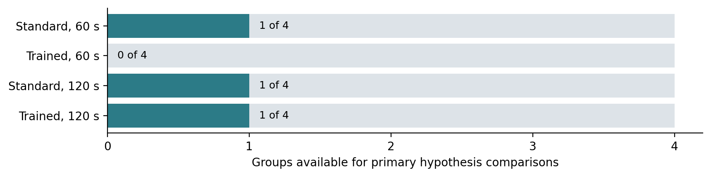

# Beer-Game API Results

## 1. Conclusions

1. **The API simulation completed.** All 2,304 decisions have successful GPT responses: 16 groups, 64 roles, and 36 weeks. No final orders came from a fallback.

2. **H1 is not established.** Training minus standard instructions at 120 seconds was +0.181 in estimated β, but this compares only one eligible group per condition. The 60-second and pooled H1 comparisons could not be estimated.

3. **H2 could not be estimated.** No trained/60-second group qualified for the primary analysis. Responses were usually much faster than either deadline, providing little evidence of an effective time-pressure manipulation.

4. **β measurement is the main problem.** 34 of 64 roles copied incoming demand exactly. Their inventory-response coefficient was almost zero, so their β estimates are not meaningful. Only 3 of 16 complete groups were eligible.

5. **The pilot is useful for redesign, not confirmation.** Improve β identification and the timing manipulation before scaling up. These GPT results cannot establish conclusions about students.

Run: api_023f89662165ca64 | Model returned: gpt-4.1-mini-2025-04-14 | Estimated recorded successful-decision cost: $1.56 (not the final bill).

## 2. Study design and analysis coverage

| Condition | Groups run | Role fits passing checks | Groups in primary analysis |
| --- | --- | --- | --- |
| Standard, 60 s | 4 | 8/16 | 1/4 |
| Trained, 60 s | 4 | 8/16 | 0/4 |
| Standard, 120 s | 4 | 4/16 | 1/4 |
| Trained, 120 s | 4 | 10/16 | 1/4 |

- Each group contains a retailer, wholesaler, distributor, and factory. The whole group receives the same training/deadline condition. There are 576 decisions per condition, 2,304 overall.

- The four-role group is the replication unit. There are 30 usable role fits; 27 remain role-eligible after timing exclusions, but only 12 belong to the 3 fully eligible groups. Partial groups are not used in primary contrasts.

- Two network-failed decisions were recovered with a new timing window. Their group, standard_60_00, is flagged and excluded; it also independently failed a β-fit check.

## 3. Why many β estimates are not interpretable

- β measures supply-line responsiveness relative to inventory responsiveness in the fitted ordering model. If inventory responsiveness α is essentially zero, β cannot be reliably inferred.

- Exactly 34 roles ordered their current incoming demand in every one of the 36 weeks. These are exactly the 34 roles flagged for weak inventory response (α < 0.02). Their fitted β values near 1.504 are numerical fit outputs, not evidence of supply-line overweighting.

- Their R² values are approximately 1 because demand alone predicts their orders. A perfect order fit does not validate the β estimate. Six entire groups have identical order histories; their response IDs are distinct, so these are repeated observed policies, not duplicated response records.

- Among the 30 roles passing fit checks, 19 have β near the lower bound of zero. This is a selected subset under a restricted model, not a population estimate. The offline policy’s β = 0.650 is not a known true value for GPT.

## 4. Primary hypothesis results

| Comparison | Prediction | Result | Conclusion |
| --- | --- | --- | --- |
| H1: trained − standard, 60 s | Positive | Not estimable | No eligible trained/60 s group |
| H1: trained − standard, 120 s | Positive | +0.1813 | Predicted sign; one group per cell only |
| H1: average across deadlines | Positive | Not estimable | Missing trained/60 s cell |
| H2: trained 60 s − trained 120 s | Negative | Not estimable | Missing trained/60 s cell |
| Training × deadline interaction | Exploratory | Not estimable | Missing trained/60 s cell |

The three included groups are standard_60_03 (β = 0.2438), standard_120_00 (β ≈ 0), and trained_120_03 (β = 0.1813). The positive H1/120 s difference is descriptive; it does not establish a training effect. No confidence intervals or p-values were produced. The notebook requires at least five eligible groups in each cell for its bootstrap intervals; that threshold is not a power calculation. Missing estimates mean “not estimable,” not zero.

## 5. Timing and connection recovery

| Condition | Median request time | Maximum request time | Within 10% of deadline |
| --- | --- | --- | --- |
| Standard, 60 s | 0.626 s | 6.87 s | 0 / 576 |
| Trained, 60 s | 0.642 s | 6.67 s | 0 / 576 |
| Standard, 120 s | 0.639 s | 88.69 s | 0 / 576 |
| Trained, 120 s | 0.654 s | 19.09 s | 0 / 576 |

- Overall median latency was 0.639 seconds; 95% of accepted responses finished within 5.82 seconds. No accepted response reached 90% of its assigned deadline. This weakens a time-pressure interpretation, but does not prove that the deadline wording had no effect.

- The first session saved 1,442 successful responses before two connection failures. The resumed session reused those responses and collected 862 more. The two original failures are archived. Their replacement timings are not the full original decision times; the affected group is excluded from primary comparisons.

- API latency includes server/network delay and does not measure human thinking time. The final progress file shows 7 minutes 8 seconds for the resumed session only, not total active runtime or waiting between sessions.

## 6. Operating costs: descriptive results

| Condition | Mean group cost | Median group cost | Range |
| --- | --- | --- | --- |
| Standard, 60 s | 2,749.75 | 836.0 | 156–9,171 |
| Trained, 60 s | 715.50 | 621.0 | 156–1,464 |
| Standard, 120 s | 696.75 | 156.0 | 156–2,319 |
| Trained, 120 s | 924.50 | 855.0 | 156–1,832 |

All 16 groups are included in these descriptive costs. Total simulated cost = 20,346 units: 18,606 holding + 1,740 backlog. One group, standard_60_03, cost 9,171 units (45.1% of the total), strongly influencing its condition mean. These cost differences do not establish a treatment effect. Maximum factory order was 280, maximum inventory 610, and maximum backlog 136; backlog occurred in 90/2,304 role-weeks (3.91%).

Mean local order-amplification ratios were retailer 1.23, wholesaler 2.48, distributor 3.67, and factory 4.51. Each ratio is order variance divided by that role’s incoming-demand variance; these are descriptive under the changing demand path.

## 7. API spending and next steps

- Recorded successful decisions used 3,880,000 input tokens (43,392 cached) and 13,862 output tokens. At $0.40/$0.10/$1.60 per million uncached-input/cached-input/output tokens, the estimate is $1.5612. Access checks and any unobserved usage on failed requests are excluded. Your account’s billing page is the authority for the actual charge.

- Before expanding: test β recovery under demand-copying policies and independently varied inventory/supply-line states; evaluate a better timing manipulation; then determine the required number of eligible groups. Do not force excluded β estimates into the primary averages.

Full detail: Beer_Game_API_Result_Details.xlsx includes all 16 groups, 64 role fits, 2,304 decisions and full responses/prompts, exclusion reasons, repeated-policy checks, tokens, archived failures, settings, and validation. All raw values retain their original precision. The prior offline report remains separate.

Audit: all 2,304 response IDs are unique; response orders/token counts match the table; all simulator states were replayed; fit statistics, group eligibility, contrasts, costs, and amplification were recomputed. API_Report_Provenance.json records input hashes. Numerical source: results/api_023f89662165ca64. Method details and source references remain in the notebook. Pricing source: https://developers.openai.com/api/docs/models/gpt-4.1-mini (checked 26 September 2026).

