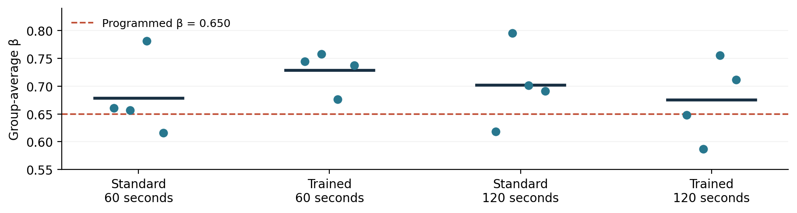

# Beer-Game Results: Your Latest Offline Run

## 1. Conclusions

1. **The simulation passed its checks.** All 2,304 decisions and inventory flows were verified.

2. **β estimates are imperfect.** Mean β was 0.696 versus the true 0.650; individual estimates ranged from 0.403 to 0.988.

3. **H1: no conclusion about training.** Training has no effect in the offline policy, so this run cannot support or reject H1.

4. **H2: no conclusion about decision time.** Offline roles face no actual time pressure, so this run cannot support or reject H2.

5. **Next step: a small GPT API pilot.** The software is ready for a pilot; this offline run provides no evidence about GPT or human behavior.

Run: offline_8edb990c49951ceb | 4 groups per condition | 36 weeks

## 2. What you ran

| Item | Latest run |
| --- | --- |
| Experimental conditions | Standard / trained × 60 / 120 seconds |
| Groups per condition | 4 |
| Roles per group | 4: retailer, wholesaler, distributor, factory |
| Total sample | 16 groups × 4 roles = 64 simulated decision-makers |
| Duration and decisions | 36 weeks; 576 decisions per condition; 2,304 total |
| Replication unit | The four-role group; 4 groups per condition |
| Actual data source | Mathematical ordering policy; no people or GPT responses |
| Earlier report replaced | Earlier run: 4 groups total, 16 roles, 24 weeks, 384 decisions |

## 3. Beer-game and offline settings

- Start: 12 inventory units at each stage; initial demand/flow 4. End-customer demand rises from 4 to 8 in week 5 and stays at 8.

- Delays: orders move upstream in 1 week; dispatched shipments arrive in 2 weeks; factory production takes 3 weeks. Unfilled demand is backlogged. No order cancellation or production capacity limit.

- Weekly sequence: receive goods/orders → ship → observe local state → place orders simultaneously. Supply line includes everything previously ordered but not yet received.

- Policy used in every condition: order = max(0, round[current demand + 0.35 × (24 − net inventory − 0.65 × supply line) + noise]). Net inventory = inventory − backlog; noise has mean 0 and standard deviation 0.8.

- Training/deadline labels affect neither this policy nor its noise distribution. Different random noise and subsequent chain dynamics generate the observed differences.

## 4. β results: how well was 0.650 recovered?

| Condition | Groups | Mean β | Group SD | Error vs 0.650 |
| --- | --- | --- | --- | --- |
| Standard, 60 s | 4 | 0.678 | 0.071 | +0.028 |
| Trained, 60 s | 4 | 0.729 | 0.036 | +0.079 |
| Standard, 120 s | 4 | 0.702 | 0.073 | +0.052 |
| Trained, 120 s | 4 | 0.676 | 0.074 | +0.026 |

Mean β = average of four group means. Group SD describes spread across those four groups; it is not a confidence interval.

Each dot is one group; dark bars are condition means; dashed line is the true offline β. No error bars or significance claims are shown.

- Role-level mean absolute β error: 0.097; root mean squared β error: 0.129. These describe error against the known 0.650.

- Average in-sample R² = 0.842, range 0.469–0.977. Eleven roles have R² below 0.70; one is below 0.50. All 64 passed the notebook’s relatively permissive checks.

## 5. Hypothesis calculations: descriptive only

| Question / contrast | Prediction | Observed |
| --- | --- | --- |
| H1: trained − standard, 60 s | > 0 | +0.0505 |
| H1: trained − standard, 120 s | > 0 | -0.0261 |
| H1: average across both deadlines | > 0 | +0.0122 |
| H2: trained 60 s − trained 120 s | < 0 | +0.0533 |
| Interaction: training effect, 120 s − 60 s | Exploratory | -0.0766 |

- **H1 signs differ across deadlines; H2 has the opposite sign to its prediction. Neither is evidence about training or time: no such effects exist in the offline generator.**

- Confidence intervals and p-values were not produced. Four groups per condition are below the notebook’s five-group threshold for bootstrap intervals. Five is a display rule, not proof of adequate statistical power.

## 6. Operating results

| Condition | Mean group cost | Group cost range |
| --- | --- | --- |
| Standard, 60 s | 889.62 | 869.0–906.0 |
| Trained, 60 s | 892.12 | 871.5–909.5 |
| Standard, 120 s | 911.50 | 884.0–952.0 |
| Trained, 120 s | 904.38 | 878.0–920.5 |

Costs sum all four roles over 36 weeks. They are simulated cost units, not money charged by the API. All-group total = 14,390.5: inventory holding 14,229.5 + backlog 161.0. Lowest mean cost is Standard/60 s, but this cannot be attributed to its condition label.

| Role | Mean amplification | Maximum order | Maximum backlog |
| --- | --- | --- | --- |
| Retailer | 1.20 | 12 | 0 |
| Wholesaler | 1.72 | 16 | 0 |
| Distributor | 2.01 | 18 | 4 |
| Factory | 2.07 | 22 | 9 |

- Amplification = order variance ÷ incoming-demand variance, averaged over roles of the same type. Values above 1 indicate locally amplified orders. This is descriptive under the changing demand path.

- Backlog was positive in 49 of 2,304 role-weeks (2.13%). Zero orders occurred 13 times: 12 factory and 1 distributor. Maximum order was 22; maximum inventory 30; maximum backlog 9.

## 7. Reliability and what the checks mean

- All 64 role fits and 16 groups were included; no fallbacks or failure records. The report audit matched all 2,304 saved decisions, replayed all stock-flow states, and recomputed group means, contrasts, fit statistics, costs, and amplification ratios.

- β was estimated jointly with forecast smoothing, inventory adjustment, and a stock target using multistart nonlinear least squares; β is bounded from 0 to 2. Zero orders are retained through clipping. Full parameters and diagnostics are in the workbook.

- The generating policy closely matches the fitted model, so a good fit is expected. This run verifies operation under one synthetic policy; it does not validate human behavior, GPT behavior, or individual β precision.

## 8. What to do next

- **Save the intended notebook settings: the selected run’s manifest records 4 groups/cell and 36 weeks, but the notebook currently saved on disk still shows 1 and 24. This report uses the run manifest and results, not that older display.**

- For a behavioral pilot, use API mode and inspect actual GPT orders, fit quality, and response times first. A 60/120-second API deadline includes network/server time and does not reproduce human thinking time.

- Before testing H1/H2, predefine the sample, model, training, exclusions, and primary contrasts. Increasing offline sample size can study estimator recovery, but cannot test training or deadline effects.

## 9. Full detail and traceability

Companion: Beer_Game_Offline_Result_Details.xlsx. It contains all 16 groups, all 64 fitted roles and performance records, all 2,304 decisions, all 2,304 complete stored prompts, every contrast, quality checks, settings, software versions, variable definitions, and this audit. Values retain their original precision. Filter “All decisions” by group_id and role to inspect one 36-week history.

Source: results/offline_8edb990c49951ceb; created 26 September 2026 at 20:20:50 UTC. Protocol 1.0; seed 20260926; replicate pilot-01. report_provenance.json records source-file hashes. The previous report is preserved in reports/archive/offline_018428cd23c456eb/.

