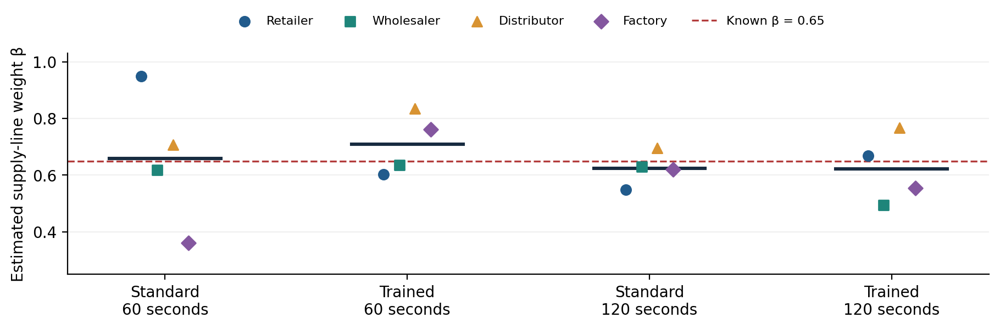

# Beer-Game Experiment: Offline Pilot Results

Prepared 26 September 2026 | Based on Thoughts reflection.docx | Run: pilot-01

## 1. Purpose and principal finding

**This report evaluates a completed offline test of the proposed supply-chain experiment. The test uses four decision-making roles per group: retailer, wholesaler, distributor, and factory. Each role is simulated by a mathematical ordering policy. No people participated and no GPT API requests were made.**

The pipeline completed 384 ordering decisions, retained all 16 role-level fits, and recovered a mean supply-line weight of β = 0.653 against a programmed value of 0.650. Individual estimates varied substantially (0.361–0.950). This is a useful implementation check, but it does not establish reliable individual measurement under other policies or provide evidence for or against the reflection’s hypotheses.

## 2. Experimental structure

| Feature | Completed offline pilot | Proposed full layout |
| --- | --- | --- |
| Conditions | Training × deadline: 2 × 2 | Same four conditions |
| Roles per group | 4 | 4 participants, or 4 GPT roles in an API pilot |
| Groups per condition | 1 | 15 |
| Total groups / roles | 4 groups / 16 simulated roles | 60 groups / 240 participants or GPT roles |
| Duration | 24 simulated weeks | Not specified in reflection; notebook configurable |
| Ordering decisions | 384 | 8,640 if 36 weeks are chosen |

The notebook assigns a common training/deadline condition to all four roles in a group. This is a whole-group treatment design, chosen to avoid mixed training conditions within a chain. Consequently, a future API comparison would estimate the effect of training an entire group, rather than an isolated individual’s direct training effect. Group execution order is randomized; all groups face the same customer-demand path.

### Beer-game rules used

The supply chain has four linked stages. Each starts with 12 units of inventory and a steady flow of 4 units. Customer demand is 4 in weeks 1–4 and 8 in weeks 5–24. Orders between stages take one week, shipments take two weeks from dispatch, and factory production takes three weeks. Unfilled demand becomes backlog. Weekly holding and backlog costs are 0.5 and 1 cost units per unit, respectively. Orders cannot be canceled; production is not capacity-limited.

Each week, roles receive goods and downstream orders, ship what is available, observe their local state, and then place orders simultaneously. The supply line includes all previously ordered units not yet received, including pending supplier fulfillment. These are explicit beer-game settings, with implementation choices documented in the notebook; they are not an exact replication of every historical board-game rule.

## 3. What the offline run actually tests

The labels “trained,” “standard,” “60 seconds,” and “120 seconds” identify the four planned conditions. They do not change the offline policy: no training is learned and no decision deadline is applied in offline mode. Every simulated role uses the same ordering rule, with different seeded noise realizations:

qₜ = max(0, round[Dₜ + 0.35 × (24 − NIₜ − 0.65 × SLₜ) + εₜ]),  εₜ ~ Normal(0, 0.8²).

Here Dₜ is the role’s incoming demand, NIₜ is inventory minus backlog, and SLₜ is the outstanding supply line before the current order. Thus, the known β is 0.65 for all roles. Small apparent differences across condition labels arise from noise, rounding, resulting chain dynamics, and estimation error—not from an implemented treatment effect.

## 4. Supply-line weight recovery

Each 24-week role history was fitted by multistart nonlinear least squares. The model jointly estimates forecast smoothing, inventory adjustment, supply-line weight β, and a constant composite inventory target. Demand forecasts use exponential smoothing initialized at 4; predicted orders are clipped at zero. β is constrained to [0, 2]. This permits overweighting above 1 but not negative supply-line responsiveness.

| Condition label | Group mean β | Difference from 0.650 |
| --- | --- | --- |
| Standard, 60 s | 0.659 | +0.009 |
| Trained, 60 s | 0.709 | +0.059 |
| Standard, 120 s | 0.624 | -0.026 |
| Trained, 120 s | 0.621 | -0.029 |

Figure 1. Each colored point is one simulated role; horizontal dark bars show group means. The dashed line is the programmed β = 0.65. These are synthetic observations, not GPT responses.

Across the 16 roles, mean β was 0.653; mean absolute error relative to 0.65 was 0.101, and root mean squared error was 0.134. The range of role-level estimates (0.361–0.950) shows why a close overall mean should not be interpreted as uniformly precise individual estimates.

The fitted ordering model had mean in-sample R² = 0.870, with values from 0.662 to 0.978. All 16 fits passed the notebook’s diagnostic rules. Because the generating rule closely matches the fitted model, this favorable fit is expected; it is not independent validation of the behavioral model.

## 5. H1 and H2: descriptive calculations only

The primary outcome is estimated β from each role’s weekly orders, not a GPT self-report. Four role estimates are averaged within each group. A group is the replication unit because its roles interact through orders and shipments. There is only one group per condition in this pilot, so there are no defensible between-group uncertainty estimates. The notebook reports neither confidence intervals nor confirmatory p-values for this run.

| Contrast | Predicted sign | Observed difference |
| --- | --- | --- |
| H1: trained − standard at 60 s | Positive | +0.0497 |
| H1: trained − standard at 120 s | Positive | -0.0025 |
| H1: average of both deadline contrasts | Positive | +0.0236 |
| H2: trained 60 s − trained 120 s | Negative | +0.0877 |
| Exploratory: training effect at 120 s − at 60 s | Not specified | -0.0522 |

**The H1 contrasts have mixed signs, and the H2 contrast is opposite its predicted direction. Neither observation supports or falsifies the hypotheses: the offline data generator has no training or time effect. These values demonstrate that the analysis computes the intended contrasts. They must not be presented as experimental findings about GPT or students.**

## 6. Operational outcomes

| Condition label | Total group cost, 24 weeks | API fallbacks |
| --- | --- | --- |
| Standard, 60 s | 572.5 | 0 |
| Trained, 60 s | 551.0 | 0 |
| Standard, 120 s | 577.0 | 0 |
| Trained, 120 s | 574.5 | 0 |

Costs are simulated holding/backlog cost units, not API spending. Differences across the labels are descriptive variation under the same policy and cannot be attributed to training or time. All 384 records are marked “synthetic”; input/output token counts and recorded API latency are zero. The API cost of this completed run was $0.

Mean role-level order-variance / incoming-demand-variance ratios were: retailer 0.99; wholesaler 1.60; distributor 1.89; factory 2.06. Ratios above 1 indicate local order amplification in this run. These are averages of individual role ratios, not a pooled chain statistic. Because demand changes during the run and the sample is short, the ratios are descriptive.

## 7. Implementation checks

The implementation’s nine automated checks passed during notebook validation. They cover notebook structure, inventory and outstanding-order conservation, delivery/production timing, recovery of known β values (0, 0.15, 0.65, and 1.4), contrast signs and group aggregation, prompt isolation, SDK parsing/caching/refusals using a mocked HTTP response, deadline handling with a mocked delay, and offline resume behavior. The known-parameter test uses synthetic data with ample variation; passing it does not remove the uncertainty in 24-week role estimates.

## 8. Interpretation and next steps

The completed run establishes that the four-role beer-game simulation, recording, estimation, and reporting pipeline execute coherently on a known synthetic policy. It does not establish that GPT underweights the supply line, that training increases β, that longer deadlines increase β, or that any effect generalizes to undergraduate students.

The next empirical step is a small API pilot with four separately controlled GPT roles per group. Inspect the actual instructions and returned orders, fit diagnostics, timeout/refusal rates, and observed latency before expanding the sample. The API deadline combines deadline wording with wall-clock enforcement. Network and server waiting time are included, so elapsed time is not human thinking time. If responses finish well below 60 seconds, there may be little effective timing constraint in either condition.

Before hypothesis testing, set the number of groups and weeks, model snapshot, training instructions, deadline implementation, exclusions, and primary contrasts. The reflection’s 15 groups per condition is a proposed layout, not a demonstrated power calculation. A human experiment would require four actual participants per group, a participant-facing interface, training-comprehension measures, and recorded human decision times. The current notebook provides a GPT pilot and analysis pipeline, not that human interface.

## 9. Reproducibility and evidence

Source: Project/Thoughts reflection.docx. Notebook: beer_game_experiment/thoughts_reflection_experiment.ipynb. Results directory: results/offline_018428cd23c456eb. Replicate: pilot-01. Simulation seed: 20260926. Protocol version: 1.0. The run manifest was created on 26 September 2026 (UTC). The manifest’s model field is a configuration setting; it does not mean that model was called in offline mode.

| Evidence file | Use in this report |
| --- | --- |
| manifest.json | Mode, group count, conditions, demand path, versions |
| rounds.csv | 384 decisions, role/group counts, synthetic status |
| agent_beta_fits.csv | Role β estimates and fit diagnostics |
| group_beta.csv | Group means and inclusion status |
| hypothesis_contrasts.csv | H1, H2, and interaction calculations |
| performance.csv | Group costs and role-level amplification ratios |
| manipulation_checks.csv | Zero fallbacks, API tokens, and latency |
| requests/*.json | Saved local prompts and synthetic decisions |

To reproduce the offline demonstration, leave MODE = "offline" and run all notebook cells. To rerun the implementation checks, use python test_notebook.py in the experiment directory. Preserve the notebook and output files together; code changes produce a new run directory. The accompanying Markdown report links the local figure, and report_provenance.json records hashes of the input tables used here.

### Method references

The experiment questions and H1/H2 signs come from Thoughts reflection.docx. Beer-game background: John Sterman, “Teaching Takes Off: The Beer Game,” https://web.mit.edu/jsterman/www/SDG/beergame.html. The notebook adapts the anchoring-and-adjustment estimator described in Sterman (2015), “Booms, Busts, and Beer,” equations 17–18: https://mitsloan.mit.edu/shared/ods/documents?PublicationDocumentID=4343. These references inform the method; all numerical results above come from the local synthetic output files.

