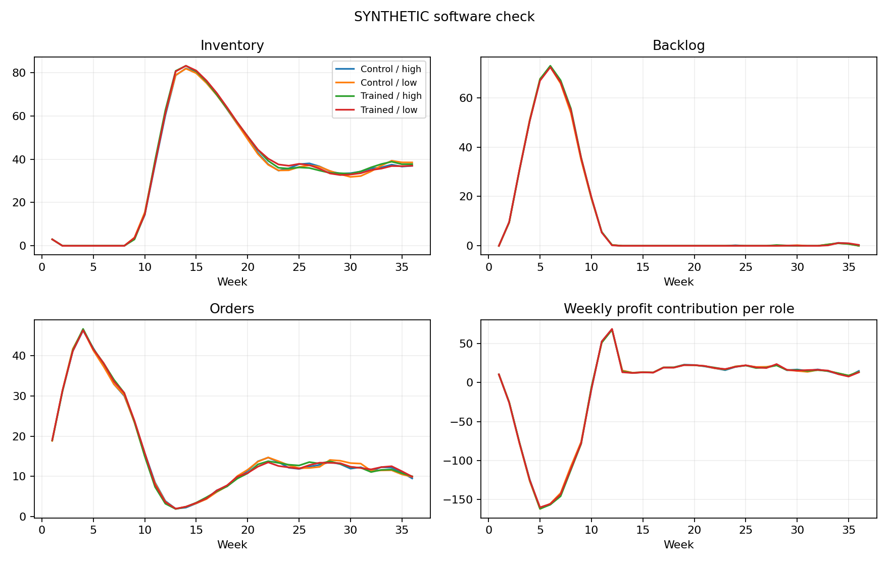

# SYNTHETIC SOFTWARE CHECK: v3 profit results

## Conclusions

1. These are synthetic decisions, not GPT results. No hypothesis conclusion or API cost follows from them.
2. 32/32 groups have four usable beta estimates; 0/128 roles copied demand every week.
3. H1 tests the training effect. H2_API tests reasoning effort, not 60/120-second human time pressure.
- H1_training_average: withheld: offline, fewer than 8 complete blocks, or excluded/incomplete data; no significance conclusion.
- H2_API_low_minus_high_trained: withheld: offline, fewer than 8 complete blocks, or excluded/incomplete data; no significance conclusion.

## Supply-chain performance (all groups)

```
 trained effort  groups  mean_team_profit  median_team_profit  mean_zero_order_rate  mean_team_cost  median_team_cost  min_team_cost  max_team_cost  mean_backlog_cost  mean_customer_fulfillment
   False   high       8         -1354.812           -1028.750                 0.207        5887.312          5737.000        5175.00        6753.25             3321.5                        1.0
   False    low       8         -1345.625           -1146.875                 0.199        5878.125          5851.875        5150.00        6629.75             3308.0                        1.0
    True   high       8         -1392.719           -1121.625                 0.208        5925.219          5826.625        5052.25        6853.00             3344.0                        1.0
    True    low       8         -1372.000           -1095.750                 0.207        5904.500          5816.875        5137.00        6770.00             3321.5                        1.0
```
Profit and cost are in simulation units, not API dollars. Team profit counts retailer revenue once, minus factory commitments and all role costs. Customer fulfillment is cumulative retailer shipments / cumulative customer demand; it includes late deliveries and is not an on-time service measure. Bullwhip is sample variance of role orders / variance of incoming demand; it is undefined when incoming demand has zero variance. No terminal inventory penalty is added.

## Beta measurement coverage

```
                roles  usable_beta
trained effort                    
False   high       32           32
        low        32           32
True    high       32           32
        low        32           32
```
See agent_beta_fits.csv: beta_for_interpretation is blank when beta is unreliable. The raw optimizer beta is retained for audit only. See group_beta.csv for analysis_beta. Missing beta means unidentified, not zero and not a failed hypothesis.



## Hypothesis results

```
                   hypothesis  estimate  complete_blocks  planned_blocks  p_two_sided  p_holm  ci95_low  ci95_high predicted_direction                                                                       status
          H1_training_average -0.002896                8               8          NaN     NaN       NaN        NaN            positive withheld: offline, fewer than 8 complete blocks, or excluded/incomplete data
H2_API_low_minus_high_trained -0.003414                8               8          NaN     NaN       NaN        NaN            negative withheld: offline, fewer than 8 complete blocks, or excluded/incomplete data
```

CIs are descriptive paired bootstrap 95% intervals, not multiplicity-adjusted. The two planned p-values are Holm-adjusted. No p-values are computed after excluding any planned block; identification failures depend on behavior and can bias selection. Eight blocks is a reporting floor, not a power calculation.

## Spending and interpretation

Recorded estimated charges/reservations: $0.0000. Not an invoice or account balance.
The original pilot remains separate. This redesigned protocol cannot confirm effects in humans. Do not repeatedly change prompts, exclusions, sample size, or models until p < .05. Use the pilot to fix measurement, then freeze a new protocol and collect independent confirmation data.
