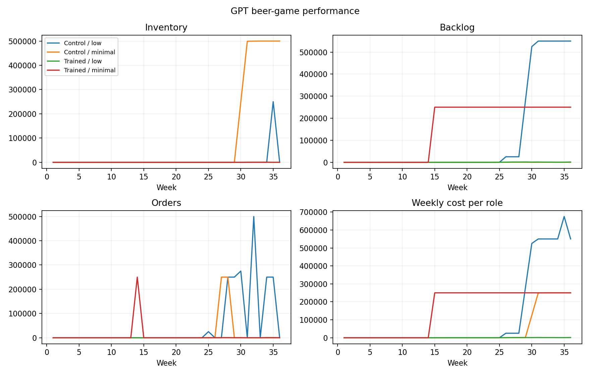

# GPT AGENT PILOT: budget verification results

## Conclusions

1. Completed 576 decision records with validated state readbacks; no replacement orders.
2. 0/4 groups have four usable beta estimates; 0/16 roles copied demand every week.
3. H1 tests training; H2_API compares minimal versus low reasoning, not 60/120-second human time pressure.
- H1_training_average: withheld: offline, too few blocks, incomplete/excluded data, or replacement selection; no significance conclusion.
- H2_API_minimal_minus_low_trained: withheld: offline, too few blocks, incomplete/excluded data, or replacement selection; no significance conclusion.

## Supply-chain performance (all groups)

```
 trained  effort  groups  mean_team_cost  median_team_cost  min_team_cost  max_team_cost  mean_backlog_cost  mean_customer_fulfillment
   False     low       1      17203896.0        17203896.0     17203896.0     17203896.0         16703112.0                      0.309
   False minimal       1       6504992.0         6504992.0      6504992.0      6504992.0             6908.0                      0.088
    True     low       1         42010.0           42010.0        42010.0        42010.0            37928.0                      1.000
    True minimal       1      22003988.0        22003988.0     22003988.0     22003988.0         22003126.0                      0.162
```
Cost is in game cost units, not API dollars. Team cost sums all four roles. Customer fulfillment is cumulative retailer shipments / cumulative customer demand; it includes late deliveries and is not an on-time service measure. Bullwhip is sample variance of role orders / variance of incoming demand; it is undefined when incoming demand has zero variance. No terminal inventory penalty is added.

## Beta measurement coverage

```
                 roles  usable_beta
trained effort                     
False   low          4            1
        minimal      4            0
True    low          4            3
        minimal      4            0
```
See agent_beta_fits.csv: beta_for_interpretation is blank when beta is unreliable. The raw optimizer beta is retained for audit only. See group_beta.csv for analysis_beta. Missing beta means unidentified, not zero and not a failed hypothesis.



## Hypothesis results

```
                      hypothesis  estimate  complete_blocks  planned_blocks  p_two_sided  p_holm  ci95_low  ci95_high predicted_direction                                                                                status
             H1_training_average       NaN                0               1          NaN     NaN       NaN        NaN            positive withheld: offline, too few blocks, incomplete/excluded data, or replacement selection
H2_API_minimal_minus_low_trained       NaN                0               1          NaN     NaN       NaN        NaN            negative withheld: offline, too few blocks, incomplete/excluded data, or replacement selection
```

CIs are descriptive paired bootstrap 95% intervals, not multiplicity-adjusted. The two planned p-values are Holm-adjusted. No p-values are computed after excluding any planned block; identification failures depend on behavior and can bias selection. Eight blocks is a reporting floor, not a power calculation.

## Reasoning manipulation check

```
         mean_reasoning_tokens  median_reasoning_tokens  median_latency_s
effort                                                                   
low                 602.222222                    576.0          4.899744
minimal               0.000000                      0.0          0.916047
```
Reasoning tokens and latency describe resource use, not human thinking time. Overlapping resource use between the two effort settings weakens the mechanism interpretation.

## Spending and interpretation

Recorded estimated charges/reservations: $0.1331. Not an invoice or account balance.
The original pilot remains separate. This redesigned protocol cannot confirm effects in humans. Do not repeatedly change prompts, exclusions, sample size, or models until p < .05. Use the pilot to fix measurement, then freeze a new protocol and collect independent confirmation data.
