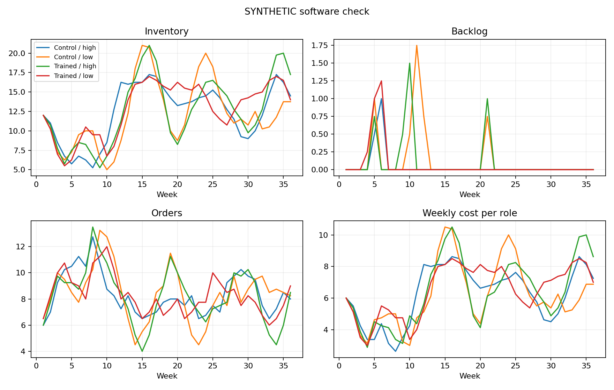

# SYNTHETIC SOFTWARE CHECK: budget verification results

## Conclusions

1. These are synthetic decisions, not GPT results. No hypothesis conclusion or API cost follows from them.
2. 4/4 groups have four usable beta estimates; 0/16 roles copied demand every week.
3. H1 tests the training effect. H2_API tests reasoning effort, not 60/120-second human time pressure.
- H1_training_average: withheld: offline, fewer than 8 complete blocks, or excluded/incomplete data; no significance conclusion.
- H2_API_low_minus_high_trained: withheld: offline, fewer than 8 complete blocks, or excluded/incomplete data; no significance conclusion.

## Supply-chain performance (all groups)

```
 trained effort  groups  mean_team_cost  median_team_cost  min_team_cost  max_team_cost  mean_backlog_cost  mean_customer_fulfillment
   False   high       1           896.5             896.5          896.5          896.5                6.0                        1.0
   False    low       1           889.0             889.0          889.0          889.0               19.0                        1.0
    True   high       1           923.0             923.0          923.0          923.0               15.0                        1.0
    True    low       1           934.0             934.0          934.0          934.0               10.0                        1.0
```
Cost is in game cost units, not API dollars. Team cost sums all four roles. Customer fulfillment is cumulative retailer shipments / cumulative customer demand; it includes late deliveries and is not an on-time service measure. Bullwhip is sample variance of role orders / variance of incoming demand; it is undefined when incoming demand has zero variance. No terminal inventory penalty is added.

## Beta measurement coverage

```
                roles  usable_beta
trained effort                    
False   high        4            4
        low         4            4
True    high        4            4
        low         4            4
```
See agent_beta_fits.csv: beta_for_interpretation is blank when beta is unreliable. The raw optimizer beta is retained for audit only. See group_beta.csv for analysis_beta. Missing beta means unidentified, not zero and not a failed hypothesis.



## Hypothesis results

```
                   hypothesis  estimate  complete_blocks  planned_blocks  p_two_sided  p_holm  ci95_low  ci95_high predicted_direction                                                                       status
          H1_training_average  0.009772                1               1          NaN     NaN       NaN        NaN            positive withheld: offline, fewer than 8 complete blocks, or excluded/incomplete data
H2_API_low_minus_high_trained  0.016096                1               1          NaN     NaN       NaN        NaN            negative withheld: offline, fewer than 8 complete blocks, or excluded/incomplete data
```

CIs are descriptive paired bootstrap 95% intervals, not multiplicity-adjusted. The two planned p-values are Holm-adjusted. No p-values are computed after excluding any planned block; identification failures depend on behavior and can bias selection. Eight blocks is a reporting floor, not a power calculation.

## Spending and interpretation

Recorded estimated charges/reservations: $0.0000. Not an invoice or account balance.
The original pilot remains separate. This redesigned protocol cannot confirm effects in humans. Do not repeatedly change prompts, exclusions, sample size, or models until p < .05. Use the pilot to fix measurement, then freeze a new protocol and collect independent confirmation data.
