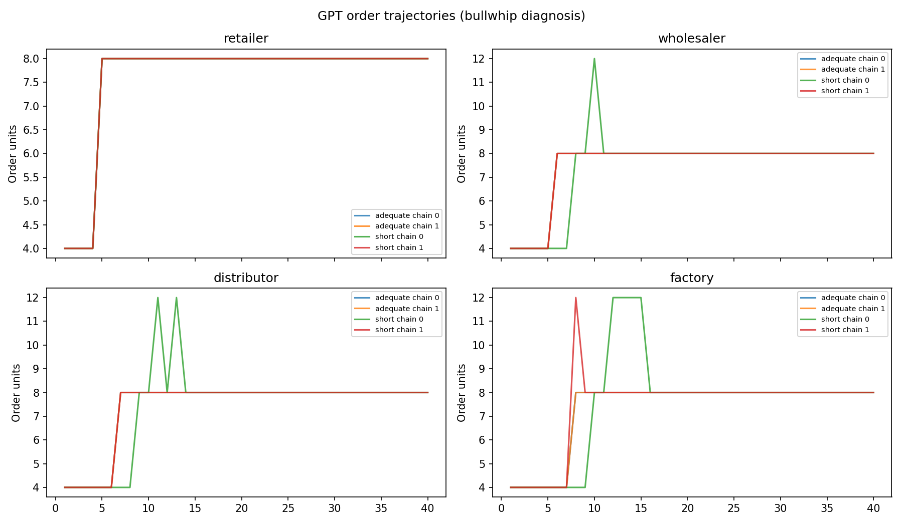
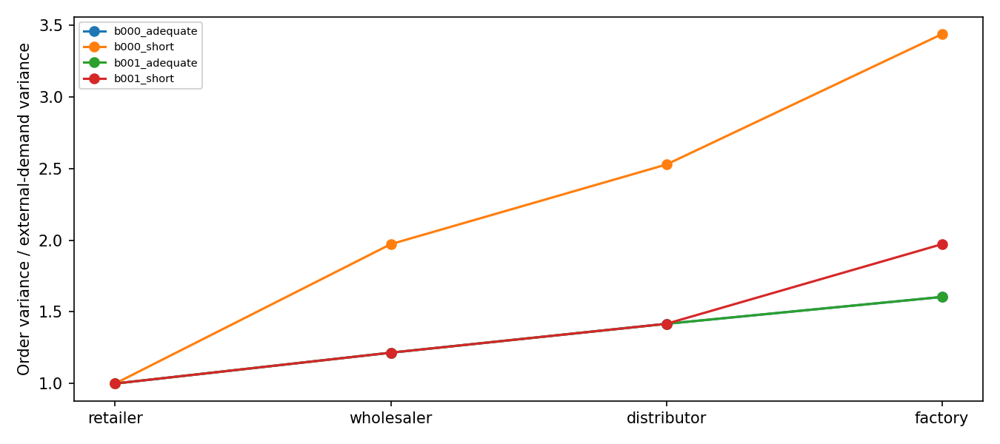

# Token-budget Beer Game — conclusions

1. Real API responses; LLM simulation, not human evidence.
2. Run status: complete. Estimated cost/reservations: $0.6667.
3. Saved successful API stages: 1168; other saved attempts: 0.
Startup rule checks: 16/16 first attempts passed; 0 clarification rechecks recorded. API success and correct rule answers are separate checks.
4. Completed groups: 4/4; usable beta: 3/16 roles.
5. H1 tests lower beta under the short allowance; H2 tests higher total scored cost. H2 does not require usable beta. See the separate status for each test.
6. Review token separation, failures, cost and bullwhip plots before increasing sample size. Zero orders and large orders are outcomes, not automatic grounds for discarding a group.
Cost is holding plus backlog, including warmup and the 12 automatic terminal weeks. Automatic decisions never enter beta, token-use or bullwhip estimates. Fulfillment counts late delivery; it is not an on-time service rate. Bullwhip ratios use all game weeks including warmup because retailer demand is constant after the step; a constant denominator is reported as missing. The deterministic demand step limits generalization.
Beta is a structural-model diagnostic, not profit. No artificial upper order cap is fitted. Rank, response strength, variation and positive-order checks flag unreliable fits. A sample of at least eight paired chains is a computational inference floor, not a power calculation. The reflection proposes ten chains per condition; no sample size guarantees significance.




## Startup rule checks

```
     group_id        role  attempt  passed failed_fields                                                                                                                                                                                                                                                                         answer
b001_adequate    retailer        1    True            [] {'factory_production_receipt_week': 13, 'production_requires_existing_supply_line': False, 'backlog_next_week_without_receipts': 20, 'next_week_backlog_cost': 20, 'zero_new_demand_cancels_backlog': False, 'current_backlog_already_includes_unfilled_current_demand': True}
b001_adequate distributor        1    True            [] {'factory_production_receipt_week': 13, 'production_requires_existing_supply_line': False, 'backlog_next_week_without_receipts': 20, 'next_week_backlog_cost': 20, 'zero_new_demand_cancels_backlog': False, 'current_backlog_already_includes_unfilled_current_demand': True}
b001_adequate  wholesaler        1    True            [] {'factory_production_receipt_week': 13, 'production_requires_existing_supply_line': False, 'backlog_next_week_without_receipts': 20, 'next_week_backlog_cost': 20, 'zero_new_demand_cancels_backlog': False, 'current_backlog_already_includes_unfilled_current_demand': True}
b001_adequate     factory        1    True            [] {'factory_production_receipt_week': 13, 'production_requires_existing_supply_line': False, 'backlog_next_week_without_receipts': 20, 'next_week_backlog_cost': 20, 'zero_new_demand_cancels_backlog': False, 'current_backlog_already_includes_unfilled_current_demand': True}
b000_adequate    retailer        1    True            [] {'factory_production_receipt_week': 13, 'production_requires_existing_supply_line': False, 'backlog_next_week_without_receipts': 20, 'next_week_backlog_cost': 20, 'zero_new_demand_cancels_backlog': False, 'current_backlog_already_includes_unfilled_current_demand': True}
b000_adequate  wholesaler        1    True            [] {'factory_production_receipt_week': 13, 'production_requires_existing_supply_line': False, 'backlog_next_week_without_receipts': 20, 'next_week_backlog_cost': 20, 'zero_new_demand_cancels_backlog': False, 'current_backlog_already_includes_unfilled_current_demand': True}
b000_adequate distributor        1    True            [] {'factory_production_receipt_week': 13, 'production_requires_existing_supply_line': False, 'backlog_next_week_without_receipts': 20, 'next_week_backlog_cost': 20, 'zero_new_demand_cancels_backlog': False, 'current_backlog_already_includes_unfilled_current_demand': True}
b000_adequate     factory        1    True            [] {'factory_production_receipt_week': 13, 'production_requires_existing_supply_line': False, 'backlog_next_week_without_receipts': 20, 'next_week_backlog_cost': 20, 'zero_new_demand_cancels_backlog': False, 'current_backlog_already_includes_unfilled_current_demand': True}
   b000_short    retailer        1    True            [] {'factory_production_receipt_week': 13, 'production_requires_existing_supply_line': False, 'backlog_next_week_without_receipts': 20, 'next_week_backlog_cost': 20, 'zero_new_demand_cancels_backlog': False, 'current_backlog_already_includes_unfilled_current_demand': True}
   b000_short  wholesaler        1    True            [] {'factory_production_receipt_week': 13, 'production_requires_existing_supply_line': False, 'backlog_next_week_without_receipts': 20, 'next_week_backlog_cost': 20, 'zero_new_demand_cancels_backlog': False, 'current_backlog_already_includes_unfilled_current_demand': True}
   b000_short distributor        1    True            [] {'factory_production_receipt_week': 13, 'production_requires_existing_supply_line': False, 'backlog_next_week_without_receipts': 20, 'next_week_backlog_cost': 20, 'zero_new_demand_cancels_backlog': False, 'current_backlog_already_includes_unfilled_current_demand': True}
   b000_short     factory        1    True            [] {'factory_production_receipt_week': 13, 'production_requires_existing_supply_line': False, 'backlog_next_week_without_receipts': 20, 'next_week_backlog_cost': 20, 'zero_new_demand_cancels_backlog': False, 'current_backlog_already_includes_unfilled_current_demand': True}
   b001_short  wholesaler        1    True            [] {'factory_production_receipt_week': 13, 'production_requires_existing_supply_line': False, 'backlog_next_week_without_receipts': 20, 'next_week_backlog_cost': 20, 'zero_new_demand_cancels_backlog': False, 'current_backlog_already_includes_unfilled_current_demand': True}
   b001_short distributor        1    True            [] {'factory_production_receipt_week': 13, 'production_requires_existing_supply_line': False, 'backlog_next_week_without_receipts': 20, 'next_week_backlog_cost': 20, 'zero_new_demand_cancels_backlog': False, 'current_backlog_already_includes_unfilled_current_demand': True}
   b001_short    retailer        1    True            [] {'factory_production_receipt_week': 13, 'production_requires_existing_supply_line': False, 'backlog_next_week_without_receipts': 20, 'next_week_backlog_cost': 20, 'zero_new_demand_cancels_backlog': False, 'current_backlog_already_includes_unfilled_current_demand': True}
   b001_short     factory        1    True            [] {'factory_production_receipt_week': 13, 'production_requires_existing_supply_line': False, 'backlog_next_week_without_receipts': 20, 'next_week_backlog_cost': 20, 'zero_new_demand_cancels_backlog': False, 'current_backlog_already_includes_unfilled_current_demand': True}
```

## Group outcomes

```
     group_id  block condition  agent_phase_cost  continuation_cost  total_scored_cost  group_beta  usable_role_betas  customer_fulfillment  retailer_backlog_weeks  terminal_inventory  terminal_backlog
b000_adequate      0  adequate             156.0                0.0              156.0         NaN                  0                1.0000                       0                   0                 0
   b000_short      0     short             684.0              168.0              852.0         NaN                  3                0.9868                      30                  12                 8
b001_adequate      1  adequate             156.0                0.0              156.0         NaN                  0                1.0000                       0                   0                 0
   b001_short      1     short             216.0               24.0              240.0         NaN                  0                1.0000                       0                   4                 0
```

## Token manipulation

```
condition  mean_preparation_tokens  median_preparation_tokens  truncated_fraction  mean_final_tokens  zero_rate  max_order
 adequate                  90.7639                       91.0              0.0000               39.0        0.0          8
    short                  31.6840                       32.0              0.7882               39.0        0.0         12
```

## Hypothesis tests

```
hypothesis           outcome  estimate  complete_pairs      predicted_direction  p_raw                                                                                    status  p_holm
        H1        group_beta       NaN               0 short minus adequate < 0    NaN withheld: offline, fewer than 8 pairs, incomplete sample, replacement, or missing outcome     NaN
        H2 total_scored_cost     390.0               2 short minus adequate > 0    NaN withheld: offline, fewer than 8 pairs, incomplete sample, replacement, or missing outcome     NaN
```

## Role performance and bullwhip

```
     group_id        role condition  holding_cost  backlog_cost  bullwhip_vs_local  bullwhip_vs_customer  order_variance  mean_order  zero_rate  max_order  backlog_weeks  max_backlog  terminal_backlog
b000_adequate distributor  adequate          42.0           0.0             1.0000                1.4167          2.0923      7.7778        0.0          8              0            0                 0
b000_adequate     factory  adequate          48.0           0.0             1.0000                1.6042          2.3692      7.6667        0.0          8              0            0                 0
b000_adequate    retailer  adequate          30.0           0.0             1.0000                1.0000          1.4769      8.0000        0.0          8              0            0                 0
b000_adequate  wholesaler  adequate          36.0           0.0             1.0000                1.2153          1.7949      7.8889        0.0          8              0            0                 0
   b000_short distributor     short         100.0          24.0             1.1704                2.5278          3.7333      7.7778        0.0         12              6            4                 0
   b000_short     factory     short         154.0          20.0             1.2660                3.4375          5.0769      7.8889        0.0         12              4            8                 0
   b000_short    retailer     short          30.0         156.0             1.0000                1.0000          1.4769      8.0000        0.0          8             30            8                 4
   b000_short  wholesaler     short          36.0         164.0             1.6229                1.9722          2.9128      7.7778        0.0         12             32            8                 4
b001_adequate distributor  adequate          42.0           0.0             1.0000                1.4167          2.0923      7.7778        0.0          8              0            0                 0
b001_adequate     factory  adequate          48.0           0.0             1.0000                1.6042          2.3692      7.6667        0.0          8              0            0                 0
b001_adequate    retailer  adequate          30.0           0.0             1.0000                1.0000          1.4769      8.0000        0.0          8              0            0                 0
b001_adequate  wholesaler  adequate          36.0           0.0             1.0000                1.2153          1.7949      7.8889        0.0          8              0            0                 0
   b001_short distributor     short          42.0           0.0             1.0000                1.4167          2.0923      7.7778        0.0          8              0            0                 0
   b001_short     factory     short         108.0           0.0             1.2294                1.9722          2.9128      7.7778        0.0         12              0            0                 0
   b001_short    retailer     short          30.0           0.0             1.0000                1.0000          1.4769      8.0000        0.0          8              0            0                 0
   b001_short  wholesaler     short          36.0           0.0             1.0000                1.2153          1.7949      7.8889        0.0          8              0            0                 0
```

## Beta diagnostics

```
     group_id        role condition  block  positive_orders  theta  alpha   beta  target   rmse     r2  jac_condition  usable                                   fit_flag  n order_limit  cap_hit_rate
b000_adequate distributor  adequate      0               36 1.0000 0.0000 1.5038 24.0305 0.0000 1.0000        17.9587   False weak_inventory_response;parameter_boundary 36        None           0.0
b000_adequate     factory  adequate      0               36 1.0000 0.0000 1.5041 24.0334 0.0000 1.0000        14.7460   False weak_inventory_response;parameter_boundary 36        None           0.0
b000_adequate    retailer  adequate      0               36    NaN    NaN    NaN     NaN    NaN    NaN            NaN   False                     insufficient_variation 36        None           0.0
b000_adequate  wholesaler  adequate      0               36 1.0000 0.0000 1.5038 24.0300 0.0000 1.0000        25.3105   False weak_inventory_response;parameter_boundary 36        None           0.0
   b000_short distributor     short      0               36 0.2271 0.6336 0.9820 19.8217 0.4702 0.9155        14.5093    True                                         ok 36        None           0.0
   b000_short     factory     short      0               36 0.1642 0.4851 0.6002 17.5589 0.4089 0.9581        13.0405    True                                         ok 36        None           0.0
   b000_short    retailer     short      0               36    NaN    NaN    NaN     NaN    NaN    NaN            NaN   False                     insufficient_variation 36        None           0.0
   b000_short  wholesaler     short      0               36 0.3465 0.2312 0.8880 10.6457 0.7661 0.6604        15.2808    True                                         ok 36        None           0.0
b001_adequate distributor  adequate      1               36 1.0000 0.0000 1.5038 24.0305 0.0000 1.0000        17.9587   False weak_inventory_response;parameter_boundary 36        None           0.0
b001_adequate     factory  adequate      1               36 1.0000 0.0000 1.5041 24.0334 0.0000 1.0000        14.7460   False weak_inventory_response;parameter_boundary 36        None           0.0
b001_adequate    retailer  adequate      1               36    NaN    NaN    NaN     NaN    NaN    NaN            NaN   False                     insufficient_variation 36        None           0.0
b001_adequate  wholesaler  adequate      1               36 1.0000 0.0000 1.5038 24.0300 0.0000 1.0000        25.3105   False weak_inventory_response;parameter_boundary 36        None           0.0
   b001_short distributor     short      1               36 1.0000 0.0000 1.5038 24.0305 0.0000 1.0000        17.9587   False weak_inventory_response;parameter_boundary 36        None           0.0
   b001_short     factory     short      1               36 1.0000 1.0000 1.0000 20.0000 0.0000 1.0000   3006562.4066   False     weak_identification;parameter_boundary 36        None           0.0
   b001_short    retailer     short      1               36    NaN    NaN    NaN     NaN    NaN    NaN            NaN   False                     insufficient_variation 36        None           0.0
   b001_short  wholesaler     short      1               36 1.0000 0.0000 1.5038 24.0300 0.0000 1.0000        25.3105   False weak_inventory_response;parameter_boundary 36        None           0.0
```

## Interpretation limits

This protocol restricts visible preparation tokens plus a common final-response allowance, with reasoning effort none. It does not directly limit hidden cognitive effort, wall-clock time or human thinking time. Prompts cannot reliably count remaining tokens; the API hard cap is the enforced constraint. A truncated memo is accepted as a deadline outcome, then a common 192-token stage solicits the order. The final stage can still involve implicit computation, and unused token allowance is not effort used.
Technical retries retain the same prompt and cap. Failed final responses can replace a whole group only within the configured limit; all failed attempts remain recorded. Replacement selection withholds inferential p-values. No order is clipped or replaced by a fabricated answer. The separate emergency scale check stops the run rather than making a boundary order.

Sources: [provided reflection](../../source/ThoughtsReflection_Paragraph.docx); [MIT Beer Game](https://web.mit.edu/jsterman/www/SDG/beergame.html); [Lee, Padmanabhan & Whang](https://pubsonline.informs.org/doi/10.1287/mnsc.43.4.546); [OpenAI model documentation](https://developers.openai.com/api/docs/models/gpt-5.4-nano).
