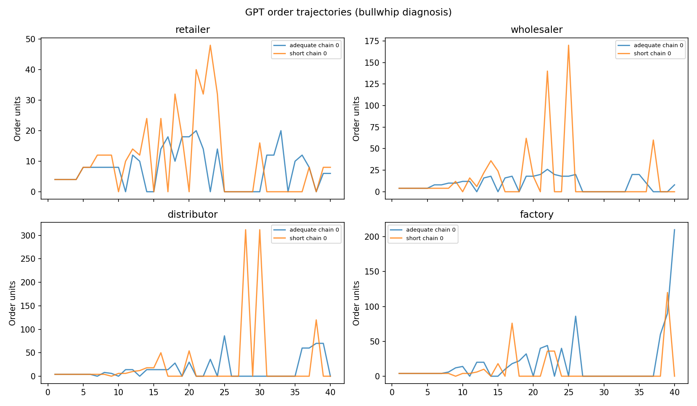
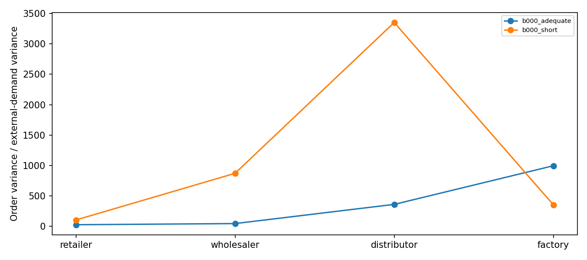

# Token-budget Beer Game — conclusions

1. Real API responses; LLM simulation, not human evidence.
2. Run status: complete. Estimated cost/reservations: $0.2775.
3. Saved successful API stages: 584; other saved attempts: 0.
Startup rule checks: 8/8 first attempts passed; 0 clarification rechecks recorded. API success and correct rule answers are separate checks.
4. Completed groups: 2/2; usable beta: 7/8 roles.
5. H1 tests lower beta under the short allowance; H2 tests higher total scored cost. H2 does not require usable beta. See the separate status for each test.
6. Review token separation, failures, cost and bullwhip plots before increasing sample size. Zero orders and large orders are outcomes, not automatic grounds for discarding a group.
Cost is holding plus backlog, including warmup and the 12 automatic terminal weeks. Automatic decisions never enter beta, token-use or bullwhip estimates. Fulfillment counts late delivery; it is not an on-time service rate. Bullwhip ratios use all game weeks including warmup because retailer demand is constant after the step; a constant denominator is reported as missing. The deterministic demand step limits generalization.
Beta is a structural-model diagnostic, not profit. No artificial upper order cap is fitted. Rank, response strength, variation and positive-order checks flag unreliable fits. A sample of at least eight paired chains is a computational inference floor, not a power calculation. The reflection proposes ten chains per condition; no sample size guarantees significance.




## Startup rule checks

```
     group_id        role  attempt  passed failed_fields                                                                                               answer
b000_adequate     factory        1    True            [] {'three_week_backlog_cost': 15, 'order_fills_today': False, 'objective_includes_continuation': True}
b000_adequate    retailer        1    True            [] {'three_week_backlog_cost': 15, 'order_fills_today': False, 'objective_includes_continuation': True}
b000_adequate  wholesaler        1    True            [] {'three_week_backlog_cost': 15, 'order_fills_today': False, 'objective_includes_continuation': True}
   b000_short  wholesaler        1    True            [] {'three_week_backlog_cost': 15, 'order_fills_today': False, 'objective_includes_continuation': True}
   b000_short    retailer        1    True            [] {'three_week_backlog_cost': 15, 'order_fills_today': False, 'objective_includes_continuation': True}
   b000_short distributor        1    True            [] {'three_week_backlog_cost': 15, 'order_fills_today': False, 'objective_includes_continuation': True}
   b000_short     factory        1    True            [] {'three_week_backlog_cost': 15, 'order_fills_today': False, 'objective_includes_continuation': True}
b000_adequate distributor        1    True            [] {'three_week_backlog_cost': 15, 'order_fills_today': False, 'objective_includes_continuation': True}
```

## Group outcomes

```
     group_id  block condition  agent_phase_cost  continuation_cost  total_scored_cost  group_beta  usable_role_betas  customer_fulfillment  retailer_backlog_weeks  terminal_inventory  terminal_backlog
b000_adequate      0  adequate            2703.0             2544.0             5247.0      0.3259                  4                   1.0                      13                 456                 6
   b000_short      0     short           16143.0            12055.0            28198.0         NaN                  3                   1.0                      15                  34               932
```

## Token manipulation

```
condition  mean_preparation_tokens  median_preparation_tokens  truncated_fraction  mean_final_tokens  zero_rate  max_order
 adequate                  171.625                      168.0              0.0347               39.0     0.4167        210
    short                   95.875                       96.0              0.9861               39.0     0.5625        312
```

## Hypothesis tests

```
hypothesis           outcome  estimate  complete_pairs      predicted_direction  p_raw                                                                                    status  p_holm
        H1        group_beta       NaN               0 short minus adequate < 0    NaN withheld: offline, fewer than 8 pairs, incomplete sample, replacement, or missing outcome     NaN
        H2 total_scored_cost   22951.0               1 short minus adequate > 0    NaN withheld: offline, fewer than 8 pairs, incomplete sample, replacement, or missing outcome     NaN
```

## Role performance and bullwhip

```
     group_id        role condition  holding_cost  backlog_cost  bullwhip_vs_local  bullwhip_vs_customer  order_variance  mean_order  zero_rate  max_order  backlog_weeks  max_backlog  terminal_backlog
b000_adequate distributor  adequate         141.0         708.0             7.7115              362.0122        534.6641     15.1667     0.5000         86             23           70                 0
b000_adequate     factory  adequate         678.0         290.0             2.7663              996.7778       1472.1641     20.4444     0.4722        210              8          150               150
b000_adequate    retailer  adequate         111.0         126.0            27.7760               27.7760         41.0231      7.8333     0.3333         20             13           18                 0
b000_adequate  wholesaler  adequate         517.0         132.0             1.6648               46.5208         68.7077      9.6667     0.3611         26             11           28                 0
   b000_short distributor     short          60.0        5660.0             3.8496             3351.2760       4949.5769     25.9444     0.5833        312             29          348               336
   b000_short     factory     short         137.0        7058.0             0.1061              355.2760        524.7154      9.0556     0.6389        120             22          708               708
   b000_short    retailer     short         204.0         254.0           105.6094              105.6094        155.9769     10.5000     0.4444         48             15           28                 0
   b000_short  wholesaler     short          36.0        2734.0             8.2192              872.3594       1288.4077     16.1667     0.5833        170             33          144               104
```

## Beta diagnostics

```
     group_id        role condition  block  positive_orders  theta  alpha   beta   target    rmse     r2  jac_condition  usable                                                         fit_flag  n order_limit  cap_hit_rate
b000_adequate distributor  adequate      0               18 0.0611 1.0000 0.9341   2.0852 22.2581 0.1259        13.3494    True                                               parameter_boundary 36        None           0.0
b000_adequate     factory  adequate      0               19 0.5375 0.7132 0.0000  15.9068 12.9178 0.8936         4.4806    True                                               parameter_boundary 36        None           0.0
b000_adequate    retailer  adequate      0               24 0.0051 0.3821 0.0000   9.9017  5.2828 0.3506         6.0464    True                                               parameter_boundary 36        None           0.0
b000_adequate  wholesaler  adequate      0               23 0.3465 0.0839 0.3695  59.5654  6.0309 0.4893         4.6369    True                                                               ok 36        None           0.0
   b000_short distributor     short      0               15 0.0000 0.3312 0.4088   0.0000 65.5265 0.1920        36.0695    True                                               parameter_boundary 36        None           0.0
   b000_short     factory     short      0               13 0.0000 0.0126 2.0000 241.5497 23.5297 0.0216        28.5222   False weak_inventory_response;parameter_boundary;upper_parameter_limit 36        None           0.0
   b000_short    retailer     short      0               20 0.0446 0.5285 0.0052   9.0355  9.7935 0.4178        12.5466    True                                                               ok 36        None           0.0
   b000_short  wholesaler     short      0               15 0.6566 1.0000 0.5907   0.0000 25.9859 0.5110         3.6944    True                                               parameter_boundary 36        None           0.0
```

## Interpretation limits

This protocol restricts visible preparation tokens plus a common final-response allowance, with reasoning effort none. It does not directly limit hidden cognitive effort, wall-clock time or human thinking time. Prompts cannot reliably count remaining tokens; the API hard cap is the enforced constraint. A truncated memo is accepted as a deadline outcome, then a common 192-token stage solicits the order. The final stage can still involve implicit computation, and unused token allowance is not effort used.
Technical retries retain the same prompt and cap. Failed final responses can replace a whole group only within the configured limit; all failed attempts remain recorded. Replacement selection withholds inferential p-values. No order is clipped or replaced by a fabricated answer. The separate emergency scale check stops the run rather than making a boundary order.

Sources: [provided reflection](../../source/ThoughtsReflection_Paragraph.docx); [MIT Beer Game](https://web.mit.edu/jsterman/www/SDG/beergame.html); [Lee, Padmanabhan & Whang](https://pubsonline.informs.org/doi/10.1287/mnsc.43.4.546); [OpenAI model documentation](https://developers.openai.com/api/docs/models/gpt-5.4-nano).
