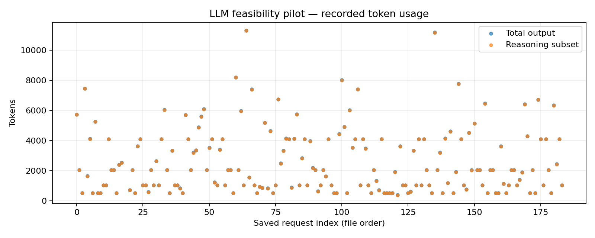

# Student-persona Beer Game: evidence report

Saved API evidence from hypothetical LLM role agents; no real student responses were collected.

Calibration-only run completed. The token-contrast feasibility screen did not establish a validated contrast. No games were requested; game completion and treatment effects are not evaluated.

Estimated charges/reservations: $2.2448; saved requests: 184.

Saved failed decision requests: 0; committed fallback orders: 0. Stopped batches may contain responses that were never committed. Unknown/unmeasured usage requests: 2.

## Evidence and outcome

Saved API evidence from hypothetical LLM role agents; no real student responses were collected.

Run status: complete. Calibration-only run completed. The token-contrast feasibility screen did not establish a validated contrast. No games were requested; game completion and treatment effects are not evaluated.

Calibration has not produced a valid contrast or a stored cap selection; no validated treatment thresholds are available.

Local saved requests: 184; estimated local charges/reservations: $2.2448. Measured local output: 475,545 tokens, including 474,439 reasoning tokens. Prior reused calibration requests and charges are reported separately.

## Calibration state correction

Calibration states were corrected before game outcomes: fields received, shipped; state items 0, 2, 6, 8, 12, 14, 18, 20. Positive post-shipment inventory with fulfilled demand requires recorded shipments; the original zero placeholders were inconsistent. The import metadata excludes 38 old request files from the corrected calibration screen and reuses 86 files with unchanged compatible prompts. The excluded responses remain preserved in requests/*.json and marked in request_index.csv; they are not observations in calibration.csv or the threshold screen. Their saved charges/reservations ($0.4588) remain included in the local campaign ledger, together with all other historical transport attempts. The corrected prompts, matched/excluded file lists and reason are retained in calibration_import.json and manifest.json.

## Model and intervention

Requested model: gpt-5.4-mini-2026-03-17. Returned models: gpt-5.4-mini-2026-03-17. Fixed reasoning effort: high. Selected total-output caps: short not selected yet, adequate not selected yet. Exact prompts, state histories and responses are retained in manifest.json and requests/*.json. The allowance applies to total generated output, including reasoning tokens and the structured decision; nonreasoning tokens equal total output minus the reasoning subset. Unused allowance is not measured effort. Selected caps are recorded in selection.json / calibration_recommendation.json.

The common 180.0-second transport timeout is operational reliability protection, not a deadline treatment. Recorded latency includes service and transport delay. Tokens do not have a validated conversion to human thinking seconds; the study manipulates an LLM computational allowance. A separate time-limit experiment requires separate calibration. Usage summaries include measured requests only; unobserved usage remains missing, and its reserved charge remains in the ledger.

## Decisions, failures and costs

Zero is a permitted decision. No positive-order floor or advertised order maximum is imposed. Concerning zero orders (positive backlog with no stock or outstanding replenishment) are reported without being changed or excluded. Fallback orders belong to a disclosed diagnostic continuation policy, not the model. A completed chain with fallbacks does not become a complete model-behavior sample. Full costs are descriptive whenever fallbacks occur; incomplete chains have only accumulated observed costs.

Costs include all 40 game weeks, including 4 fixed warmup weeks, plus 12 automatic continuation weeks. Automatic and fallback orders are excluded from valid model decision zero rates. Raw failures and their charges/reservations remain in the request ledger; no failed generation is converted into a valid zero decision.

## Bullwhip and beta

Bullwhip ratios use sample variance over the full 40 game weeks including warmup, or the observed partial window when stopped. Both local incoming demand and external customer demand are reported. A zero-variance denominator produces a missing ratio. The single demand step and different timing upstream make these descriptive ratios sensitive to the window; a ratio alone does not establish sustained oscillation.

Beta is an exploratory fitted supply-line weight, not a direct measurement of thinking or a diagnosed human bias. A role with invalid/fallback decisions has an unusable fit. Variation, fit quality and identification flags remain visible. Chain beta requires four usable role fits. No confirmatory p-values are calculated for this small feasibility pilot; weekly calls are not independent participants.

## Research scope

The common persona is a hypothetical second-year business student at University at Buffalo. A demographic prompt does not validate a population model. Repeated calls represent model-generated decisions, not independent University at Buffalo students. Claims about actual students require answers from real students using comparable tasks; see Bisbee et al. (https://doi.org/10.1017/pan.2024.5) on the limits of synthetic survey respondents. The cited GPT behavioral-operations study (https://doi.org/10.1287/msom.2023.0279) motivates investigating model decisions across operational tasks; this Beer Game alone does not diagnose all eighteen biases. Deliberately requesting a bias or oscillation would change the behavior being studied. Prompt, model, effort, budget selection and failure policy must remain fixed within the comparison, and historical none-effort protocols must remain separate.

## Sources and reproducibility

Game timing/cost background: MIT / John Sterman Beer Game (https://web.mit.edu/jsterman/www/SDG/beergame.html). API token accounting and incomplete responses: OpenAI reasoning guide (https://developers.openai.com/api/docs/guides/reasoning). Response schema mechanics: OpenAI structured outputs (https://developers.openai.com/api/docs/guides/structured-outputs). These sources support game/API mechanics; they do not validate student realism or tokens as human time.

The manifest, raw requests, calibration, rule checks and trajectory CSVs are the reproducible evidence. Currency values are local estimated charges/reservations, not an account balance; unresolved request usage may remain reserved. Software checks and offline synthetic runs cannot supply missing live results.

## Condition outcomes

No observations recorded.

## Group outcomes

No observations recorded.

## Calibration

| limit | n | genuine_api_n | completed_valid_n | completion_denominator | completion_rate | positive_reasoning_n | measured_usage_n | median_output_tokens | near_cap_fraction | truncated_fraction | complete_unique_items | viable | matching_reference_items |
| --- | --- | --- | --- | --- | --- | --- | --- | --- | --- | --- | --- | --- | --- |
| 512 | 24 | 24 | 0 | 24 | 0 | 0 | 24 | 512 | 1 | 1 | yes | no | yes |
| 1024 | 24 | 24 | 2 | 24 | 0.08333 | 2 | 24 | 1,024 | 0.9167 | 0.9167 | yes | no | yes |
| 2048 | 24 | 24 | 5 | 24 | 0.2083 | 5 | 24 | 2,048 | 0.7917 | 0.7917 | yes | no | yes |
| 4096 | 24 | 24 | 11 | 24 | 0.4583 | 11 | 24 | 4,096 | 0.5417 | 0.5417 | yes | no | yes |
| 8192 | 24 | 24 | 23 | 24 | 0.9583 | 23 | 24 | 5,057 | 0.125 | 0.04167 | yes | yes | yes |
| 16384 | 24 | 24 | 24 | 24 | 1 | 24 | 24 | 4,413 | 0 | 0 | yes | yes | yes |

## Beta diagnostics

No observations recorded.

Calibration has not produced a valid contrast or a stored cap selection; no validated treatment thresholds are available. Full selection criteria and state results are saved in [calibration_recommendation.json](calibration_recommendation.json) and [calibration.csv](calibration.csv).

Primary references: [MIT / John Sterman: Beer Game](https://web.mit.edu/jsterman/www/SDG/beergame.html); [OpenAI: reasoning models and output-token accounting](https://developers.openai.com/api/docs/guides/reasoning); [OpenAI: structured outputs](https://developers.openai.com/api/docs/guides/structured-outputs); [Bisbee et al.: limitations of LLM survey respondents](https://doi.org/10.1017/pan.2024.5); [GPT and behavioral operations study](https://doi.org/10.1287/msom.2023.0279); [OpenAI: GPT-5.4 Mini model documentation](https://developers.openai.com/api/docs/models/gpt-5.4-mini).

