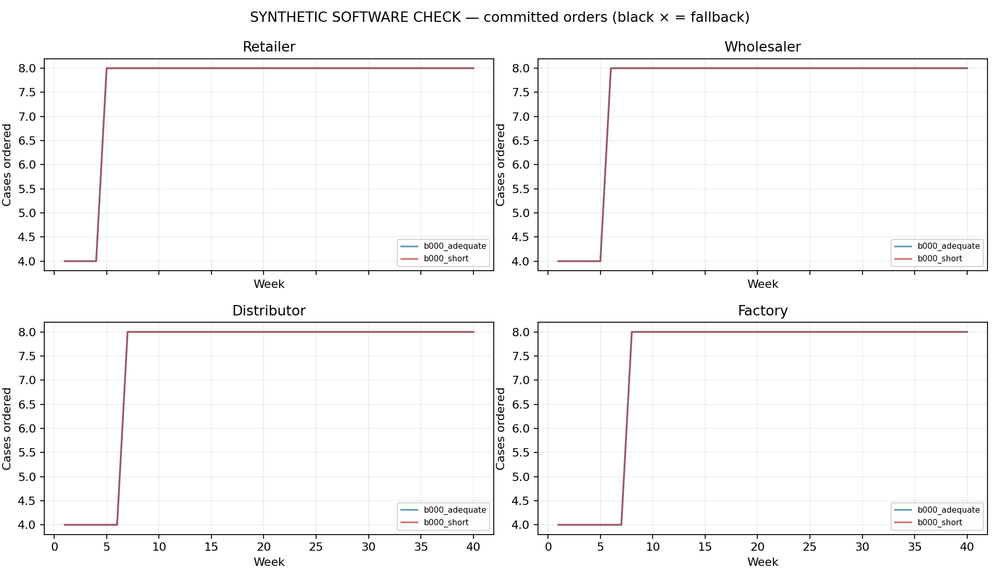
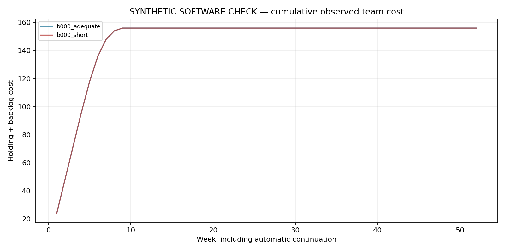
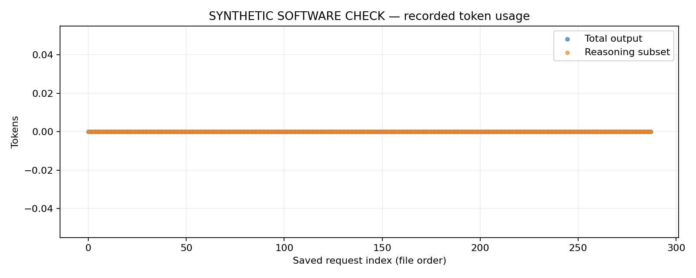

# Student-persona Beer Game: evidence report

SYNTHETIC SOFTWARE CHECK: no actual model responses, human observations or treatment-effect evidence.

A clean behavioral comparison is not established: calibration passed=False, completed chains=2/2, clean chains=2, missing decisions=0, fallback orders=0.

Estimated charges/reservations: $0.0000; saved requests: 296.

Saved failed decision requests: 0; committed fallback orders: 0. Stopped batches may contain responses that were never committed. Unknown/unmeasured usage requests: 0.

Prior calibration estimate: $0.0000; local run plus prior calibration: $0.0000. Prior responses were reused without new calibration calls.

## Evidence and outcome

SYNTHETIC SOFTWARE CHECK: no actual model responses, human observations or treatment-effect evidence.

Run status: complete. A clean behavioral comparison is not established: calibration passed=False, completed chains=2/2, clean chains=2, missing decisions=0, fallback orders=0.

Calibration did not validate a token contrast. The predeclared 8192/16384 caps are engineering diagnostic settings, not validated treatment thresholds.

Local saved requests: 296; estimated local charges/reservations: $0.0000. Measured local output: 0 tokens, including 0 reasoning tokens. Prior reused calibration requests and charges are reported separately.

## Model and intervention

Requested model: gpt-5.4-mini-2026-03-17. Returned models: none recorded. Fixed reasoning effort: high. Selected total-output caps: short 8192, adequate 16384. Exact prompts, state histories and responses are retained in manifest.json and requests/*.json. The allowance applies to total generated output, including reasoning tokens and the structured decision; nonreasoning tokens equal total output minus the reasoning subset. Unused allowance is not measured effort. Selected caps are recorded in selection.json / calibration_recommendation.json.

The common 180.0-second transport timeout is operational reliability protection, not a deadline treatment. Recorded latency includes service and transport delay. Tokens do not have a validated conversion to human thinking seconds; the study manipulates an LLM computational allowance. A separate time-limit experiment requires separate calibration. Usage summaries include measured requests only; unobserved usage remains missing, and its reserved charge remains in the ledger.

## Game sample planning

Selected chain pairs: 1; configured maximum: 1. Forecast cost per full pair: not applicable to the synthetic check. Selection uses calibration token costs before game outcomes, with a 15% forecast margin and common onboarding allowances. This budget-based sample choice is not a power calculation or a guarantee that later histories and generation will fit the forecast. The local spending guard remains binding; changing group count after observing game outcomes would create a different design.

## Reused calibration provenance

Completed calibration is reused from D:\beergame\data\runs\student_offline_3f945fcf691d8e74. Its source mode is offline; requested model gpt-5.4-mini-2026-03-17, effort high, returned models none recorded. The parent manifest and raw request paths/hashes are retained in calibration_reuse.json. Copied calibration CSVs and the recommendation are prior evidence, not new calls or new games. Original estimated calibration charge: $0.0000. Parent charges are excluded from this run's local ledger and are not purchased again.

## Decisions, failures and costs

Zero is a permitted decision. No positive-order floor or advertised order maximum is imposed. Concerning zero orders (positive backlog with no stock or outstanding replenishment) are reported without being changed or excluded. Fallback orders belong to a disclosed diagnostic continuation policy, not the model. A completed chain with fallbacks does not become a complete model-behavior sample. Full costs are descriptive whenever fallbacks occur; incomplete chains have only accumulated observed costs.

Costs include all 40 game weeks, including 4 fixed warmup weeks, plus 12 automatic continuation weeks. Automatic and fallback orders are excluded from valid model decision zero rates. Raw failures and their charges/reservations remain in the request ledger; no failed generation is converted into a valid zero decision.

## Bullwhip and beta

Bullwhip ratios use sample variance over the full 40 game weeks including warmup, or the observed partial window when stopped. Both local incoming demand and external customer demand are reported. A zero-variance denominator produces a missing ratio. The single demand step and different timing upstream make these descriptive ratios sensitive to the window; a ratio alone does not establish sustained oscillation.

Beta is an exploratory fitted supply-line weight, not a direct measurement of thinking or a diagnosed human bias. A role with invalid/fallback decisions has an unusable fit. Variation, fit quality and identification flags remain visible. Chain beta requires four usable role fits. No confirmatory p-values are calculated for this small feasibility pilot; weekly calls are not independent participants.

## Research scope

The common persona is a hypothetical second-year business student at University at Buffalo. A demographic prompt does not validate a population model. Repeated calls represent model-generated decisions, not independent University at Buffalo students. Claims about actual students require answers from real students using comparable tasks; see Bisbee et al. (https://doi.org/10.1017/pan.2024.5) on the limits of synthetic survey respondents. The cited GPT behavioral-operations study (https://doi.org/10.1287/msom.2023.0279) motivates investigating model decisions across operational tasks; this Beer Game alone does not diagnose all eighteen biases. Deliberately requesting a bias or oscillation would change the behavior being studied. Prompt, model, effort, budget selection and failure policy must remain fixed within the comparison, and historical none-effort protocols must remain separate.

## Sources and reproducibility

Game timing/cost background: MIT / John Sterman Beer Game (https://web.mit.edu/jsterman/www/SDG/beergame.html). API token accounting and incomplete responses: OpenAI reasoning guide (https://developers.openai.com/api/docs/guides/reasoning). Response schema mechanics: OpenAI structured outputs (https://developers.openai.com/api/docs/guides/structured-outputs). These sources support game/API mechanics; they do not validate student realism or tokens as human time.

The manifest, raw requests, calibration, rule checks and trajectory CSVs are the reproducible evidence. Currency values are local estimated charges/reservations, not an account balance; unresolved request usage may remain reserved. Software checks and offline synthetic runs cannot supply missing live results.

## Condition outcomes

| condition | chains_complete | clean_chains | valid_submitted_decisions | missing_decisions | fallback_count | zero_rate_valid | max_submitted_order | mean_total_scored_cost |
| --- | --- | --- | --- | --- | --- | --- | --- | --- |
| adequate | 1 | 1 | 144 | 0 | 0 | 0 | 8 | 156 |
| short | 1 | 1 | 144 | 0 | 0 | 0 | 8 | 156 |

## Group outcomes

| group_id | full_game | fallback_count | total_scored_cost | usable_role_betas | group_beta |
| --- | --- | --- | --- | --- | --- |
| b000_adequate | yes | 0 | 156 | 0 | missing |
| b000_short | yes | 0 | 156 | 0 | missing |

## Calibration

| limit | n | genuine_api_n | completed_valid_n | completion_denominator | completion_rate | positive_reasoning_n | measured_usage_n | median_output_tokens | near_cap_fraction | truncated_fraction | complete_unique_items | viable | matching_reference_items |
| --- | --- | --- | --- | --- | --- | --- | --- | --- | --- | --- | --- | --- | --- |
| 512 | 24 | 0 | 0 | 24 | 0 | 0 | 0 | missing | missing | 0 | yes | no | yes |
| 1024 | 24 | 0 | 0 | 24 | 0 | 0 | 0 | missing | missing | 0 | yes | no | yes |
| 2048 | 24 | 0 | 0 | 24 | 0 | 0 | 0 | missing | missing | 0 | yes | no | yes |
| 4096 | 24 | 0 | 0 | 24 | 0 | 0 | 0 | missing | missing | 0 | yes | no | yes |
| 8192 | 24 | 0 | 0 | 24 | 0 | 0 | 0 | missing | missing | 0 | yes | no | yes |
| 16384 | 24 | 0 | 0 | 24 | 0 | 0 | 0 | missing | missing | 0 | yes | no | yes |

## Beta diagnostics

| group_id | role | beta | usable | fit_flag |
| --- | --- | --- | --- | --- |
| b000_adequate | distributor | 1.504 | no | weak_inventory_response;parameter_boundary |
| b000_adequate | factory | 1.504 | no | weak_inventory_response;parameter_boundary |
| b000_adequate | retailer | missing | no | insufficient_variation |
| b000_adequate | wholesaler | 1.404 | no | weak_inventory_response;parameter_boundary |
| b000_short | distributor | 1.504 | no | weak_inventory_response;parameter_boundary |
| b000_short | factory | 1.504 | no | weak_inventory_response;parameter_boundary |
| b000_short | retailer | missing | no | insufficient_variation |
| b000_short | wholesaler | 1.404 | no | weak_inventory_response;parameter_boundary |

Calibration did not validate a token contrast. The predeclared 8192/16384 caps are engineering diagnostic settings, not validated treatment thresholds. Full selection criteria and state results are saved in [calibration_recommendation.json](calibration_recommendation.json) and [calibration.csv](calibration.csv).

Primary references: [MIT / John Sterman: Beer Game](https://web.mit.edu/jsterman/www/SDG/beergame.html); [OpenAI: reasoning models and output-token accounting](https://developers.openai.com/api/docs/guides/reasoning); [OpenAI: structured outputs](https://developers.openai.com/api/docs/guides/structured-outputs); [Bisbee et al.: limitations of LLM survey respondents](https://doi.org/10.1017/pan.2024.5); [GPT and behavioral operations study](https://doi.org/10.1287/msom.2023.0279); [OpenAI: GPT-5.4 Mini model documentation](https://developers.openai.com/api/docs/models/gpt-5.4-mini).

