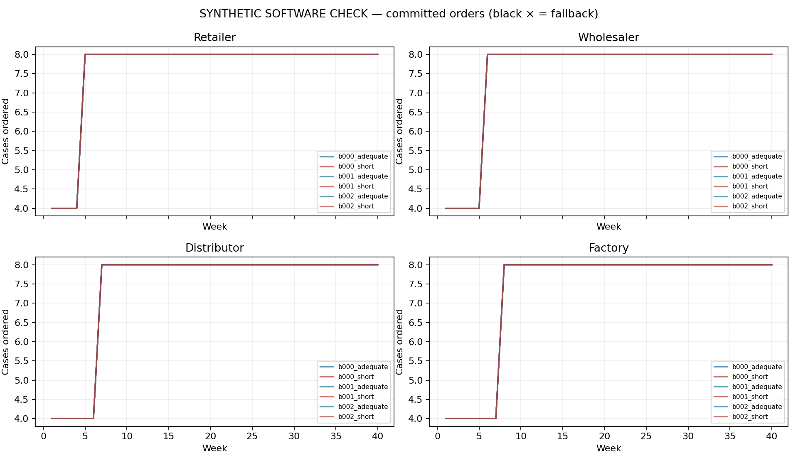
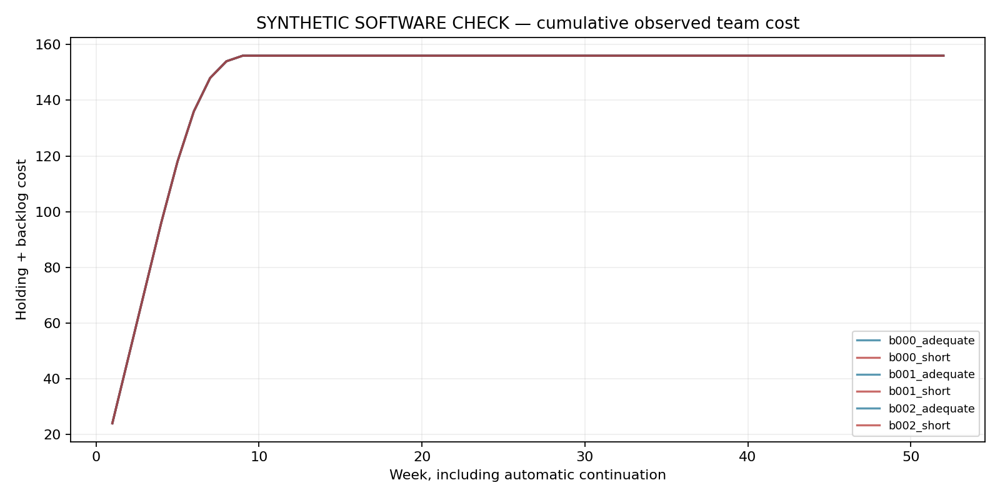
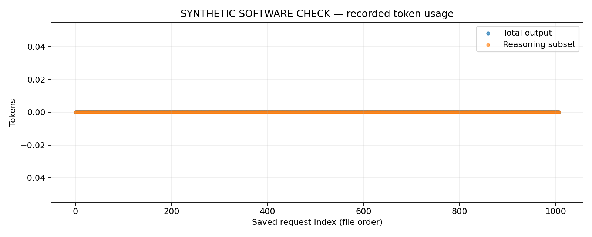

# Student-persona Beer Game: evidence report

SYNTHETIC SOFTWARE CHECK: no actual model responses, human observations or treatment-effect evidence.

A clean behavioral comparison is not established: calibration passed=False, completed chains=6/6, clean chains=6, missing decisions=0, fallback orders=0.

Estimated charges/reservations: $0.0000; saved requests: 1032.

Saved failed decision requests: 0; committed fallback orders: 0. Stopped batches may contain responses that were never committed. Unknown/unmeasured usage requests: 0.

## Evidence and outcome

SYNTHETIC SOFTWARE CHECK: no actual model responses, human observations or treatment-effect evidence.

Run status: complete. A clean behavioral comparison is not established: calibration passed=False, completed chains=6/6, clean chains=6, missing decisions=0, fallback orders=0.

## Model and intervention

Requested model: gpt-5.4-mini-2026-03-17. Returned models: none recorded. Fixed reasoning effort: high. Exact prompts, state histories and responses are retained in manifest.json and requests/*.json. The allowance applies to total generated output, including reasoning tokens and the structured decision; nonreasoning tokens equal total output minus the reasoning subset. Unused allowance is not measured effort. Selected caps are recorded in selection.json / calibration_recommendation.json.

The common 180-second transport timeout is operational reliability protection, not a deadline treatment. Recorded latency includes service and transport delay. Tokens do not have a validated conversion to human thinking seconds; the study manipulates an LLM computational allowance. A separate time-limit experiment requires separate calibration.

## Decisions, failures and costs

Zero is a permitted decision. No positive-order floor or advertised order maximum is imposed. Concerning zero orders (positive backlog with no stock or outstanding replenishment) are reported without being changed or excluded. Fallback orders belong to a disclosed diagnostic continuation policy, not the model. A completed chain with fallbacks does not become a complete model-behavior sample. Full costs are descriptive whenever fallbacks occur; incomplete chains have only accumulated observed costs.

Costs include all game weeks, including four fixed warmup weeks, plus twelve automatic continuation weeks. Automatic and fallback orders are excluded from valid model decision zero rates. Raw failures and their charges/reservations remain in the request ledger; no failed generation is converted into a valid zero decision.

## Bullwhip and beta

Bullwhip ratios use sample variance over the full forty game weeks including warmup, or the observed partial window when stopped. Both local incoming demand and external customer demand are reported. A zero-variance denominator produces a missing ratio. The single demand step and different timing upstream make these descriptive ratios sensitive to the window; a ratio alone does not establish sustained oscillation.

Beta is an exploratory fitted supply-line weight, not a direct measurement of thinking or a diagnosed human bias. A role with invalid/fallback decisions has an unusable fit. Variation, fit quality and identification flags remain visible. Chain beta requires four usable role fits. No confirmatory p-values are calculated for this small feasibility pilot; weekly calls are not independent participants.

## Research scope

The common persona is a hypothetical second-year business student at University at Buffalo. A demographic prompt does not validate a population model. Repeated calls represent model-generated decisions, not independent University at Buffalo students. Claims about actual students require answers from real students using comparable tasks. The Beer Game alone does not diagnose all eighteen behavioral-operation biases; deliberately requesting a bias or oscillation would change the behavior being studied. Prompt, model, effort, budget selection and failure policy must remain fixed within the comparison, and historical none-effort protocols must remain separate.

## Sources and reproducibility

Game timing/cost background: MIT / John Sterman Beer Game (https://web.mit.edu/jsterman/www/SDG/beergame.html). API token accounting and incomplete responses: OpenAI reasoning guide (https://developers.openai.com/api/docs/guides/reasoning). Response schema mechanics: OpenAI structured outputs (https://developers.openai.com/api/docs/guides/structured-outputs). These sources support game/API mechanics; they do not validate student realism or tokens as human time.

The manifest, raw requests, calibration, rule checks and trajectory CSVs are the reproducible evidence. Currency values are local estimated charges/reservations, not an account balance; unresolved request usage may remain reserved. Software checks and offline synthetic runs cannot supply missing live results.

## Condition outcomes

| condition | chains_complete | clean_chains | valid_model_decisions | missing_decisions | fallback_count | zero_rate_valid | max_model_order | mean_total_scored_cost |
| --- | --- | --- | --- | --- | --- | --- | --- | --- |
| adequate | 3 | 3 | 432 | 0 | 0 | 0 | 8 | 156 |
| short | 3 | 3 | 432 | 0 | 0 | 0 | 8 | 156 |

## Group outcomes

| group_id | full_game | fallback_count | total_scored_cost | usable_role_betas | group_beta |
| --- | --- | --- | --- | --- | --- |
| b000_adequate | yes | 0 | 156 | 0 | missing |
| b000_short | yes | 0 | 156 | 0 | missing |
| b001_adequate | yes | 0 | 156 | 0 | missing |
| b001_short | yes | 0 | 156 | 0 | missing |
| b002_adequate | yes | 0 | 156 | 0 | missing |
| b002_short | yes | 0 | 156 | 0 | missing |

## Calibration

| limit | n | genuine_api_n | completed_valid_n | completion_denominator | completion_rate | positive_reasoning_n | measured_usage_n | median_output_tokens | near_cap_fraction | truncated_fraction | complete_unique_items | viable | matching_reference_items |
| --- | --- | --- | --- | --- | --- | --- | --- | --- | --- | --- | --- | --- | --- |
| 512 | 24 | 0 | 0 | 24 | 0 | 0 | 0 | missing | missing | 0 | yes | no | yes |
| 1024 | 24 | 0 | 0 | 24 | 0 | 0 | 0 | missing | missing | 0 | yes | no | yes |
| 2048 | 24 | 0 | 0 | 24 | 0 | 0 | 0 | missing | missing | 0 | yes | no | yes |
| 4096 | 24 | 0 | 0 | 24 | 0 | 0 | 0 | missing | missing | 0 | yes | no | yes |
| 8192 | 24 | 0 | 0 | 24 | 0 | 0 | 0 | missing | missing | 0 | yes | no | yes |
| 16384 | 24 | 0 | 0 | 24 | 0 | 0 | 0 | missing | missing | 0 | yes | no | yes |

## Beta diagnostics

| group_id | role | beta | usable | fit_flag |
| --- | --- | --- | --- | --- |
| b000_adequate | distributor | 1.504 | no | weak_inventory_response;parameter_boundary |
| b000_adequate | factory | 1.504 | no | weak_inventory_response;parameter_boundary |
| b000_adequate | retailer | missing | no | insufficient_variation |
| b000_adequate | wholesaler | 1.404 | no | weak_inventory_response;parameter_boundary |
| b000_short | distributor | 1.504 | no | weak_inventory_response;parameter_boundary |
| b000_short | factory | 1.504 | no | weak_inventory_response;parameter_boundary |
| b000_short | retailer | missing | no | insufficient_variation |
| b000_short | wholesaler | 1.404 | no | weak_inventory_response;parameter_boundary |
| b001_adequate | distributor | 1.504 | no | weak_inventory_response;parameter_boundary |
| b001_adequate | factory | 1.504 | no | weak_inventory_response;parameter_boundary |
| b001_adequate | retailer | missing | no | insufficient_variation |
| b001_adequate | wholesaler | 1.404 | no | weak_inventory_response;parameter_boundary |
| b001_short | distributor | 1.504 | no | weak_inventory_response;parameter_boundary |
| b001_short | factory | 1.504 | no | weak_inventory_response;parameter_boundary |
| b001_short | retailer | missing | no | insufficient_variation |
| b001_short | wholesaler | 1.404 | no | weak_inventory_response;parameter_boundary |
| b002_adequate | distributor | 1.504 | no | weak_inventory_response;parameter_boundary |
| b002_adequate | factory | 1.504 | no | weak_inventory_response;parameter_boundary |
| b002_adequate | retailer | missing | no | insufficient_variation |
| b002_adequate | wholesaler | 1.404 | no | weak_inventory_response;parameter_boundary |
| b002_short | distributor | 1.504 | no | weak_inventory_response;parameter_boundary |
| b002_short | factory | 1.504 | no | weak_inventory_response;parameter_boundary |
| b002_short | retailer | missing | no | insufficient_variation |
| b002_short | wholesaler | 1.404 | no | weak_inventory_response;parameter_boundary |

Calibration recommendation: `{"adequate_cap_binding_risk": false, "adequate_tokens": null, "complete_matched_batch": true, "completion_threshold": 0.95, "expected_n_per_cap": 24, "manipulation_screen_passed": false, "median_total_output_contrast": null, "nonbinding_cap_risk": false, "note": "Feasibility screen only. Caps are not guaranteed valid. Recheck in full games; no human-time equivalence is established. Any fallback makes that game ineligible for confirmatory outcome claims. Synthetic calls cannot validate the manipulation.", "protocol": "hypothetical-student-fixed-high-single-call-v1", "reference_cap_binding_risk": false, "reference_near_cap_threshold": 0.05, "reference_screen_passed": false, "required_usage_contrast": 0.25, "screen_rows": [{"complete_unique_items": true, "completed_valid_n": 0, "completion_denominator": 24, "completion_rate": 0.0, "genuine_api_n": 0, "limit": 512, "matching_reference_items": true, "measured_usage_n": 0, "median_output_tokens": null, "n": 24, "near_cap_fraction": null, "positive_reasoning_n": 0, "truncated_fraction": 0.0, "viable": false}, {"complete_unique_items": true, "completed_valid_n": 0, "completion_denominator": 24, "completion_rate": 0.0, "genuine_api_n": 0, "limit": 1024, "matching_reference_items": true, "measured_usage_n": 0, "median_output_tokens": null, "n": 24, "near_cap_fraction": null, "positive_reasoning_n": 0, "truncated_fraction": 0.0, "viable": false}, {"complete_unique_items": true, "completed_valid_n": 0, "completion_denominator": 24, "completion_rate": 0.0, "genuine_api_n": 0, "limit": 2048, "matching_reference_items": true, "measured_usage_n": 0, "median_output_tokens": null, "n": 24, "near_cap_fraction": null, "positive_reasoning_n": 0, "truncated_fraction": 0.0, "viable": false}, {"complete_unique_items": true, "completed_valid_n": 0, "completion_denominator": 24, "completion_rate": 0.0, "genuine_api_n": 0, "limit": 4096, "matching_reference_items": true, "measured_usage_n": 0, "median_output_tokens": null, "n": 24, "near_cap_fraction": null, "positive_reasoning_n": 0, "truncated_fraction": 0.0, "viable": false}, {"complete_unique_items": true, "completed_valid_n": 0, "completion_denominator": 24, "completion_rate": 0.0, "genuine_api_n": 0, "limit": 8192, "matching_reference_items": true, "measured_usage_n": 0, "median_output_tokens": null, "n": 24, "near_cap_fraction": null, "positive_reasoning_n": 0, "truncated_fraction": 0.0, "viable": false}, {"complete_unique_items": true, "completed_valid_n": 0, "completion_denominator": 24, "completion_rate": 0.0, "genuine_api_n": 0, "limit": 16384, "matching_reference_items": true, "measured_usage_n": 0, "median_output_tokens": null, "n": 24, "near_cap_fraction": null, "positive_reasoning_n": 0, "truncated_fraction": 0.0, "viable": false}], "short_tokens": null}`.

Primary references: [MIT / John Sterman: Beer Game](https://web.mit.edu/jsterman/www/SDG/beergame.html); [OpenAI: reasoning models and output-token accounting](https://developers.openai.com/api/docs/guides/reasoning); [OpenAI: structured outputs](https://developers.openai.com/api/docs/guides/structured-outputs).

