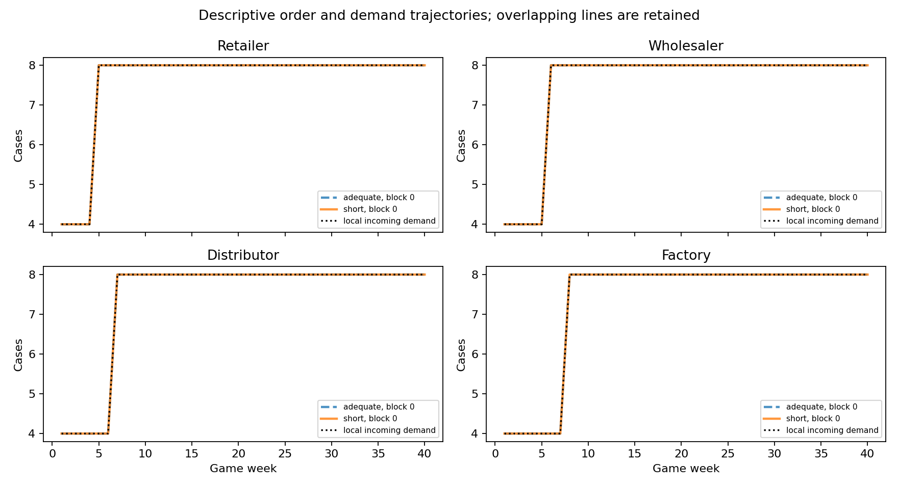
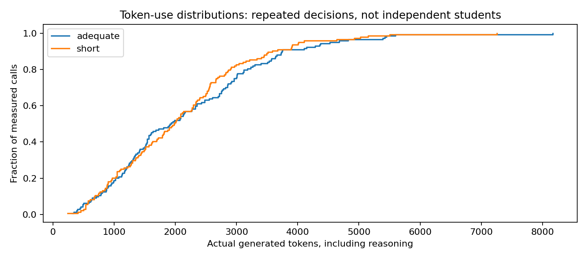

# Full hypothesis analysis: student Beer Game

Analysis date: 11 October 2026. LLM simulations; no human observations.

## Conclusion and scope

This is the full H1/H2 analysis of saved run student_api_b609eca42866feb0, produced without additional model calls. It adds the hypothesis checks omitted from the earlier outcome report. It is a post-hoc analysis document; it does not revise the saved experiment or claim prospective registration of this new analysis code.

The frozen plan selected 1 chain pair(s), with 8,192 versus 16,384 generated-token caps. The calibration manipulation screen passed: False. Read the separate H1 and H2 eligibility decisions below; withheld tests are missing, rather than zero or a fabricated p-value.

For the completed 11 October pilot, both chains scored 156 and matched on every valid week-role order. H1 cannot be estimated from usable coefficients; H2 has a descriptive paired difference of zero. Neither hypothesis has a valid confirmatory conclusion from this pilot. Identical observations do not establish equivalence or the absence of an effect.

The evidence consists of configured LLM simulations. It contains no real students, and weekly calls are repeated interacting decisions. The analysis unit is an independently initialized four-role supply chain, paired by block across conditions.

## Original hypotheses, estimands and planned tests

H1: within shared information, a binding decision constraint increases underweighting of outstanding replenishment. The repo operationalizes this as a lower supply-line coefficient beta under the short allowance. For block b, D_beta,b = mean(beta_short,b,r over all four roles) - mean(beta_adequate,b,r over all four roles). The null is no paired condition difference; the predicted direction is E[D_beta] < 0. A chain mean exists only if every role fit is usable.

H2: within shared information, a binding decision constraint raises total inventory-holding and backlog costs. D_cost,b = C_short,b - C_adequate,b, with C = sum over roles and all scored weeks of (0.50 * inventory + 1.00 * backlog). The null is no paired condition difference; the predicted direction is E[D_cost] > 0. Costs include fixed familiarization and automatic continuation. H2 does not require identifiable beta and is checked independently.

Following the earlier workflow, eligible comparisons use a two-sided paired sign-flip test on mean chain-block differences. For n <= 16, enumerate all 2^n sign vectors and count abs(mean(s_b * D_b)) >= abs(mean(D_b)). For larger n, use the fixed-seed 50,000-draw Monte Carlo variant with a plus-one correction. This requires sign exchangeability under the null; a mean-equality statement alone does not establish that assumption. Predicted direction is reported separately from a two-sided p-value.

Holm adjustment retains the planned family of two hypotheses. If one test is unavailable, a p=1 placeholder is used only internally for the other adjustment; the unavailable p-value stays blank in reports. The inherited eight-pair minimum is a software inference floor, not a power calculation. This new analysis additionally withholds inferential results when the recorded token-manipulation screen failed. No independent-pair confidence interval is manufactured from one pair; no bootstrap over weekly decisions is used.

The hypotheses originate in data/source/ThoughtsReflection_Paragraph.docx and the legacy docs/PROTOCOL.md. Their mapping is retained while the active prompt/model/high-effort/single-call token protocol differs from the historical none-effort, two-call implementation. This is an exploratory analysis workflow, not a registered human experiment.

## Original proposal and implemented study

| design_element | original_human_proposal | implemented_llm_study |
| --- | --- | --- |
| Target population | Human university participants | Hypothetical second-year UB business-student prompt; no humans observed |
| Pilot calibration | 16 participants in four chains; ordinary per-round response times | 24 fixed hypothetical states, six caps, 144 selected observations |
| Constraint | P25 restrictive / P95 generous / doubled generous seconds | Fixed high effort; generated-token cap including reasoning; diagnostic 8192/16384 after failed screen |
| Main sample | 80 new participants; ten chains per condition | 1 selected independently initialized chain(s) per condition |
| Information sharing | Shared supply-chain information | All four inventories; own demand, receipts, shipments, backlog, total supply line and history; other orders/backlogs hidden |
| Process evidence | Screen recordings, written explanations and post-questionnaire | Exact prompts/replies/status/usage/state transitions; no human process evidence or questionnaire |

## Information sharing and mechanism coverage

The model sees all four current available inventories and its own local state/history, while other roles' orders and backlogs remain hidden. Future customer demand is not disclosed. The same information fields and repeated question are supplied in both token conditions. Information load is not separately randomized in this pilot. The total outstanding supply line is already aggregated in the prompt, so the original proposal's mental aggregation across pipeline stages is not isolated. A token effect, if later observed, would not by itself identify that mechanism.

## H1 and H2 results

| hypothesis | complete_pairs | estimate | predicted_direction | p_raw | p_holm | ci_lower | ci_upper | status |
| --- | --- | --- | --- | --- | --- | --- | --- | --- |
| H1 | 0 | — | short minus adequate < 0 | — | — | — | — | inference withheld |
| H2 | 1 | 0 | short minus adequate > 0 | — | — | — | — | inference withheld |

## Individual reasons and hypothesis conclusions

H1: The prospective completion-and-actual-token-usage manipulation screen must pass.; At least 8 planned independent complete pairs are required by the inherited software floor; this is not adequate-power evidence.; Every planned chain must have four usable role beta fits.. Not tested; descriptive outcomes do not establish a treatment effect or equivalence

H2: The prospective completion-and-actual-token-usage manipulation screen must pass.; At least 8 planned independent complete pairs are required by the inherited software floor; this is not adequate-power evidence.. Not tested; descriptive outcomes do not establish a treatment effect or equivalence

## Paired chain-block contrasts

| hypothesis | block | short_value | adequate_value | contrast | usable_pair | pair_reason |
| --- | --- | --- | --- | --- | --- | --- |
| H1 | 0 | — | — | — | no | short lacks four usable role beta fits; adequate lacks four usable role beta fits |
| H2 | 0 | 156 | 156 | 0 | yes | complete outcome pair |

## Inference prerequisites

| hypothesis | check | passed | detail |
| --- | --- | --- | --- |
| H1 | api_observations | yes | Genuine API simulations are required; synthetic checks are software evidence only. |
| H1 | calibration_passed | no | The prospective completion-and-actual-token-usage manipulation screen must pass. |
| H1 | complete_planned_sample | yes | Every chain in the frozen pre-outcome plan must finish game and scoring continuation. |
| H1 | no_replacements | yes | No chain may be replaced after outcomes; operational cached resume is not replacement. |
| H1 | no_fallbacks_or_missing | yes | All planned model decisions must be observed without mechanical fallback orders. |
| H1 | model_effort_caps_consistent | yes | The pinned model, high effort, exact prompts, and frozen caps must be consistent. |
| H1 | rules_checks_passed | yes | All common factual onboarding checks must pass before gameplay. |
| H1 | minimum_independent_pairs | no | At least 8 planned independent complete pairs are required by the inherited software floor; this is not adequate-power evidence. |
| H1 | all_planned_outcomes_usable | no | Every planned chain must have four usable role beta fits. |
| H2 | api_observations | yes | Genuine API simulations are required; synthetic checks are software evidence only. |
| H2 | calibration_passed | no | The prospective completion-and-actual-token-usage manipulation screen must pass. |
| H2 | complete_planned_sample | yes | Every chain in the frozen pre-outcome plan must finish game and scoring continuation. |
| H2 | no_replacements | yes | No chain may be replaced after outcomes; operational cached resume is not replacement. |
| H2 | no_fallbacks_or_missing | yes | All planned model decisions must be observed without mechanical fallback orders. |
| H2 | model_effort_caps_consistent | yes | The pinned model, high effort, exact prompts, and frozen caps must be consistent. |
| H2 | rules_checks_passed | yes | All common factual onboarding checks must pass before gameplay. |
| H2 | minimum_independent_pairs | no | At least 8 planned independent complete pairs are required by the inherited software floor; this is not adequate-power evidence. |
| H2 | all_planned_outcomes_usable | yes | Every planned chain must have its full game-plus-continuation scored cost; H2 does not require beta identification. |

## Sample and data integrity

The saved configuration requested at most 3 pairs, but selection.json prospectively froze 1 pair(s) using calibration charges before game outcomes. The selected count is the denominator, not the requested maximum. Each game has four roles, 40 weeks, 4 fixed familiarization weeks and 12 automatic scoring weeks. Rules checks are common before treatment; passing them is a comprehension screen, not validation of human-like choice.

Saved run status: complete; valid model decisions: 288; missing decisions: 0; fallbacks: 0. The group table records full-game and full-continuation availability. Invalid decisions or mechanical fallbacks are never labeled as model choices. All completed outcomes remain visible; no chain is filtered for cost, direction, zero orders or a favorable coefficient.

The analysis independently rebuilds scored costs and checks saved outcomes, role fits, source provenance and raw requests. For this pilot, the separate independent_audit.json additionally reconstructs 320 physical game states, 288 model decisions and 96 continuation states. The week-12 filesystem recovery retained the same chains and saved decisions; it was not an extra replicate or behavioral replacement. Scheduling changed commonly from concurrency/interval 2/2 to 8/1; latency is consequently descriptive operational evidence, not a treatment or cognitive-time measurement. When exporting another run, rely on its inference checks and its own audit record rather than treating this pilot audit as transferable.

## Chain outcomes and H1 identifiability

| group_id | full_game | full_continuation | valid_submitted_decisions | missing_decisions | fallback_count | total_scored_cost | usable_role_betas | group_beta |
| --- | --- | --- | --- | --- | --- | --- | --- | --- |
| b000_adequate | yes | yes | 144 | 0 | 0 | 156 | 0 | — |
| b000_short | yes | yes | 144 | 0 | 0 | 156 | 0 | — |

## Token manipulation and technical timing

Requested model: gpt-5.4-mini-2026-03-17; reasoning effort: high, fixed across conditions. Common technical timeout: 180.0 seconds. The cap covers total generated tokens, including hidden reasoning; it is an allowance, not computation necessarily consumed. The model is not told its cap. There is one structured decision call and no extra reasoning opportunity.

The fixed calibration bank uses 24 matched hypothetical states per cap. Eligibility requires at least 95% valid decisions for both selected caps, recorded positive reasoning for valid answers, a complete matched bank, at least 25% lower median actual generated tokens at the short cap, and a generous reference with at most 5% of responses using at least 90% of its cap. Calibration usage summaries include incomplete generation. These are engineering feasibility thresholds, not validated human-time thresholds.

In this pilot, 8,192 was the only candidate cap to reach 95% observed completion, but its median use was 5,057 versus 4,413 at the 16,384 reference (short use 14.59% higher). No pair passed the prespecified separation screen. The 8,192/16,384 diagnostic pair was declared before game outcomes; it was not chosen to favor H1/H2.

In the completed games, mean output was 2,087.424 versus 2,183.375 tokens (4.39% lower in short), while medians were 1,982 versus 1,922 (3.12% higher in short). Both had zero calls reaching 90% of their assigned allowance. The short maximum was 7,258; adequate maximum 8,171. The game therefore supplies no clear binding-computation contrast. These per-call summaries are descriptive; 144 decisions per condition are not 144 independent subjects.

A common transport timeout allows the API to finish a request and is not calibrated decision pressure. Adding a wall-clock treatment would require a separate prospective design accounting for server/network delay while holding token policy fixed. This dataset cannot estimate a human seconds-to-tokens conversion.

## Calibration completion, truncation and actual computation

| limit | n | completed_valid_n | completion_rate | median_output_tokens | near_cap_fraction | truncated_fraction | viable |
| --- | --- | --- | --- | --- | --- | --- | --- |
| 512 | 24 | 0 | 0 | 512 | 1 | 1 | no |
| 1024 | 24 | 2 | 0.0833333 | 1,024 | 0.916667 | 0.916667 | no |
| 2048 | 24 | 5 | 0.208333 | 2,048 | 0.791667 | 0.791667 | no |
| 4096 | 24 | 11 | 0.458333 | 4,096 | 0.541667 | 0.541667 | no |
| 8192 | 24 | 23 | 0.958333 | 5,057 | 0.125 | 0.0416667 | yes |
| 16384 | 24 | 24 | 1 | 4,413 | 0 | 0 | yes |

## Main-game actual token usage and binding

| condition | independent_chains | decision_calls | measured_usage_calls | token_limit | median_output_tokens | mean_output_tokens | median_reasoning_tokens | near_cap_fraction | cap_binding_fraction |
| --- | --- | --- | --- | --- | --- | --- | --- | --- | --- |
| short | 1 | 144 | 144 | 8192 | 1,982 | 2,087.42 | 1,968 | 0 | 0 |
| adequate | 1 | 144 | 144 | 16384 | 1,922 | 2,183.38 | 1,908 | 0 | 0 |

## H1 structural coefficient checks

The inherited model is q_hat,t = max(0, F_t + alpha * (S - net_inventory_t - beta * supply_line_t)), F_t = theta * demand_t + (1-theta) * F_(t-1), initialized at 4. Each role is fitted on its own model-choice weeks. Bounds are theta/alpha in [0,1], beta in [0,2], target S in [0,10000], with multiple optimizer starts. Diagnostics check variation, sample size, inventory response, Jacobian rank/conditioning, poor fit and parameter limits. A boundary flag alone need not invalidate a fit; current upstream fits also have weak inventory response.

For the 11 October pilot, retailer choices are constant at 8 in all model-choice weeks, so the required variation is absent. Other roles closely follow current incoming demand; fitted theta is approximately 1 and alpha is about 0.000003–0.000006, below the 0.02 response threshold. Their numerical beta values around 1.40–1.50 are unusable. Near-perfect R-squared measures reproduction of orders, not identification of supply-line weight.

For an interior predicted order, the sensitivity to beta is -alpha * supply_line. As alpha approaches zero, changes in beta barely change predictions; at alpha=0 the model reduces to the forecast and beta drops out entirely. An unidentifiable beta is not beta=0 or proof of either neglect or full attention. All four roles must be usable before a chain mean enters H1; the current 0/8 usable fits leave zero eligible beta pairs. No selective averaging, new optimizer bounds or relaxed diagnostics were applied to produce a result.

## All role fits, including unusable numerical coefficients

| condition | role | theta | alpha | beta | rmse | r2 | jac_condition | usable | fit_flag |
| --- | --- | --- | --- | --- | --- | --- | --- | --- | --- |
| adequate | retailer | — | — | — | — | — | — | no | insufficient_variation |
| adequate | wholesaler | 0.999995 | 5.74e-06 | 1.40372 | 1.71e-06 | 1 | 22.5392 | no | weak_inventory_response;parameter_boundary |
| adequate | distributor | 0.999996 | 3.21e-06 | 1.50394 | 1.19e-06 | 1 | 17.976 | no | weak_inventory_response;parameter_boundary |
| adequate | factory | 0.999996 | 3.25e-06 | 1.50401 | 1.2e-06 | 1 | 14.7028 | no | weak_inventory_response;parameter_boundary |
| short | retailer | — | — | — | — | — | — | no | insufficient_variation |
| short | wholesaler | 0.999995 | 5.74e-06 | 1.40372 | 1.71e-06 | 1 | 22.5392 | no | weak_inventory_response;parameter_boundary |
| short | distributor | 0.999996 | 3.21e-06 | 1.50394 | 1.19e-06 | 1 | 17.976 | no | weak_inventory_response;parameter_boundary |
| short | factory | 0.999996 | 3.25e-06 | 1.50401 | 1.2e-06 | 1 | 14.7028 | no | weak_inventory_response;parameter_boundary |

## H2 costs and descriptive effect

Costs are rebuilt from physical inventory and backlog, including the full fixed scoring horizon. The table separates common familiarization, model-choice weeks and automatic continuation. The completed pilot has 96 familiarization cost plus 60 model-choice cost and zero continuation cost per chain; all cost is holding, with zero backlog. The paired condition difference is 156 - 156 = 0, or 0% relative to adequate. H1 coefficient failure does not remove this cost observation.

There is only one independent pair. The between-pair variance, standard error and population confidence interval are not estimable here. The reported zero is an observed difference, not a statistically established zero effect, a noninferiority result or evidence that H2 is false. The failed computation manipulation is an additional reason that this cannot adjudicate a binding-constraint hypothesis.

## Holding and backlog costs by scoring phase

| group_id | condition | block | scoring_phase | holding_cost | backlog_cost | total_cost |
| --- | --- | --- | --- | --- | --- | --- |
| b000_adequate | adequate | 0 | familiarization | 96 | 0 | 96 |
| b000_adequate | adequate | 0 | model-choice weeks | 60 | 0 | 60 |
| b000_adequate | adequate | 0 | automatic continuation | 0 | 0 | 0 |
| b000_short | short | 0 | familiarization | 96 | 0 | 96 |
| b000_short | short | 0 | model-choice weeks | 60 | 0 | 60 |
| b000_short | short | 0 | automatic continuation | 0 | 0 | 0 |

## Bullwhip and order-behavior checks: supplementary outcomes

Direct bullwhip ratios supplement H1/H2; they are not a newly declared third confirmatory hypothesis. The primary descriptive window includes all game weeks, as in the existing repo workflow. Local ratio = sample Var(role orders) / sample Var(local incoming demand); customer ratio uses the common retailer demand denominator. The window and numerator/denominator variances are explicit. A constant denominator is missing, never zero or infinity.

In this pilot all local ratios are 1.000. Customer ratios are 1.000, 1.215278, 1.416667 and 1.604167 upstream. All matched orders agree, with values only 4 or 8, and each equals its role's incoming demand. The >1 customer ratios arise because the same demand step is delayed upstream within a finite window. They do not show local amplification or sustained oscillations. They also do not imply that the student persona is realistic.

The post-hoc window sensitivity table adds model-choice weeks (5 onward) and a settled-period window (9 onward). After familiarization, customer demand is constant so customer-referenced ratios are undefined. In the settled window, local denominators are also constant. These windows illustrate the measurement limitation; they were not used to select caps, exclude chains or seek a favorable hypothesis result. Zero orders remain valid outcomes and no advertised maximum or positive-order rule was imposed.

## Matched decisions across conditions

| block | matched_valid_week_role_choices | identical_orders | agreement_fraction | mean_absolute_order_difference | short_orders_equal_local_demand | adequate_orders_equal_local_demand |
| --- | --- | --- | --- | --- | --- | --- |
| 0 | 144 | 144 | 1 | 0 | yes | yes |

## Order, backlog, service and terminal-state checks

| group_id | condition | role | valid_choices | zero_orders | max_order | concerning_zeros | backlog_weeks | max_backlog | cumulative_shipped_over_demand | terminal_inventory | terminal_backlog | terminal_preorder_supply_line |
| --- | --- | --- | --- | --- | --- | --- | --- | --- | --- | --- | --- | --- |
| b000_adequate | adequate | distributor | 36 | 0 | 8 | 0 | 0 | 0 | 1 | 0 | 0 | 16 |
| b000_adequate | adequate | factory | 36 | 0 | 8 | 0 | 0 | 0 | 1 | 0 | 0 | 16 |
| b000_adequate | adequate | retailer | 36 | 0 | 8 | 0 | 0 | 0 | 1 | 0 | 0 | 16 |
| b000_adequate | adequate | wholesaler | 36 | 0 | 8 | 0 | 0 | 0 | 1 | 0 | 0 | 16 |
| b000_short | short | distributor | 36 | 0 | 8 | 0 | 0 | 0 | 1 | 0 | 0 | 16 |
| b000_short | short | factory | 36 | 0 | 8 | 0 | 0 | 0 | 1 | 0 | 0 | 16 |
| b000_short | short | retailer | 36 | 0 | 8 | 0 | 0 | 0 | 1 | 0 | 0 | 16 |
| b000_short | short | wholesaler | 36 | 0 | 8 | 0 | 0 | 0 | 1 | 0 | 0 | 16 |

## Service and terminal-state definitions

Cumulative shipped divided by demand can include late delivery; it is not inherently an on-time service rate. Backlog weeks and maximum backlog are therefore shown separately. In this pilot there was no backlog. Final inventory and backlog are zero, but the saved final pre-order supply line is 16 cases per role; outstanding orders have not disappeared. Continuation is a fixed finite scoring policy, not an empty-system or infinite-horizon terminal valuation.

## Bullwhip window sensitivity with denominator variances

| condition | role | first_week | last_week | order_variance | local_demand_variance | customer_demand_variance | bullwhip_vs_local | bullwhip_vs_customer |
| --- | --- | --- | --- | --- | --- | --- | --- | --- |
| adequate | distributor | 1 | 40 | 2.09231 | 2.09231 | 1.47692 | 1 | 1.41667 |
| adequate | factory | 1 | 40 | 2.36923 | 2.36923 | 1.47692 | 1 | 1.60417 |
| adequate | retailer | 1 | 40 | 1.47692 | 1.47692 | 1.47692 | 1 | 1 |
| adequate | wholesaler | 1 | 40 | 1.79487 | 1.79487 | 1.47692 | 1 | 1.21528 |
| adequate | distributor | 5 | 40 | 0.863492 | 0.863492 | 0 | 1 | — |
| adequate | factory | 5 | 40 | 1.25714 | 1.25714 | 0 | 1 | — |
| adequate | retailer | 5 | 40 | 0 | 0 | 0 | — | — |
| adequate | wholesaler | 5 | 40 | 0.444444 | 0.444444 | 0 | 1 | — |
| adequate | distributor | 9 | 40 | 0 | 0 | 0 | — | — |
| adequate | factory | 9 | 40 | 0 | 0 | 0 | — | — |
| adequate | retailer | 9 | 40 | 0 | 0 | 0 | — | — |
| adequate | wholesaler | 9 | 40 | 0 | 0 | 0 | — | — |
| short | distributor | 1 | 40 | 2.09231 | 2.09231 | 1.47692 | 1 | 1.41667 |
| short | factory | 1 | 40 | 2.36923 | 2.36923 | 1.47692 | 1 | 1.60417 |
| short | retailer | 1 | 40 | 1.47692 | 1.47692 | 1.47692 | 1 | 1 |
| short | wholesaler | 1 | 40 | 1.79487 | 1.79487 | 1.47692 | 1 | 1.21528 |
| short | distributor | 5 | 40 | 0.863492 | 0.863492 | 0 | 1 | — |
| short | factory | 5 | 40 | 1.25714 | 1.25714 | 0 | 1 | — |
| short | retailer | 5 | 40 | 0 | 0 | 0 | — | — |
| short | wholesaler | 5 | 40 | 0.444444 | 0.444444 | 0 | 1 | — |
| short | distributor | 9 | 40 | 0 | 0 | 0 | — | — |
| short | factory | 9 | 40 | 0 | 0 | 0 | — | — |
| short | retailer | 9 | 40 | 0 | 0 | 0 | — | — |
| short | wholesaler | 9 | 40 | 0 | 0 | 0 | — | — |

## Order and local-demand trajectories

## Actual token distributions

## Interpretation, power and the next study

H1 is not testable with these unusable structural coefficients. H2 has an observed zero difference with insufficient independent replication. The computational treatment was not validated. More copies of the same easy step trajectories would not repair an unidentifiable coefficient or a nonbinding intervention.

Before an inferential study, prospectively specify an operationally meaningful effect, a demand/state design that permits coefficient identification, and a calibration that can separate actual computation while preserving decision completion. Use offline synthetic recovery checks for software and identifiability, then a separately authorized live feasibility check for the intervention. Any changed demand, prompt, model or cap policy creates a new scientific protocol/fingerprint. Do not retune it for the sign or significance of H1/H2.

The original reflection proposed ten chains per condition. Neither that target nor the inherited eight-pair floor guarantees power. This one-pair pilot cannot estimate between-pair variance or support a defensible numeric power claim. A future sample plan needs independent-pair variance and a meaningful effect, not the variance of repeated weekly calls. Any budget/power tradeoff should be declared before outcomes; $10 funded this diagnostic pilot, not a powered hypothesis test.

A hypothetical UB student prompt is a simulation condition, not population validation. Compare at least a small set of matched real-student decisions before making claims about actual students, using a predefined comparison of choices and trajectories. This run did not test the 18 behavioral biases mentioned in the research background, collect human observations or isolate an information-overload mechanism. No bias was inserted to make the model appear human.

Historical none-effort/two-call nano and mini results remain interpretable in their own reports. They cannot be pooled with this high-effort/single-call study or used as a causal estimate of the effect of the new persona, model or effort, because several features changed together.

## Exact prompt, model and reproducibility

Scientific protocol: hypothetical-student-fixed-high-single-call-v1. Run: student_api_b609eca42866feb0. Analysis version: student-hypothesis-report-v1. Analysis fingerprint: f1df357f5ca0806aea32161d391e3d35b3f38a6e1eb6f3ebfafae7c26d3220e3. The unchanged scientific source hashes are in the run manifest; new analysis-source snapshots and hashes are recorded separately in analysis_manifest.json.

The total saved campaign ledger is $5.19360675 (see the original report summary and ledger for accounting scope). This analysis makes zero API calls and adds zero API charges. For the 11 October campaign, calibration cost $2.24484225, including preserved excluded old-state charges; rules cost $0.013455 and game decisions $2.93530950. Copied/imported evidence is charged once and is not an independent observation.

Exact rendered messages, histories, schema, requested/returned model, high effort, cap, completion status, usage, latency and charge remain in requests/*.json. prompt_template.txt below reproduces the manifest template, while raw requests are authoritative for each realized prompt. The report directory contains hypothesis, contrast, eligibility, token, cost, fit and bullwhip CSVs; the workbook contains the same tables. analysis_manifest.json records byte hashes of every input, including all raw request files and this report's analysis sources.

Rebuild from PowerShell in D:\beergame: .\.venv\Scripts\python.exe -X utf8 scripts/build_student_hypothesis_report.py --run D:\beergame\data\runs\student_api_b609eca42866feb0

Notebook 03 includes a separate full-hypothesis review cell after the game/report cells. It reads saved evidence and needs no key. Completed raw evidence and the five pinned scientific source files are preserved; this report has a separate analysis fingerprint.
