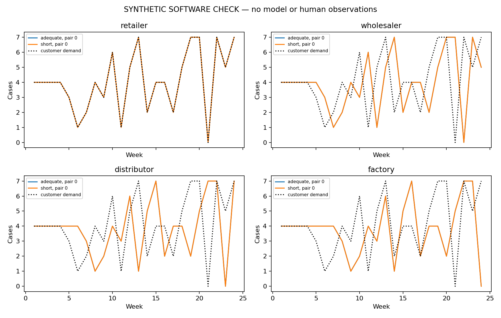

# Synthetic software example: no empirical findings

Run economy_offline_a6a67fe37918f5ba; status complete. Completed chains: 2; Synthetic orders: 160. Calibration passed: False; game computation separation passed: False. This run used deterministic synthetic responses; no model or human observations were collected.

## What happened to the hypotheses

Game costs in the outcome tables are simulated holding/backlog costs, separate from API spending.

| Outcome | Short | Adequate | Short - adequate | Observed direction |
| --- | --- | --- | --- | --- |
| Pipeline sensitivity (revised H1) | 0 | 0 | 0 | No observed difference |
| Full scored cost (H2) | 1085 | 1085 | 0 | No observed difference |
| Bullwhip (primary H3) | 0.902555 | 0.902555 | 0 | No observed difference |

Every chain-average customer-referenced variance ratio is below 1 in this run. A higher ratio between conditions is a relative difference in order variability; it does not demonstrate chain-average amplification above customer-demand variance. Individual local-demand ratios are reported separately in roles.csv.

A single pair cannot estimate between-pair uncertainty; its observed direction is neither confirmation nor disproof. Weekly calls and the four roles are not independent students. The full report retains all eligibility checks and any available confidence intervals and adjusted p-values.

Bullwhip is the mean of the four role order-variance/customer-demand-variance ratios over the 20 model weeks. Cost includes practice, model weeks and the 12-week automatic continuation. The revised H1 uses separate matched states with a 24-case pipeline difference; it does not identify the original dynamic beta.

## Completion, orders and actual computation

| Condition | Orders | Zero orders | Order range | Distinct quantities |
| --- | --- | --- | --- | --- |
| adequate | 80 | 4 | 0 to 7 | 8 |
| short | 80 | 4 | 0 to 7 | 8 |

| Condition | Median total tokens | Changed by revision | Zero despite empty stock/pipeline and backlog |
| --- | --- | --- | --- |
| adequate | 0 | 0 | 0 |
| short | 0 | 0 | 0 |

Median short/adequate generated-token ratio: None; the prespecified maximum was 0.75. Both initial and revision tokens count. Initial ceiling: 16,384; additional revision ceiling: 8,192. These are ceilings, not observed usage. Temperature is omitted identically; the common 900-second timeout is technical infrastructure.

Order zero remains a valid model choice. No preferred maximum, positive floor or artificial variation is imposed. Fallback orders recorded: 0. A completed game checks operation; it does not validate the profiles against actual students.

| condition | phase | cost |
| --- | --- | --- |
| adequate | automatic | 495.5 |
| adequate | model | 493.5 |
| adequate | practice | 96 |
| short | automatic | 495.5 |
| short | model | 493.5 |
| short | practice | 96 |

Across recorded chains, the short-minus-adequate cost difference is 0 during model weeks and 0 during automatic continuation (0 over all scored weeks).

The automatic continuation repeats the last order and is not LLM behavior. Compare its cost with the model-week cost before attributing the full-cost contrast to decisions throughout the game.

Original structural beta: 0/8 role fits pass the existing usability checks; 0 chains have four usable role fits. An unusable coefficient is not evidence about supply-line neglect. The complete diagnostics remain in beta_fits.csv and the full report.

## What was spent

| Stage | Estimated USD |
| --- | --- |
| calibration | 0 |
| game | 0 |
| probe | 0 |
| rules | 0 |

This Luna run: $0.00000000. Prior campaign spending: $0.00000000; combined campaign ledger: $0.00000000. These are conservative usage-based estimates including cache-write rates, not an invoice. They exclude taxes and unrelated account activity. The earlier $0.7198179 Mini calibration remains a separate failed-model screen.

Hard guards: $2.20 for this run, $0.18 for its fresh calibration, $2.95 for all redesign runs together, and $10 for the original campaign including the earlier $5.19360675 pilot. Completed evidence and report generation are free to reuse; no new calls are made by this summary.

## Run it yourself in Jupyter

Open notebooks/04_personality_deliberation_study.ipynb in the Beer Game (.venv) kernel. All paid flags default off. WATCH_RUNNING=True displays the background progress bar without buying calls. The Review results cell reads saved evidence without a key.

This run cannot supply passed live calibration. Use a compatible passed API calibration or perform fresh calibration within the spending guards.

Use a pair count divisible by four to balance profile-role assignments. The notebook power calculation requires a scientifically meaningful effect-size assumption; eight pairs is only the inference reporting floor. New replicate IDs create new API draws but the default seed repeats the same indexed demand paths. Do not pool incompatible horizons, models or protocols or count repeated demand paths as new demand scenarios.

## What this pilot can establish

Passing completion and computation checks establishes a usable experiment on configured LLM participants. Extra revision combines additional computation with reconsideration; it does not isolate information overload, a pure single-call token cap, or human time pressure. No student data exist, and persona fidelity remains unvalidated. Replication may produce a positive, null, opposite or inconclusive result. Preserve every result and do not retune for the desired direction.

Full analysis: REPORT.md / Economy_Study_Report.docx. Numerical tables: DETAILS.xlsx. Raw requests, exact prompts, usage and source snapshots: the source run under data/runs/. Design and primary literature: reports/revised_design_20261011/REPORT.md.

