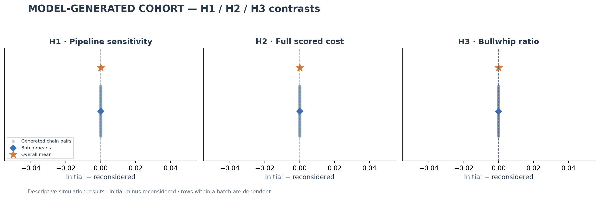
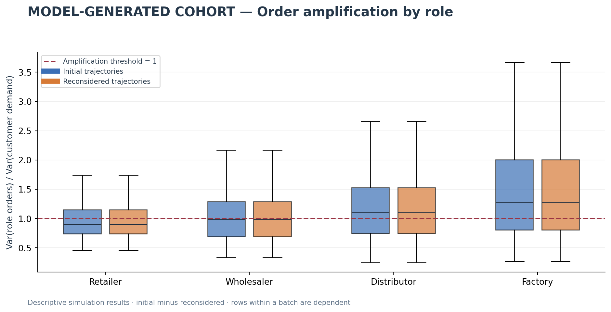
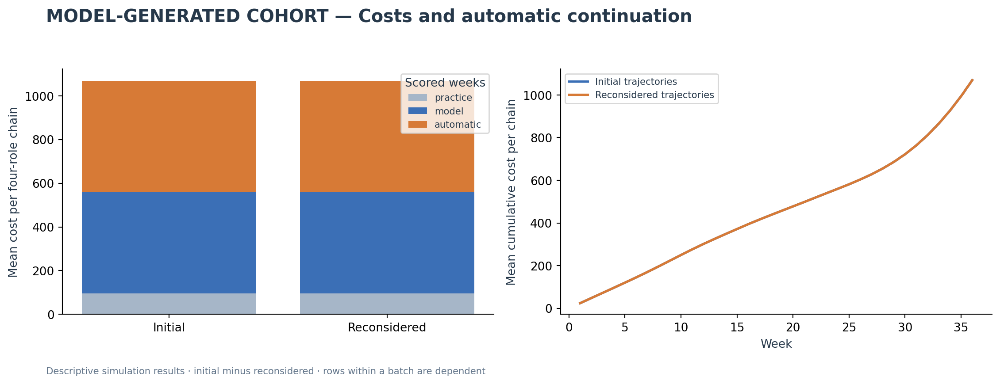

# Completed manual Beer Game study — 18 October 2026

**All 10 responses were collected successfully. Every revision reproduced its initial orders and probe choices. The study therefore found no initial-versus-revision difference; it did not establish a test of time pressure.**

The collection contains 500 fictional student identities in 125 four-role chains, generated in five batches. Each batch has an initial response and a reconsidered response. There are 10,000 weekly orders per pass, 20,000 across both passes. Across the 10,000 paired weekly choices and 1,000 paired individual probe choices, **zero changed**. These are model-generated identities, not 500 independently observed students.

## H1, H2 and H3

| Hypothesis as operationalized in this manual study | Initial | Reconsidered | Initial minus reconsidered | Finding |
| --- | ---: | ---: | ---: | --- |
| H1: lower pipeline sensitivity in initial choices | 0.670667 | 0.670667 | 0 | No observed difference |
| H2: higher full inventory/backlog cost in initial trajectories | 1,069.448 | 1,069.448 | 0 | No observed difference |
| H3: higher customer-referenced bullwhip in initial trajectories | 1.303496 | 1.303496 | 0 | No observed difference |

H1 is the mean matched-state sensitivity `(order with 8 dispatched cases − order with 32) / 24`. It is not the original fitted structural beta. H2 is the mean total simulated dollar cost per four-role chain across 36 scored weeks. H3 is the mean of the four role order/customer-demand sample-variance ratios during the 20 model weeks. Every contrast is defined for all 125 paired chains.

**None of the predicted contrasts appears in these outputs. This is neither evidence that real students are unaffected by time pressure nor an equivalence test showing a zero population effect.** The prompts requested initial decisions and whole-trajectory reconsideration. They did not impose or measure different time or token budgets. The revision prompt supplied the original answers, so anchoring/copying is a plausible explanation, but this dataset cannot distinguish it from deliberate retention or other causes. Identical final answers do not reveal whether any additional internal computation occurred.



## What the generated games do show

There is descriptive order amplification: the mean chain-average bullwhip ratio is 1.303496, and 66 of 125 chains have ratios above 1 in each pass. Average role ratios are 0.968608 for retailers, 1.089434 for wholesalers, 1.319401 for distributors and 1.836542 for factories. The upstream pattern is present in the generated data, but does not demonstrate that time pressure caused it or that the fictional students resemble actual UB students.



Orders span 0–40 cases; 2,063 of 10,000 orders are zero in each pass (20.63%). All 500 within-pass role trajectories are distinct, while each trajectory is identical to its counterpart across passes. No order was filled in, forced positive, clipped or substituted. A value of 40 is the observed maximum, not an imposed or preferred cap.

The mean full cost of 1,069.448 comprises 96.000 in four fixed practice weeks, 464.316 in 20 model weeks and 509.132 in 12 automatic continuation weeks. Continuation accounts for 47.61% of total cost. During continuation, customer demand and each role's orders remain at their respective final submitted values; these orders are imposed by the scoring rule, not additional model choices. All phase costs are identical across passes.



## What remains unresolved

The primary gap is the intervention, not simply a shortage of generated student rows. Both passes used the same user-reported GPT-6 / Pro setting, with unknown internal token use and duration. Generating more fictional students under the same design would not by itself establish a thinking-budget difference. Whole-trajectory generation also exposes the generator to future demand and all roles; the instructions cannot verify decentralized information use. Student personality prompts have no real-student validation here.

A new exploratory prompt-development exercise can investigate sensitivity to pressure framing. It must retain its attempts, remain separate from this completed sample, and use fresh held-out evaluation after choosing prompts. A prompt-responsive difference alone would not validate a human time-pressure mechanism. Do not choose or rewrite the completed outputs to obtain a difference. The original structural-beta hypothesis remains unresolved; the optional beta fit was not run or substituted for H1.

## Provenance and checks

The first response retains its original v1 study ID through hashed lineage. The GPT-6 / Pro settings amendment was documented after that first response arrived. Later settings follow the user's established workflow; external chat transmission, backend snapshots and actual token counts are not independently verified. Pro is not equated to API high effort. See the [settings amendment](../../docs/MANUAL_CHAT_SETTINGS_20261018.md).

Four accepted outputs are documented format-only derivatives: initial batches 4/5 and revision batches 1/2. Only three rule-answer value tokens in each were converted to Boolean/numeric JSON types. The original texts, rejected format attempts, exact transformations and all decisions remain preserved. Revisions 3/4/5 required no conversion. See the [formatting record](../../docs/MANUAL_FORMATTING_NOTE_20261018.md) and the disclosures in the full report.

The [completion audit](../software_checks/manual_chat_complete_20261018.json) executed all eight notebook code cells with API clients blocked, validated all ten accepted outputs, replayed 36,000 role-states, checked H1/H3 directly from submitted arrays and frozen demands, reconciled H2 with holding/backlog costs, and checked all nine workbook sheets plus six PNG/PDF figure pairs. All 89 current run files remained unchanged during analysis. The final attachment and all 84 previously present files were preserved during import. No new API calls or charges occurred.

No generated-student p-values or confidence intervals are reported. Five batch pairs are the collection structure; the generated chains within a response do not constitute independent human observations. Earlier partial analysis versions and all earlier API studies remain separate and preserved.

## Open and reproduce

- [Full report, all six plots and formatting disclosures](analysis/c429aab99c2b/REPORT.md)
- [Excel results and underlying replayed data](analysis/c429aab99c2b/RESULTS.xlsx)
- [Every order trajectory](analysis/c429aab99c2b/order_heatmap.png)
- [Final response receipt](BATCH_05_REVISION_RECEIPT.md)
- [Notebook 06](../../notebooks/06_manual_cohort_simulation.ipynb): leave the current plan selected and choose **Run All**. Progress will show 10/10, no further prompt will be requested, and the chain selector offers all 125 chains.

From `D:\beergame`, reproduce the completed notebook/export audit without a key:

```powershell
.\.venv\Scripts\python.exe -X utf8 scripts/check_manual_chat_completion.py
```

The dated checker requires this completed run to remain the latest manual selection. It regenerates reports, never edits accepted responses, and does not start another study.
