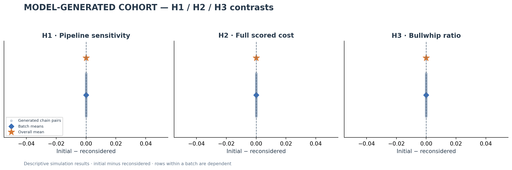
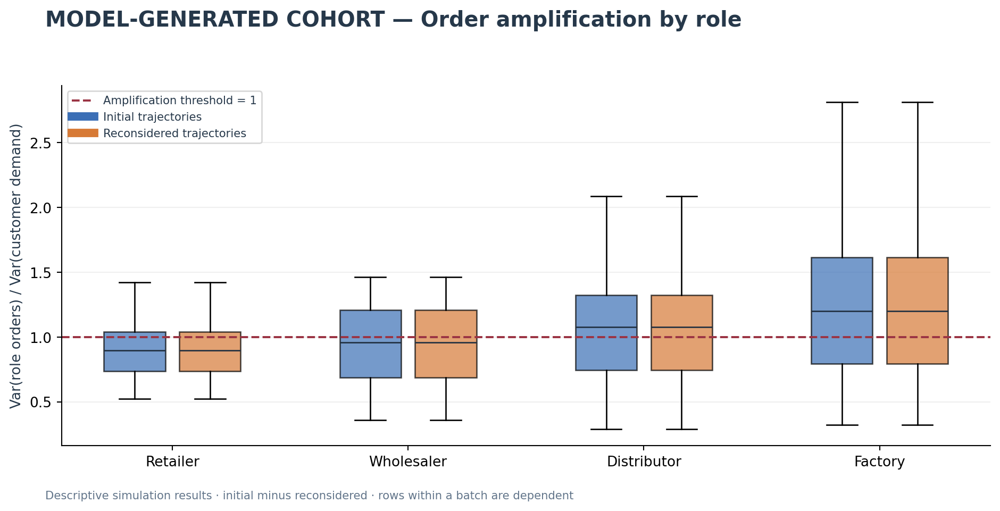
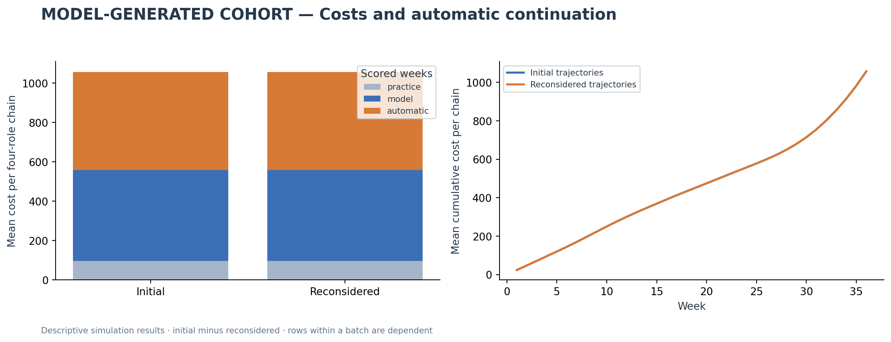
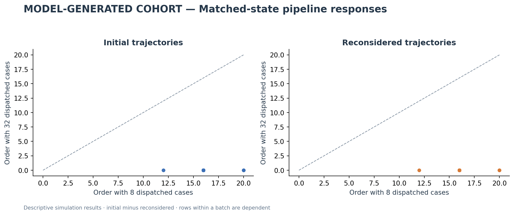
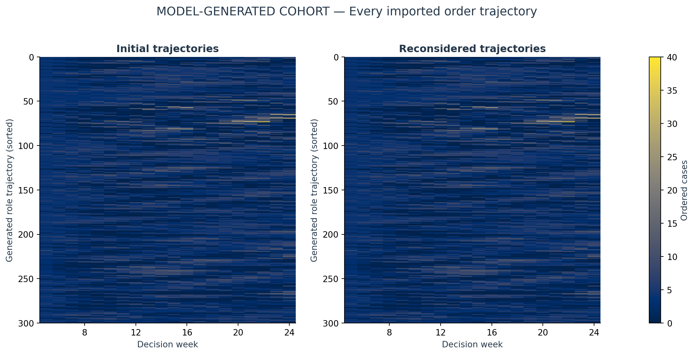
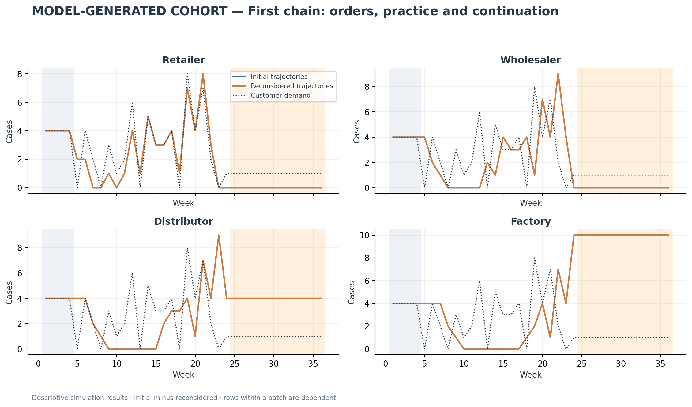

# Manual cohort comparison

Status: **partial / awaiting pasted responses**. 8/10 responses accepted; 3/5 batches have both passes.

Planned fictional identities: **500**; condition-specific role trajectories: **1,000**. Model label recorded by the operator: **GPT-6**, UI setting **pro** (user-reported; provider snapshot unverified).

Generated fictional cohorts; no human observations. These are descriptive contrasts, not tests of per-decision token pressure or independent students. Whole trajectories from the same response share a generator. No inferential p-values or confidence intervals are assigned to the generated student rows.

## H1, H2 and H3

| hypothesis | initial | revision | initial_minus_revision | defined_chain_pairs | direction |
| --- | --- | --- | --- | --- | --- |
| H1 | 0.67333 | 0.67333 | 0 | 75 | no mean difference |
| H2 | 1057.4 | 1057.4 | 0 | 75 | no mean difference |
| H3 | 1.2573 | 1.2573 | 0 | 75 | no mean difference |

H1 is the matched-state sensitivity proxy: (order with 8 dispatched cases − order with 32)/24. H2 sums holding/backlog costs over practice, model and 12 continuation weeks. H3 averages the four role order/customer-demand sample-variance ratios during model weeks. A zero customer-demand variance makes H3 undefined; it is never replaced by zero. The original structural beta is separate and optional.

A predicted direction describes this generated dataset. It does not verify the student-time hypothesis. An opposite direction does not disprove that hypothesis. No actual per-student reasoning tokens or wall-clock budgets were observed. The generator sees the horizon and future demand paths; prompt instructions cannot prove decentralized information use.

## Completion and data quality

| batch_id | repetition | students | initial | revision |
| --- | --- | --- | --- | --- |
| b0001 | 1 | 100 | True | True |
| b0002 | 1 | 100 | True | True |
| b0003 | 1 | 100 | True | True |
| b0004 | 1 | 100 | True | False |
| b0005 | 1 | 100 | True | False |

| condition | weekly_orders | zero_fraction | largest_order | distinct_role_trajectories | total_role_trajectories | duplicate_trajectory_fraction |
| --- | --- | --- | --- | --- | --- | --- |
| initial | 6000 | 0.21417 | 40 | 300 | 300 | 0 |
| revision | 6000 | 0.21417 | 40 | 300 | 300 | 0 |

Only batches with both accepted passes enter paired comparisons. Missing outputs remain missing; no order is filled in or clipped. Rejected raw responses are retained. Identical paths and valid zero orders are reported, not removed. A correct rules answer and successful physical replay validate format and accounting, not human behavior or the model’s internal state tracking.

**Settings amendment, 18 October 2026:** the first response arrived before the displayed GPT-6 / Pro settings were documented. Its exact earlier prompt and unchanged response were carried into this separate protocol with hashes and the original study ID preserved. Subsequent prompts use this new run ID. Pro is not asserted to equal API high effort. See [amendment](../../../../docs/MANUAL_CHAT_SETTINGS_20261018.md).

Tables: [RESULTS.xlsx](RESULTS.xlsx); figures are available as PNG and PDF.

## Response formatting provenance

- **b0001 revision:** 3 rule-answer JSON types were converted mechanically after receipt. The original response is retained as a rejected format attempt; the accepted text is an explicitly documented derivative. All orders, probes and other text are unchanged. No model retry or additional deliberation occurred.
- **b0002 revision:** 3 rule-answer JSON types were converted mechanically after receipt. The original response is retained as a rejected format attempt; the accepted text is an explicitly documented derivative. All orders, probes and other text are unchanged. No model retry or additional deliberation occurred.
- **b0004 initial:** 3 rule-answer JSON types were converted mechanically after receipt. The original response is retained as a rejected format attempt; the accepted text is an explicitly documented derivative. All orders, probes and other text are unchanged. No model retry or additional deliberation occurred.
- **b0005 initial:** 3 rule-answer JSON types were converted mechanically after receipt. The original response is retained as a rejected format attempt; the accepted text is an explicitly documented derivative. All orders, probes and other text are unchanged. No model retry or additional deliberation occurred.

This format-only exception was documented after receiving the affected response. It preserves the supplied answer meanings, without substituting correct answers. Original/derived files, hashes and the exact edits are recorded under the run’s `normalization/` directory. It is not another model generation.
