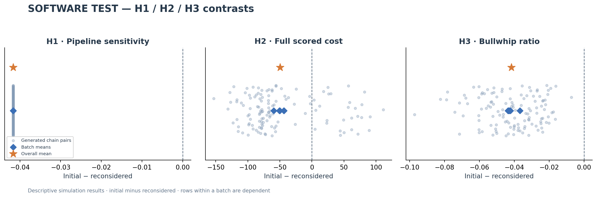
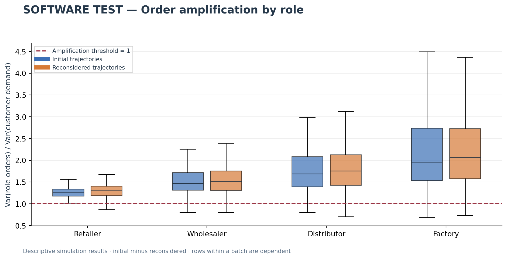
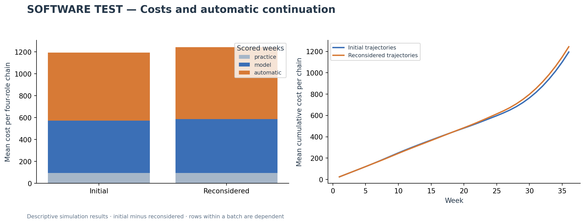
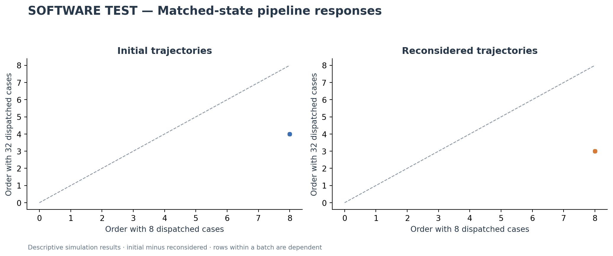
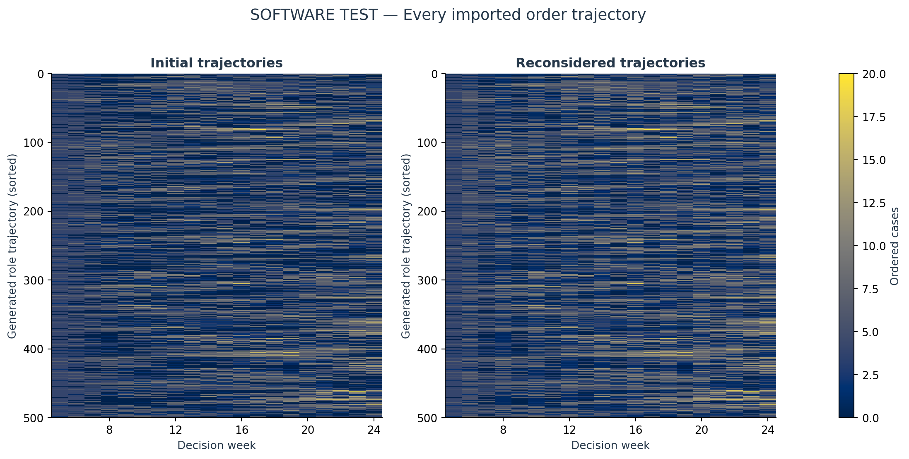
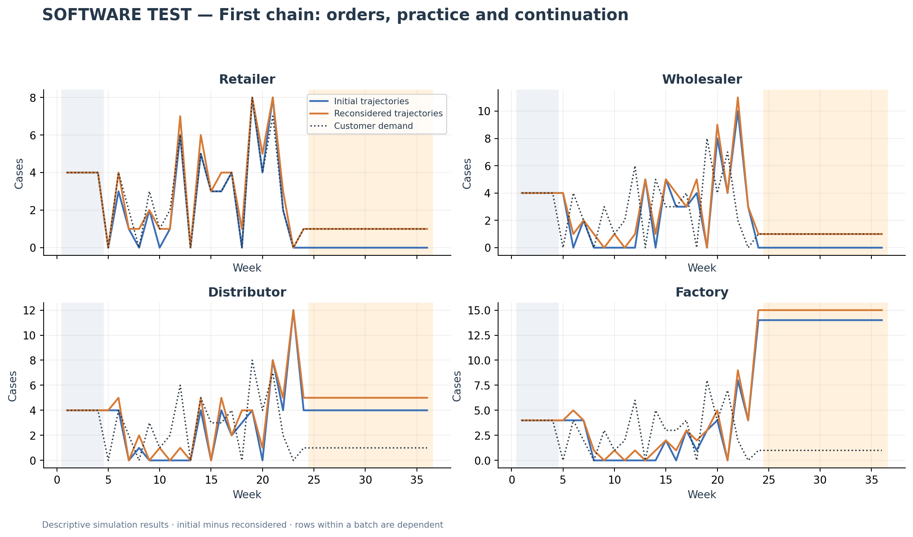

# SOFTWARE TEST: Manual cohort comparison

Status: **complete**. 10/10 responses accepted; 5/5 batches have both passes.

Planned fictional identities: **500**; condition-specific role trajectories: **1,000**. Model label recorded by the operator: **GPT-6 Astra**, effort **high**.

Generated fictional cohorts; no human observations. These are descriptive contrasts, not tests of per-decision token pressure or independent students. Whole trajectories from the same response share a generator. No inferential p-values or confidence intervals are assigned to the generated student rows.

## H1, H2 and H3

| hypothesis | initial | revision | initial_minus_revision | defined_chain_pairs | direction |
| --- | --- | --- | --- | --- | --- |
| H1 | 0.16667 | 0.20833 | -0.041667 | 125 | predicted direction |
| H2 | 1194.8 | 1244.3 | -49.48 | 125 | opposite direction |
| H3 | 1.6863 | 1.7279 | -0.041667 | 125 | opposite direction |

H1 is the matched-state sensitivity proxy: (order with 8 dispatched cases − order with 32)/24. H2 sums holding/backlog costs over practice, model and 12 continuation weeks. H3 averages the four role order/customer-demand sample-variance ratios during model weeks. A zero customer-demand variance makes H3 undefined; it is never replaced by zero. The original structural beta is separate and optional.

A predicted direction describes this generated dataset. It does not verify the student-time hypothesis. An opposite direction does not disprove that hypothesis. No actual per-student reasoning tokens or wall-clock budgets were observed. The generator sees the horizon and future demand paths; prompt instructions cannot prove decentralized information use.

## Completion and data quality

| batch_id | repetition | students | initial | revision |
| --- | --- | --- | --- | --- |
| b0001 | 1 | 100 | True | True |
| b0002 | 1 | 100 | True | True |
| b0003 | 1 | 100 | True | True |
| b0004 | 1 | 100 | True | True |
| b0005 | 1 | 100 | True | True |

| condition | weekly_orders | zero_fraction | largest_order | distinct_role_trajectories | total_role_trajectories | duplicate_trajectory_fraction |
| --- | --- | --- | --- | --- | --- | --- |
| initial | 10000 | 0.2639 | 20 | 500 | 500 | 0 |
| revision | 10000 | 0.1278 | 20 | 500 | 500 | 0 |

Only batches with both accepted passes enter paired comparisons. Missing outputs remain missing; no order is filled in or clipped. Rejected raw responses are retained. Identical paths and valid zero orders are reported, not removed. A correct rules answer and successful physical replay validate format and accounting, not human behavior or the model’s internal state tracking.

Tables: [RESULTS.xlsx](RESULTS.xlsx); figures are available as PNG and PDF.
