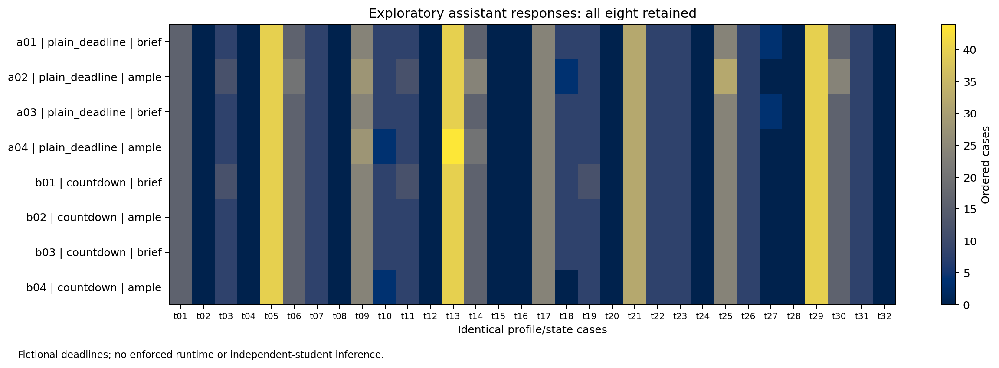

# Prompt self-tests completed — 18 October 2026

**The isolated tests produced different orders under the two deadline descriptions, including on held-out states. The plain-deadline prompt is a candidate for further testing, but these results do not establish a stable time-pressure effect.**

At the user's request, twelve fresh assistant instances completed these tasks: eight development responses and four held-out responses. Each instance received only its assigned prompt and instructions to return its own choices; no parent conversation, competing-condition answers or desired hypothesis direction was supplied. All twelve responses are retained. No external API calls were made. The inherited assistant backend and effort were kept consistent by using no model overrides, but equivalence to the user's GPT-6 / Pro website selection is unverified.

## What changed in the prompts

Both conditions portray the same hypothetical second-year UB business students, with the same four personality descriptions, game rules and decision states. Each is a separate generation, with no original answers to revise. The plain condition wording is:

**Brief deadline**

```text
The student has 10 seconds from seeing each decision display to submitting its order. The order is final when submitted. Represent the choice the described student would make within that deadline.
```

**Ample deadline**

```text
The student has 180 seconds from seeing each decision display to submitting its order. The order is final when submitted. Represent the choice the described student would make within that deadline.
```

The full prompts explicitly identify these as fictional classroom deadlines. They do not instruct the student to ignore the pipeline, make mistakes, order more, use a particular formula, or behave differently from another condition. Ten and 180 seconds were illustrative development values, not estimates of an appropriate real-student or model deadline.

Full copyable prompts: [brief](PLAIN_DEADLINE_BRIEF.md) and [ample](PLAIN_DEADLINE_AMPLE.md). These contain 32 static choices, not a full game. Do not import their responses into the completed notebook 06 study.

## Every comparison

Each comparison below contains the same 32 profile/state cases. Repetition numbers define the saved pairing; these are not independent student samples.

| Prompt / input set | Comparison | Orders that differed | Mean absolute order difference |
| --- | --- | ---: | ---: |
| Plain deadline, development | Brief vs ample, repetition 1 | 9/32 | 1.50000 |
| Plain deadline, development | Brief vs ample, repetition 2 | 5/32 | 0.62500 |
| Plain deadline, development | Repeat brief condition | 0/32 | 0.00000 |
| Plain deadline, development | Repeat ample condition | 9/32 | 1.37500 |
| Countdown wording, development | Brief vs ample, repetition 1 | 3/32 | 0.37500 |
| Countdown wording, development | Brief vs ample, repetition 2 | 2/32 | 0.37500 |
| Countdown wording, development | Repeat brief condition | 3/32 | 0.37500 |
| Countdown wording, development | Repeat ample condition | 2/32 | 0.37500 |
| Plain deadline, held-out states | Brief vs ample, repetition 1 | 15/32 | 0.96875 |
| Plain deadline, held-out states | Brief vs ample, repetition 2 | 5/32 | 0.31250 |
| Plain deadline, held-out states | Repeat brief condition | 3/32 | 0.15625 |
| Plain deadline, held-out states | Repeat ample condition | 13/32 | 0.62500 |

The plain-deadline held-out comparisons both have lower mean orders in the brief scenario: signed brief-minus-ample differences are -0.96875 and -0.31250 cases. Those differences are observations, not evidence that the brief condition should always order less or that costs/bullwhip improve. Repeated ample responses vary substantially, so the between-condition changes cannot confidently be attributed to deadline wording alone with only two repetitions per condition.

For a concrete example, held-out case `t01` returned **12 under the brief deadline in both repetitions, versus 14 under the ample deadline in both repetitions**. For `t08`, the brief responses were 0 and 0; the ample responses were 4 and 2. These are illustrative rows selected after the results; the complete table and all responses remain available.

The countdown candidate's between-condition variation was no greater than its corresponding repeat-condition variation in these comparisons. It offers no clear advantage from this screen.



## Selection, limitations and next use

The plain-deadline candidate was selected for the held-out check after the first development results were visible, because it was the simpler wording. It was not prospectively selected before development. Its exact instruction text was then frozen; four new responses used new states, balances, demand histories and delivery quantities. The held-out plan was saved before those four responses. No trials were dropped or repeated to replace a result, and collection stopped at the stated eight development plus four held-out responses.

This exercise answers the user's prompt-development question: these standalone scenario prompts produced differing assistant answers. It does **not** show that the model actually had less computation, that the deadlines caused a stable effect, that the fictional participants match real students, or that a full-game H1/H2/H3 result will be conclusive. Recognizing the deadline in the output is an instruction check, not a measurement of experienced pressure. Differences among static orders cannot establish full-game H2 cost or H3 bullwhip effects.

The next defensible use is a separately frozen, small full-game pilot with independent deadline conditions, chronological state updates, fixed profiles and matched exogenous demand paths. The conditions must not see one another's decisions. Keep within-condition repeats and require format/completion checks; do not use a favorable H1/H2/H3 sign as an acceptance rule. A prompt-only study should be labeled **deadline-framed student simulation**. An actual computational-budget study needs enforced and measured generation resources.

The completed 500-identity initial/revision study remains unchanged, with all zero contrasts preserved. [Its final report](../manual_cohort_975b76e63e5b4882/FINDINGS.md).

## Exact evidence and reproduction

- [All eight development responses and prompt links](TRANSCRIPTS.md)
- [All four held-out responses](holdout/TRANSCRIPTS.md), with [brief](holdout/BRIEF.md) and [ample](holdout/AMPLE.md) prompts
- [Excel choices and comparisons](DEVELOPMENT_RESULTS.xlsx)
- [Development checks](CHECKS.json) and [held-out checks](holdout/CHECKS.json)
- [Initial development plan](PLAN.json) and [held-out plan](holdout/PLAN.json)

Raw replies and immutable prompt snapshots are under `data/development/pressure_prompt_development_20261018/`. Exact agent invocation instructions and the inherited-model limitation are also recorded there. The initial plan's `prepared_no_model_responses` status describes its preparation time; the checks and this findings document record the completed status.

All 384 submitted integers passed schema/ID/completeness checks across twelve responses. Prompt hashes, unchanged held-out wording, and raw-file preservation were checked. The count of 384 is output size, not a sample of independent people. The analysis contains no p-values or confidence intervals.

From `D:\beergame`, regenerate the tables, transcripts, workbook and plot without calling a model:

```powershell
.\.venv\Scripts\python.exe -X utf8 scripts/analyze_pressure_prompt_pilot.py
```
