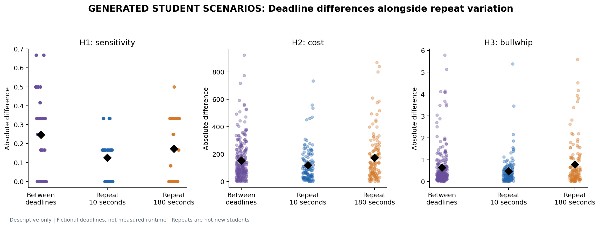

# Beer Game deadline study — final report

**18 October 2026 — all 20 planned responses are saved. No more prompts are needed for this study.**

The model portrayed 500 fictional second-year UB business students in 125 teams. Each team appeared under a 10-second and a 180-second deadline scenario, with both scenarios generated twice. We collected 40,000 weekly orders using the established, user-reported GPT-6 / Pro setting. Every response passed unchanged.

## Hypothesis results

| Hypothesis | 10-second mean | 180-second mean | Finding in these outputs |
| --- | ---: | ---: | --- |
| H1: less sensitivity to incoming stock | 0.5800 | 0.8017 | Predicted direction in both rounds |
| H2: higher team cost | 1,038.968 | 1,071.472 | Opposite direction in both rounds |
| H3: higher bullwhip | 1.2344 | 1.3920 | Opposite overall; direction changed between rounds |

H1 is a separate two-question sensitivity measure, not the original structural beta. H2 includes the automatic scoring continuation. H3 measures order variance relative to customer-demand variance during model-decision weeks.

**H1 shows the clearest descriptive pattern. The predicted increases in cost and bullwhip are not supported by the overall averages.** This does not establish a causal effect of real time pressure.

## What the repeats revealed

The table below shows **10-second minus 180-second** means. H1 predicts a negative value; H2 and H3 predict positive values.

| Outcome | First round | Second round | Both rounds |
| --- | ---: | ---: | ---: |
| H1 | -0.2733 | -0.1700 | -0.2217 |
| H2 | -8.448 | -56.560 | -32.504 |
| H3 | +0.0618 | -0.3770 | -0.1576 |

The first-round suggestion of higher bullwhip did **not** repeat. Across the ten batch comparisons, H1 follows its prediction eight times, opposes it once and is tied once. H3 splits five in each direction. These are descriptive counts, not independent statistical tests.

**Changing the deadline changed 49.78% of paired orders. Repeating the same deadline changed 47.09% under 10 seconds and 51.87% under 180 seconds.** Ordinary generation variation is therefore substantial; different answers alone are not evidence of pressure. H1's mean absolute between-deadline difference is 0.247, compared with repeat differences of 0.125 and 0.173; this is descriptive, not a significance test.

About **98% of the overall cost difference** comes from the 12 automatic continuation weeks. During the actual model-decision weeks, mean costs differ by only -0.698. The continuation follows the frozen scoring rule; it is not additional model behavior.

## What this study can conclude

These generated cohorts show lower pipeline sensitivity under the brief-deadline wording on average, but no consistent increase in bullwhip and no average increase in cost. The repeats materially changed the interpretation of H3.

The deadlines were written scenarios, not enforced model thinking time. The personas were not validated against real students. Whole-batch generation exposes the generator to all roles and future demand. Model/mode and separate-chat use were not independently verified. The 500 identities and their repeated trajectories are not independent human observations; no student-level p-values are reported. The fixed collection is complete and should be preserved, regardless of the direction of its results.

## Plots

All six figures are copied without alteration from the completed analysis. Dots and repeated trajectories are generated observations, not independent human samples.

### 1. H1, H2 and H3

Lines join the same team and generation across deadlines; black diamonds show means.

[Download PDF](plots/hypothesis_levels.pdf).

### 2. Deadline differences versus ordinary repeat variation

Absolute differences have no direction. Black diamonds show means, not significance tests.

[Download PDF](plots/effect_and_repeat_variation.pdf).

### 3. Bullwhip by supply-chain role

A ratio above 1 means orders vary more than customer demand.

[Download PDF](plots/bullwhip_by_role.pdf).

### 4. Where costs come from

Practice and automatic continuation are scoring-rule actions; only the model phase contains submitted decisions.

[Download PDF](plots/cost_phases.pdf).

### 5. One team across both deadlines and rounds

This is the first team in the fixed plan, not an example selected for its results.

[Download PDF](plots/example_chain.pdf).

### 6. Every submitted weekly order

Each row is a role trajectory; the two panels use the same color scale.

[Download PDF](plots/all_orders.pdf).

[Exact prompts](EXACT_PROMPTS.md) · [Extracted results and field guide](results/README.md) · [Excel workbook](results/RESULTS.xlsx).
