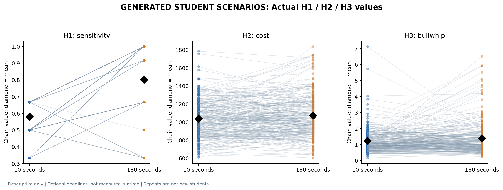
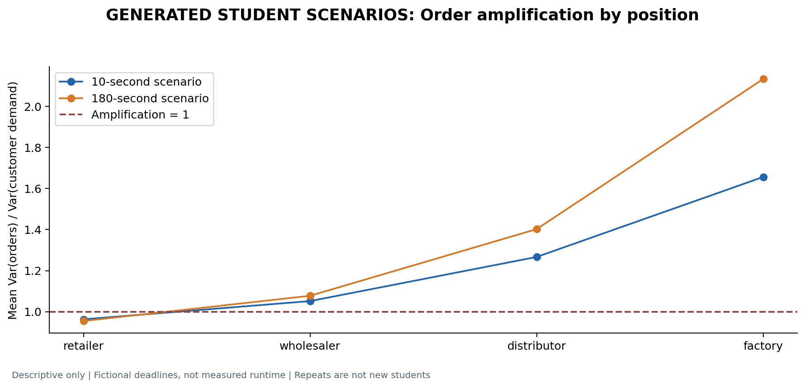
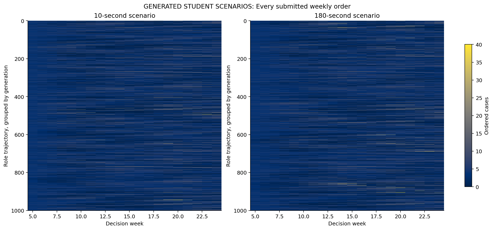
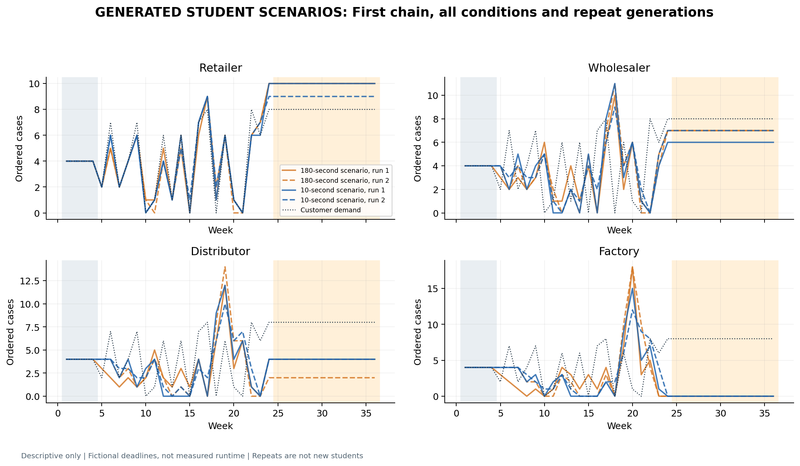

# Deadline-framed Beer Game study

Status: **complete**; 20/20 responses accepted.

**500 fictional identities**, 125 chains, 2 repeated generations per deadline. Repeats reuse the same identities, profiles and demand paths. Model label: **GPT-6 / pro**; collection: chat_ui. Backend equivalence to other studies is unverified.

The manipulation is a fictional 10-second versus 180-second student deadline. No actual per-decision model token budget, runtime or experienced pressure is measured. Conditions are generated independently without earlier answers. Whole trajectories still expose the generator to future demand and all roles; decentralized information use is not verified. No human observations, independent-student tests or inferential p-values are reported.

## H1 / H2 / H3

| hypothesis | metric | brief | ample | brief_minus_ample | defined_chain_generation_pairs | direction |
| --- | --- | --- | --- | --- | --- | --- |
| H1 | sensitivity | 0.58 | 0.801667 | -0.221667 | 250 | predicted direction |
| H2 | cost | 1038.97 | 1071.47 | -32.504 | 250 | opposite direction |
| H3 | bullwhip | 1.23442 | 1.39205 | -0.15763 | 250 | opposite direction |

H1 = (probe order with 8 dispatched cases minus order with 32) / 24, averaged across roles. It is not the original structural beta. H2 = full chain cost, including four practice and twelve automatic continuation weeks. H3 = mean of four role order/customer-demand sample-variance ratios during model weeks. Zero demand variance makes the ratio undefined. Contrasts use only matched chain/generation pairs; a predicted direction describes these outputs and does not confirm a human-time hypothesis.

## How many orders changed?

| kind | batch_id | generation | condition | choices | changed | changed_fraction | mean_absolute_change |
| --- | --- | --- | --- | --- | --- | --- | --- |
| between_deadlines | b0001 | 1 | brief minus ample | 2000 | 970 | 0.485 | 0.9195 |
| between_deadlines | b0001 | 2 | brief minus ample | 2000 | 1083 | 0.5415 | 1.002 |
| between_deadlines | b0002 | 1 | brief minus ample | 2000 | 871 | 0.4355 | 0.775 |
| between_deadlines | b0002 | 2 | brief minus ample | 2000 | 1007 | 0.5035 | 1.0265 |
| between_deadlines | b0003 | 1 | brief minus ample | 2000 | 877 | 0.4385 | 0.651 |
| between_deadlines | b0003 | 2 | brief minus ample | 2000 | 943 | 0.4715 | 0.7045 |
| between_deadlines | b0004 | 1 | brief minus ample | 2000 | 906 | 0.453 | 0.7165 |
| between_deadlines | b0004 | 2 | brief minus ample | 2000 | 1284 | 0.642 | 1.4195 |
| between_deadlines | b0005 | 1 | brief minus ample | 2000 | 1047 | 0.5235 | 1.142 |
| between_deadlines | b0005 | 2 | brief minus ample | 2000 | 968 | 0.484 | 0.82 |
| repeat_same_deadline | b0001 | 1-2 | ample | 2000 | 950 | 0.475 | 0.8355 |
| repeat_same_deadline | b0001 | 1-2 | brief | 2000 | 1040 | 0.52 | 0.863 |
| repeat_same_deadline | b0002 | 1-2 | ample | 2000 | 957 | 0.4785 | 0.9785 |
| repeat_same_deadline | b0002 | 1-2 | brief | 2000 | 819 | 0.4095 | 0.682 |
| repeat_same_deadline | b0003 | 1-2 | ample | 2000 | 970 | 0.485 | 0.7175 |
| repeat_same_deadline | b0003 | 1-2 | brief | 2000 | 792 | 0.396 | 0.578 |
| repeat_same_deadline | b0004 | 1-2 | ample | 2000 | 1167 | 0.5835 | 1.3335 |
| repeat_same_deadline | b0004 | 1-2 | brief | 2000 | 1032 | 0.516 | 0.7875 |
| repeat_same_deadline | b0005 | 1-2 | ample | 2000 | 1143 | 0.5715 | 1.0285 |
| repeat_same_deadline | b0005 | 1-2 | brief | 2000 | 1026 | 0.513 | 1.0075 |

Within-condition repeat changes are shown alongside deadline changes. Different orders alone do not prove a pressure mechanism. Repeat generations and rows within a response are dependent generated data, not new students.

## Data quality

| condition | generation | orders | zeros | zero_fraction | largest_order | distinct_role_paths | role_paths |
| --- | --- | --- | --- | --- | --- | --- | --- |
| ample | 1 | 10000 | 1820 | 0.182 | 32 | 500 | 500 |
| ample | 2 | 10000 | 2238 | 0.2238 | 40 | 500 | 500 |
| brief | 1 | 10000 | 2120 | 0.212 | 36 | 500 | 500 |
| brief | 2 | 10000 | 1874 | 0.1874 | 40 | 500 | 500 |

No missing decisions are filled in, no order is clipped and no valid zero is removed. Automatic continuation holds each role at its own final submitted order and demand at its final value; these are scoring-rule actions, not new model decisions.

## Provenance and completion

| task_id | batch_id | generation | condition | students | accepted |
| --- | --- | --- | --- | --- | --- |
| b0001_g01_brief | b0001 | 1 | brief | 100 | True |
| b0001_g01_ample | b0001 | 1 | ample | 100 | True |
| b0002_g01_ample | b0002 | 1 | ample | 100 | True |
| b0002_g01_brief | b0002 | 1 | brief | 100 | True |
| b0003_g01_brief | b0003 | 1 | brief | 100 | True |
| b0003_g01_ample | b0003 | 1 | ample | 100 | True |
| b0004_g01_ample | b0004 | 1 | ample | 100 | True |
| b0004_g01_brief | b0004 | 1 | brief | 100 | True |
| b0005_g01_brief | b0005 | 1 | brief | 100 | True |
| b0005_g01_ample | b0005 | 1 | ample | 100 | True |
| b0001_g02_ample | b0001 | 2 | ample | 100 | True |
| b0001_g02_brief | b0001 | 2 | brief | 100 | True |
| b0002_g02_brief | b0002 | 2 | brief | 100 | True |
| b0002_g02_ample | b0002 | 2 | ample | 100 | True |
| b0003_g02_ample | b0003 | 2 | ample | 100 | True |
| b0003_g02_brief | b0003 | 2 | brief | 100 | True |
| b0004_g02_brief | b0004 | 2 | brief | 100 | True |
| b0004_g02_ample | b0004 | 2 | ample | 100 | True |
| b0005_g02_ample | b0005 | 2 | ample | 100 | True |
| b0005_g02_brief | b0005 | 2 | brief | 100 | True |

Exact prompts, raw responses, settings, plan and source snapshots are preserved in the run. Mechanical conversion of unambiguous rule-answer JSON types is allowed prospectively, with original and derived text retained. No incorrect answer or order is corrected.

[Excel tables and replayed data](RESULTS.xlsx). All six figures are available as PNG/PDF.

[Protocol and limitations](../../../../docs/DEADLINE_COHORT_PROTOCOL_20261018.md). The previous initial/revision study is preserved separately. No response replacement or sample extension based on outcomes is permitted.
