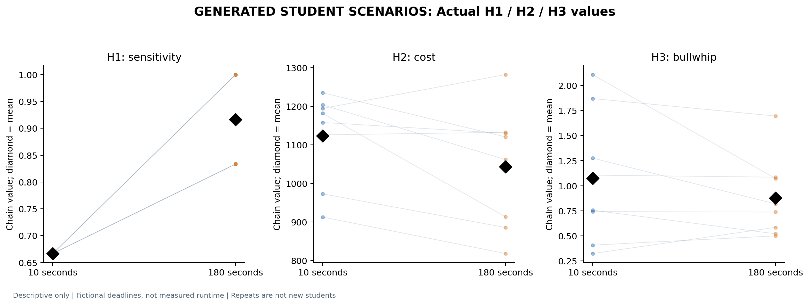
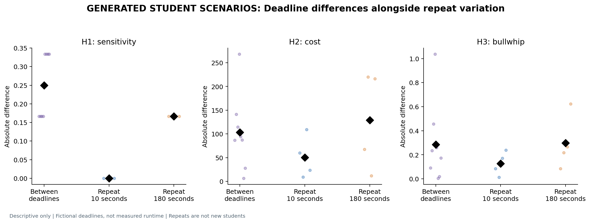

# Deadline prompt rerun: completed assistant pilot

**18 October 2026. The new prompts produced different complete game trajectories.** All four planned responses were accepted on their first attempt, without formatting conversion, replacement or decision edits. The earlier study remains unchanged.

This pilot used 16 fictional student identities in four chains, with two separate generations per deadline. Each trajectory has four practice weeks, 20 model-decision weeks and 12 automatic scoring weeks. The two scenarios describe students deciding within 10 seconds or 180 seconds; neither response sees the other condition or earlier decisions. The pilot used isolated assistant instances with inherited settings, without external API calls. Its backend is not verified equivalent to the user's website GPT-6 / Pro selection.

## H1, H2 and H3

Means across eight matched chain-generation pairs:

| Outcome | 10-second scenario | 180-second scenario | Brief minus ample | Descriptive result |
| --- | ---: | ---: | ---: | --- |
| H1: pipeline sensitivity | 0.666667 | 0.916667 | -0.250000 | Predicted direction in both generations |
| H2: full chain cost | 1,123.0625 | 1,043.1250 | +79.9375 | Predicted direction in both generations; magnitude varies |
| H3: bullwhip ratio | 1.073261 | 0.876485 | +0.196776 | Predicted direction on average; reverses in generation 2 |

H1 is the separate matched-state probe slope, not the original structural beta. H2 includes the fixed scoring continuation. H3 is the mean role order/customer-demand variance ratio during the 20 model-decision weeks. [Exact definitions, all tables and six figures](analysis/b9f38e169709/REPORT.md) · [Excel workbook](analysis/b9f38e169709/RESULTS.xlsx).

The results demonstrate a usable, non-identical scenario comparison. They do **not yet establish a stable deadline effect**: repeated generations under the same deadline also vary, and H3 does not retain its direction across the two generations. Fictional deadline wording does not enforce model thinking time or validate student behavior.

## Repeat check

| Comparison | Generation 1 | Generation 2 |
| --- | ---: | ---: |
| H1: brief minus ample | -0.166667 | -0.333333 |
| H2: brief minus ample | +152.750 | +7.125 |
| H3: brief minus ample | +0.409117 | -0.015565 |
| Weekly orders changed between deadlines | 166/320 (51.9%) | 147/320 (45.9%) |

Across both comparisons, **313/640 paired orders changed (48.9%)**. Repeating the same deadline changed 137/320 orders for the brief scenario (42.8%) and 163/320 for the ample scenario (50.9%). Thus, the frequency of changed orders alone does not distinguish deadline framing from generation variation.

Mean absolute chain-level H2/H3 differences between deadlines were 103.44 and 0.2851. Repeating the ample deadline produced 129.00 and 0.2978 respectively; repeating the brief deadline produced 50.38 and 0.1269. No generated-student p-values or confidence intervals are used.

## Cost and behavior checks

The mean full-cost difference is +79.9375. Only +15.0000 arises during the model-decision weeks; +64.9375 arises during the automatic continuation, and practice costs are equal. The continuation therefore contributes about 81% of the difference. It is a fixed scoring rule, not another 12 weeks of model decisions.

All 1,280 weekly orders were supplied. Orders range from 0 to 17; 151 orders are zero (11.8%). Every response has 16 distinct role trajectories. No missing game was filled, and no order floor or preferred maximum was introduced.

Each response nevertheless gives identical probe answers across all 16 identities: [16, 0] in both brief generations, [20, 0] in ample generation 1, and [24, 0] in ample generation 2. The personality prompts therefore produced no within-response probe heterogeneity. These identities cannot be treated as independent students or as validated personality effects.

## Evidence and checks

Exact prompts and invocation messages, source snapshots, original responses, accepted payloads and hashes are preserved under `data/runs/deadline_cohort_8ec04e524ad81927/`. [Prompt index](PROMPTS.md). The sample is complete at four responses; it was not extended or selectively regenerated after seeing results.

- [Independent audit](../software_checks/deadline_cohort_8ec04e524ad81927_audit.json): H1/H3 recomputed directly from saved arrays, every holding/backlog cost reconciled, 2,304 role-states replayed, 10 workbook sheets and six PNG/PDF figure pairs checked, all 34 raw files unchanged.
- [Notebook check](../software_checks/deadline_cohort_8ec04e524ad81927_notebook.json): all eight cells passed with API clients blocked, including the three outcomes, six plots and four interactive chains.
- [Offline tests](../software_checks/deadline_tests_20261018.json): 11 controls passed, covering immutable acceptance, strict validation, repeat identity counting and null/nonzero outcomes.
- [500-identity software check](../software_checks/deadline_scale_20261018.json): 20 explicitly synthetic replies, 40,000 orders and 72,000 role-states processed. This is a software test, not model evidence.
- [Preservation check](../software_checks/deadline_prior_evidence_verified_20261018.json): all 12,980 earlier raw evidence files and the original manual report selection retained.

## Start the separate 500-identity website collection

The GPT-6 / Pro collection is prepared at **0/20 replies**. It is not part of this completed pilot and will be reported separately. [Three simple steps and the first prompt](../deadline_cohort_2800524c9b2e0729/START_HERE.md) · [Notebook 07](../../notebooks/07_deadline_cohort_rerun.ipynb).

Use the frozen prompts unchanged and retain all valid replies, whatever their direction. The 500 fictional identities share 20 generated cohort responses, rather than supplying 500 independent human observations. More generated rows do not resolve that limitation.
