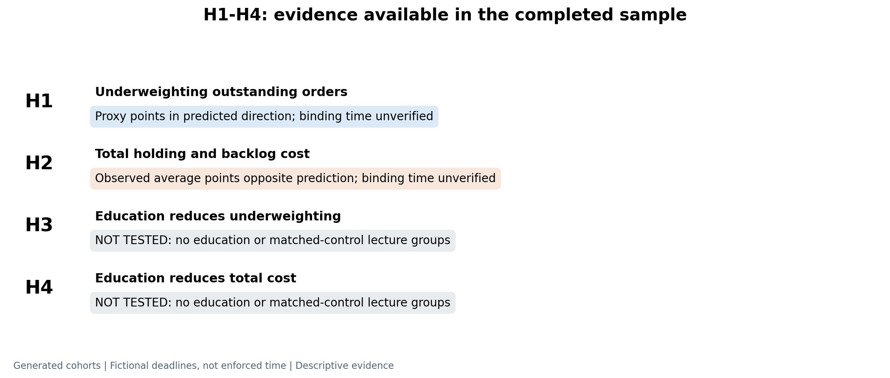
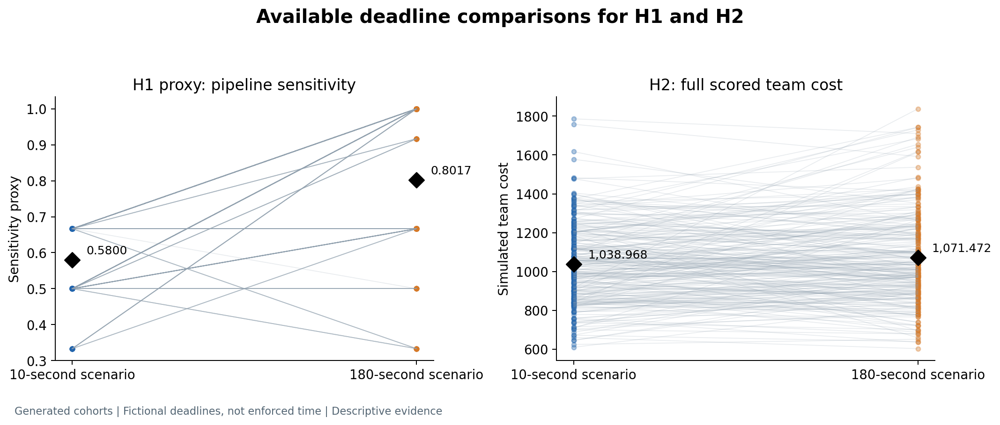
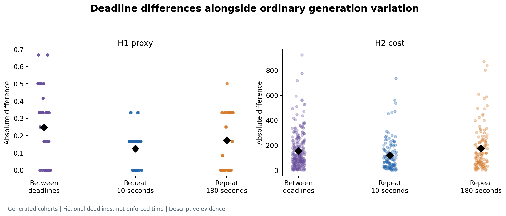
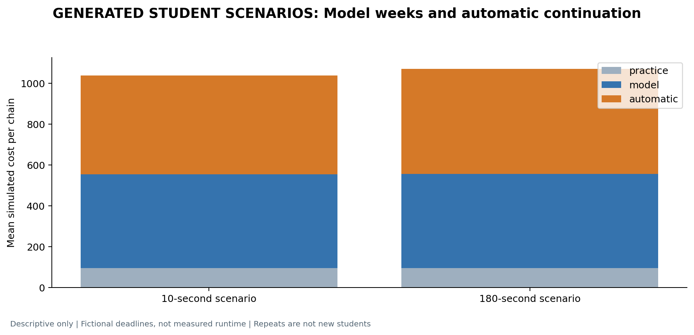

# Beer Game report: your four hypotheses

**Completed data:** 20 replies, 500 fictional student identities, 125 teams and 40,000 weekly orders. Recorded setting: user-reported GPT-6 / Pro.

**Main conclusion:** the existing sample gives exploratory information for H1 and H2. It cannot test H3 or H4 because no causal-education or matched-control-lecture groups were collected. A new experiment is needed to test all four hypotheses as written.

## The four hypotheses

**H1.** Within an information-sharing environment, a binding decision-time constraint increases the underweighting of outstanding replenishment orders relative to adequate decision time.

**H2.** Within an information-sharing environment, supply chains operating under binding decision-time constraints incur higher total inventory-holding and backlog costs than supply chains operating with adequate decision time.

**H3.** Within an information-sharing environment and under a binding decision-time constraint, participants receiving causal education about the origins and propagation of order fluctuations underweight outstanding replenishment orders less than participants receiving standard game instructions and a matched control lecture.

**H4.** Within an information-sharing environment and under a binding decision-time constraint, supply chains receiving causal education about the origins and propagation of order fluctuations incur lower total inventory-holding and backlog costs than supply chains receiving standard game instructions and a matched control lecture.

## What the existing results say

| Hypothesis | Available evidence | Conclusion |
| --- | --- | --- |
| H1 | Pipeline sensitivity: 0.5800 in the 10-second scenario versus 0.8017 in the 180-second scenario; difference -0.2217 | Consistent with relatively less response to outstanding orders, using a proxy. The binding-time hypothesis is not established. |
| H2 | Mean full team cost: 1,038.968 versus 1,071.472; difference -32.504 | Opposite the predicted cost increase in this sample. The binding-time hypothesis is not established. |
| H3 | No education or matched-control lecture groups | Not tested. No effect estimate is available. |
| H4 | No education or matched-control lecture groups | Not tested. No effect estimate is available. |

For H1, the proxy is `(order with 8 dispatched cases - order with 32)/24`, averaged across roles. It measures response sensitivity; it does not estimate the original structural coefficient or establish an optimal benchmark for underweighting. The H1 proxy difference is negative in both generations (-0.2733 and -0.1700). H2 cost differences are also negative in both (-8.448 and -56.560).

The environment shared all four inventories while other roles' orders/backlogs remained hidden. The model generated whole trajectories with access to the full demand paths; genuine role-level information isolation was not verified. The prompt's 10/180-second deadlines were neither enforced nor timed. Therefore the sample cannot establish the effect of a **binding** decision-time constraint.

The four hypotheses were supplied after these data had been collected and reviewed. This is a transparent post-collection assessment, not a claim that education contrasts were planned or observed. The previous bullwhip outcome is now supplementary; it is not the new H3 or H4.

## Cost and repeat checks

H2 counts holding costs at $0.50 and backlog costs at $1 per case-week, including four practice, 20 model and 12 automatic continuation weeks. The mean cost difference is -0.698 during model weeks and -31.806 during automatic continuation: about 98% of the total difference comes from the scoring continuation.

Changing deadline scenarios changed 49.78% of paired orders. Repeating the same scenario changed 47.09% under 10 seconds and 51.87% under 180 seconds. Ordinary generation variation is substantial. These rows and repeated identities are not independent human students; no student-level p-values are reported.

The separately stored Claude API experiment compared an initial choice with an extra revision opportunity. It also showed lower pipeline sensitivity; cost results were inconclusive. It included no education/control lecture comparison and does not supply the missing H3/H4 data. Its outcomes are not pooled with this website sample.

## Do you need to rerun?

**To describe the existing sample: no. To test all four hypotheses as written: yes.** More replies to the old prompts cannot create an education treatment or validate binding time.

A minimal new design has three groups, all with the same specified information sharing:

| Group | Decision time | Instruction/lecture |
| --- | --- | --- |
| A | Adequate | Standard game instructions + matched control lecture |
| B | Binding | Standard game instructions + matched control lecture |
| C | Binding | Standard game instructions + causal education |

Compare B with A for H1/H2, and C with B for H3/H4. Randomize at the chain level, match lecture length/format, freeze the sample and demand paths before outcomes, and verify that the time constraint actually binds. For LLM work, a calibrated computation restriction is an explicitly model-specific intervention; a typed deadline alone is insufficient. Claims about real students require human validation.

## Plots

### 1. What the data can assess

H3 and H4 have no education/control observations. Missing effects are not plotted as zero.

[PDF](plots/hypothesis_coverage.pdf).

### 2. Available H1 proxy and H2 cost outcomes

Lines join matched team/round outcomes. Diamonds show descriptive means; the stated deadlines were not enforced.

[PDF](plots/deadline_outcomes.pdf).

### 3. Deadline differences and same-deadline repeat variation

These are absolute differences, not signed effects or significance tests.

[PDF](plots/deadline_vs_repeat.pdf).

### 4. Inventory-holding and backlog costs by phase

The 12 automatic continuation weeks are scoring-rule actions, not further model decisions.

[PDF](plots/cost_phases.pdf).

### 5. First planned team: both scenarios and rounds

This team was selected by plan order, not by the size or direction of its results.

[PDF](plots/example_chain.pdf).

### 6. Supplementary bullwhip description

Bullwhip is supplementary here. It does not test the new education hypotheses H3 or H4.

[PDF](plots/bullwhip_by_role.pdf).

[Exact prompts](EXACT_PROMPTS.md) · [Results and column guide](results/README.md) · [Excel](results/RESULTS.xlsx).
