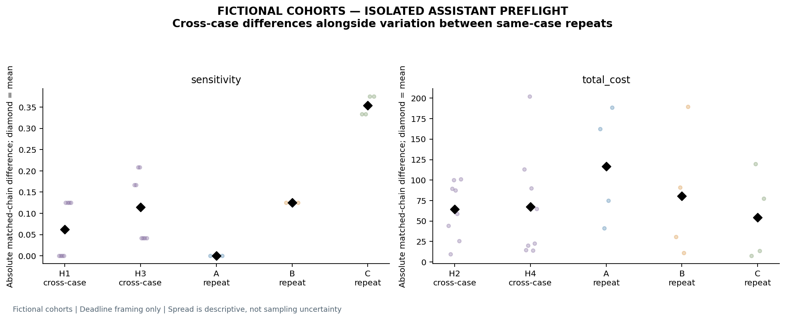
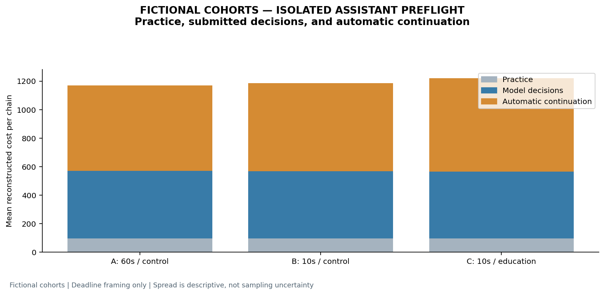
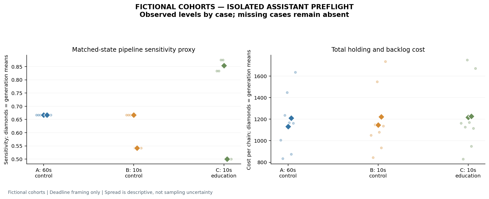

# Education and 10s/60s deadline-framing study

**FICTIONAL COHORTS — ISOLATED ASSISTANT PREFLIGHT**

Status: **complete**; **6/6** planned responses accepted. Model-generated fictional identities; zero observed human participants.

The fixed plan contains **16 fictional identities** in **4 four-role chains**, three cases and **2 repeated generation(s) per case**. Repeats and cases reuse identities, profiles and demand paths. Accepted responses contain **96 role trajectories** and **1920 submitted weekly orders**. These counts are not independent students.

Recorded model: **current-assistant-inherited / inherited**; collection: **isolated_assistant**. The isolated assistant uses its inherited model and reasoning setting. It is not verified to match the website GPT-6 / Pro backend.

## Cases and measurement

| Case | Fictional decision allowance | Reading |
| --- | --- | --- |
| A | 60 seconds | Standard rules plus matched control text |
| B | 10 seconds | Standard rules plus matched control text |
| C | 10 seconds | Standard rules plus causal education text |

No actual per-decision elapsed time or compute budget is imposed or measured. Neither bindingness of 10 seconds nor adequacy of 60 seconds is established. A textual reading is not a verified 20-minute lecture or measured learning. All cases keep the information-sharing rules fixed; whole-cohort generation nevertheless exposes the generator to future demand and all roles. Decentralized information use and human persona fidelity are unverified.

Pipeline sensitivity is `(order with 8 dispatched cases − order with 32 dispatched cases) / 24`, averaged across four roles. It is a matched-state proxy, not an identified structural underweighting coefficient. Lower sensitivity alone can also reflect ordering boundaries or policy differences. Costs reconstruct holding and backlog charges over four practice weeks, submitted model decisions, and twelve automatic continuation weeks. Continuation repeats each role’s last submitted order and final customer demand; those automatic actions are not model decisions.

## Descriptive H1–H4 contrasts

H1: B minus A sensitivity, predicted negative. H2: B minus A total cost, predicted positive. H3: C minus B sensitivity, predicted positive. H4: C minus B total cost, predicted negative.

| hypothesis | repetition | mean_difference | matched_chain_generation_pairs | direction |
| --- | --- | --- | --- | --- |
| H1 | 1 | 0 | 4 | zero observed difference |
| H1 | 2 | -0.125 | 4 | predicted direction |
| H1 | overall | -0.0625 | 8 | predicted direction |
| H2 | 1 | 16.125 | 4 | predicted direction |
| H2 | 2 | 11.75 | 4 | predicted direction |
| H2 | overall | 13.9375 | 8 | predicted direction |
| H3 | 1 | 0.1875 | 4 | predicted direction |
| H3 | 2 | -0.0416667 | 4 | opposite direction |
| H3 | overall | 0.0729167 | 8 | predicted direction |
| H4 | 1 | 70.125 | 4 | opposite direction |
| H4 | 2 | 4.125 | 4 | opposite direction |
| H4 | overall | 37.125 | 8 | opposite direction |

Only actual matched chain/repetition pairs enter these contrasts. Absent cases stay absent, and no missing choices are imputed. The overall mean pools eligible chain-generation pairs. A direction label describes these saved outputs and does not confirm the stated human-time hypothesis. No result direction or significance is an acceptance criterion.

Two repetitions provide two response-level generation units per case, regardless of the number of fictional chains. With two paired independent replication contrasts, an exact sign-flip test has only four assignments and a minimum one-sided p-value of .25. No inferential p-values, confidence intervals, or statistical-significance claims are computed here. More jointly generated student rows do not repair this replication limit.

## Same-case variation and changed weekly choices

| comparison | arm_or_contrast | repetition_a | repetition_b | matched_weekly_choices | changed_choices | changed_fraction | mean_absolute_change | mean_signed_change |
| --- | --- | --- | --- | --- | --- | --- | --- | --- |
| between_arms | H1/H2: B minus A | 1 | 1 | 320 | 92 | 0.2875 | 0.328125 | 0.103125 |
| between_arms | H3/H4: C minus B | 1 | 1 | 320 | 124 | 0.3875 | 0.625 | 0 |
| between_arms | H1/H2: B minus A | 2 | 2 | 320 | 95 | 0.296875 | 0.3625 | -0.1 |
| between_arms | H3/H4: C minus B | 2 | 2 | 320 | 118 | 0.36875 | 0.51875 | 0.16875 |
| same_arm_repeat | a60_control | 1 | 2 | 320 | 121 | 0.378125 | 0.5375 | 0.20625 |
| same_arm_repeat | b10_control | 1 | 2 | 320 | 87 | 0.271875 | 0.384375 | 0.003125 |
| same_arm_repeat | c10_education | 1 | 2 | 320 | 141 | 0.440625 | 0.634375 | 0.171875 |

Repeat differences are shown alongside cross-case differences. Changed orders alone do not establish a deadline mechanism. Chain distributions and their ranges describe these generated outputs, not sampling uncertainty for human students.

## Cost phases

| hypothesis | repetition | matched_chain_generation_pairs | cost_practice_difference | cost_model_difference | cost_automatic_difference | total_cost_difference | automatic_difference_over_total_difference |
| --- | --- | --- | --- | --- | --- | --- | --- |
| H2 | 1 | 4 | 0 | 0.875 | 15.25 | 16.125 | 0.945736 |
| H2 | 2 | 4 | 0 | -6.125 | 17.875 | 11.75 | 1.52128 |
| H2 | overall | 8 | 0 | -2.625 | 16.5625 | 13.9375 | 1.18834 |
| H4 | 1 | 4 | 0 | -17.25 | 87.375 | 70.125 | 1.24599 |
| H4 | 2 | 4 | 0 | 12 | -7.875 | 4.125 | -1.90909 |
| H4 | overall | 8 | 0 | -2.625 | 39.75 | 37.125 | 1.07071 |

The automatic-to-total contrast ratio is signed and undefined when the total contrast is zero; it can exceed one when phases oppose each other. The CSV and workbook retain each chain and each phase.

## Completion and provenance

| task_id | repetition | arm | students | accepted |
| --- | --- | --- | --- | --- |
| r01_a60_control | 1 | a60_control | 16 | True |
| r01_b10_control | 1 | b10_control | 16 | True |
| r01_c10_education | 1 | c10_education | 16 | True |
| r02_a60_control | 2 | a60_control | 16 | True |
| r02_c10_education | 2 | c10_education | 16 | True |
| r02_b10_control | 2 | b10_control | 16 | True |

All accepted responses, exact original bytes, attempt receipts, frozen prompts, profile assignments, demand paths and scientific source hashes remain in the source run. Rejected attempts are retained. No accepted result is replaced, no choice is clipped, no missing decision is filled, and no format conversion is performed.

Source run: `D:\beergame\data\runs\education_deadline_dcd6a6887c0ec5d1`. Evidence signature: `127fd0d406dd1a53`. This report makes **zero API calls**.

[Excel workbook](results/RESULTS.xlsx). Individual tables are available as CSV in `results/`. The `hypothesis_summary` table includes medians, ranges and absolute differences; `repeat_outcomes` preserves each matched same-case chain difference.

