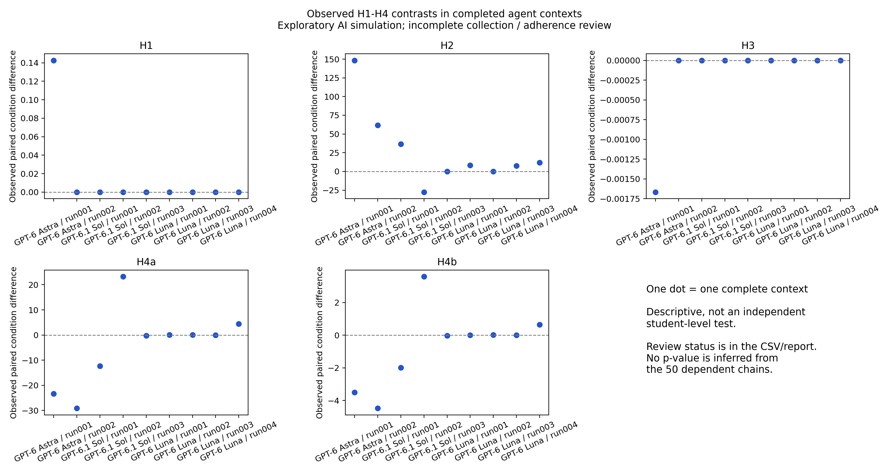

# Agent Beer Game results (v5)

1. **9 complete agent contexts received; 5 have passed the recorded procedure review.** User time cap: collection stops 2026-10-25 23:07:34 EDT; report deadline 2026-10-25 23:27:34 EDT. The ten-run target is superseded.
2. **H1-H4 are not established by incomplete collection or a single context.** The table below contains observed differences only; null and opposite results are retained.
3. **Fifty chains inside one context are dependent.** Additional fresh contexts provide replication; increasing a within-context prefix does not create independent students.
4. **This tests decision opportunities in fictional students.** It does not establish binding human clock pressure, normative underweighting, or real student behavior.

## Observed H1-H4 differences

| Requested model | Run | H1: B-A sensitivity | H2: B-A cost | H3: C-B sensitivity | H4a: C-B variance | H4b: C-B bullwhip | Review |
|---|---|---:|---:|---:|---:|---:|---|
| GPT-6 Astra | run001 | 0.1425 | 148.2 | -0.001667 | -23.38 | -3.502 | Pending: incomplete orchestration record |
| GPT-6 Astra | run002 | 0 | 61.88 | 0 | -29.14 | -4.481 | Reviewed |
| GPT-6.1 Sol | run001 | 0 | 36.69 | 0 | -12.33 | -1.993 | Pending: incomplete orchestration record |
| GPT-6.1 Sol | run002 | 0 | -27.65 | 0 | 23.22 | 3.586 | Reviewed |
| GPT-6.1 Sol | run003 | 0 | 0 | 0 | -0.2473 | -0.03711 | Reviewed |
| GPT-6 Luna | run001 | 0 | 8.36 | 0 | 0.0209 | 0.003169 | Excluded: Public state fields omitted before decisions |
| GPT-6 Luna | run002 | 0 | 0 | 0 | 0.07625 | 0.01026 | Excluded: Code generated current-page choices |
| GPT-6 Luna | run003 | 0 | 7.45 | 0 | 0 | 0 | Reviewed |
| GPT-6 Luna | run004 | 0 | 11.85 | 0 | 4.42 | 0.6444 | Reviewed |

Expected directions are H1 negative, H2 positive, H3 positive, and H4a/b negative. A difference in that direction alone is not significance. H1/H3 use pipeline sensitivity as a proxy.

## Open these files

- [Live notebook](../../notebooks/AGENT_PROGRESS.ipynb): run all cells and tick Auto-refresh (10 s).
- [Per-context / condition results](context_arm_results.csv) and [per-chain extracted results](per_chain_results.csv).
- [Current reviewed-context estimates, intervals and adjusted p-values](current_context_inference.csv). Missing p-values mean replication or review is insufficient.
- [Within-context size table](within_context_chain_prefixes.csv): first 5/10/20/30/40/50 chains, descriptive only.
- [Fresh-context size table](observed_context_size_sweep.csv): original attempted prefixes 1/2/5/10 plus observed time-cutoff sizes; eligible counts and missingness remain explicit.
- [H1-H4 versus chain-count plot and data](chain_size_stability/README.md): observed direction stability within contexts.
- [Exact tasks, prompts, decisions and public trace reviews](../../data/assistant_v5_20261025/).

## Collection and limits

Requested agent models are GPT-6 Astra, GPT-6.1 Sol and GPT-6 Luna, all high effort. Client model labels/settings are recorded separately from provider authentication. These agent observations are not pooled with manual website or historical API data. Claude is still a manual route.

A has a matched control reading plus a separate revision opportunity; B has the control reading and one committed decision; C has causal education and one decision. All three arms share a context, allowing carryover. Python computes state; the model supplies literal order pages. Full games replay before extraction. A code execution log does not by itself prove prompt adherence.

Procedure review covers visible prompts and tool interactions, complete public state exposure, and actual literal decisions. Encrypted parent-message bodies are covered only where exact operator-saved plaintext receipts exist; these are operator attestations, not decrypted or independently authenticated provider transcripts. Missing receipts remain explicit review gaps. This review does not validate student fidelity or clock pressure. Deviating attempts are preserved and do not disappear from the attempted sample.

When eligible replication exists, the exploratory tests use paired context differences, two-sided sign flips and pointwise bootstrap intervals. The Holm family retains all 20 model-by-endpoint tests, including missing Claude tests. These assumptions do not make model contexts equivalent to real human samples. Repeated live looks are not a stopping rule.

No new direct API calls are made by this monitor, analysis or local transport. The shared API ledger is unchanged; agent-service usage is separate.

Report generated UTC: 2026-10-26T02:25:56.316925+00:00. Evidence ID: `97a8c16f768d13d3`. Earlier current-report bytes are preserved in `history/` before changed evidence is published.
