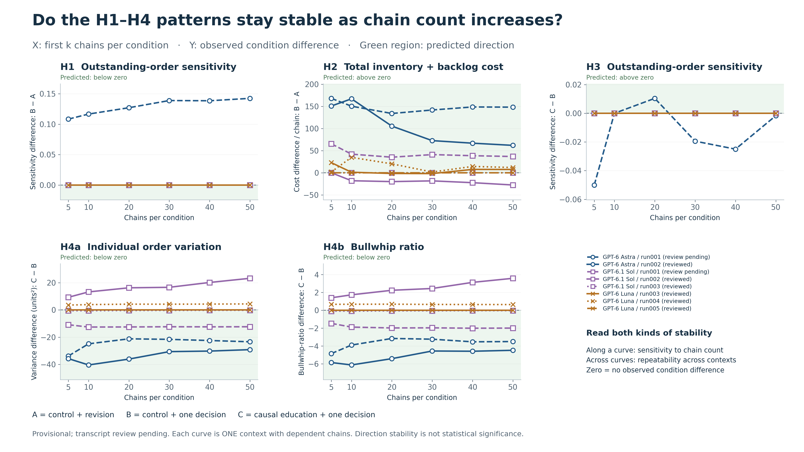

# H1–H4: chain count versus conclusion stability

1. **The x-axis is 5, 10, 20, 30, 40 and 50 chains per condition.** Each point uses the same first-k chain IDs in A, B and C.
2. **The y-axis is the effect relevant to each hypothesis:** B−A for H1/H2; C−B for H3/H4a/H4b. Green marks the predicted direction; zero means no observed difference.
3. **These are descriptive direction checks.** The chains in a curve share one context; adding chains to a prefix does not add independent model replications. No chain-level p-values or confidence intervals are computed.

[Presentation PNG](H1_H4_VS_CHAIN_SIZE.png) · [Scalable SVG](H1_H4_VS_CHAIN_SIZE.svg) · [PDF](H1_H4_VS_CHAIN_SIZE.pdf)

## What the observed curves say

| Model / context | Hypothesis | Direction at 50 chains | Same direction at all six sizes? |
|---|---|---|---|
| GPT-6 Astra / run001 | H1 | Opposite direction | Yes |
| GPT-6 Astra / run001 | H2 | Predicted direction | Yes |
| GPT-6 Astra / run001 | H3 | Opposite direction | No |
| GPT-6 Astra / run001 | H4a | Predicted direction | Yes |
| GPT-6 Astra / run001 | H4b | Predicted direction | Yes |
| GPT-6 Astra / run002 | H1 | Zero difference | Yes |
| GPT-6 Astra / run002 | H2 | Predicted direction | Yes |
| GPT-6 Astra / run002 | H3 | Zero difference | Yes |
| GPT-6 Astra / run002 | H4a | Predicted direction | Yes |
| GPT-6 Astra / run002 | H4b | Predicted direction | Yes |
| GPT-6.1 Sol / run001 | H1 | Zero difference | Yes |
| GPT-6.1 Sol / run001 | H2 | Predicted direction | Yes |
| GPT-6.1 Sol / run001 | H3 | Zero difference | Yes |
| GPT-6.1 Sol / run001 | H4a | Predicted direction | Yes |
| GPT-6.1 Sol / run001 | H4b | Predicted direction | Yes |
| GPT-6.1 Sol / run002 | H1 | Zero difference | Yes |
| GPT-6.1 Sol / run002 | H2 | Opposite direction | No |
| GPT-6.1 Sol / run002 | H3 | Zero difference | Yes |
| GPT-6.1 Sol / run002 | H4a | Opposite direction | Yes |
| GPT-6.1 Sol / run002 | H4b | Opposite direction | Yes |
| GPT-6.1 Sol / run003 | H1 | Zero difference | Yes |
| GPT-6.1 Sol / run003 | H2 | Zero difference | Yes |
| GPT-6.1 Sol / run003 | H3 | Zero difference | Yes |
| GPT-6.1 Sol / run003 | H4a | Predicted direction | Yes |
| GPT-6.1 Sol / run003 | H4b | Predicted direction | Yes |
| GPT-6 Luna / run003 | H1 | Zero difference | Yes |
| GPT-6 Luna / run003 | H2 | Predicted direction | No |
| GPT-6 Luna / run003 | H3 | Zero difference | Yes |
| GPT-6 Luna / run003 | H4a | Zero difference | Yes |
| GPT-6 Luna / run003 | H4b | Zero difference | Yes |
| GPT-6 Luna / run004 | H1 | Zero difference | Yes |
| GPT-6 Luna / run004 | H2 | Predicted direction | Yes |
| GPT-6 Luna / run004 | H3 | Zero difference | Yes |
| GPT-6 Luna / run004 | H4a | Opposite direction | Yes |
| GPT-6 Luna / run004 | H4b | Opposite direction | Yes |
| GPT-6 Luna / run005 | H1 | Zero difference | Yes |
| GPT-6 Luna / run005 | H2 | Zero difference | Yes |
| GPT-6 Luna / run005 | H3 | Zero difference | Yes |
| GPT-6 Luna / run005 | H4a | Zero difference | Yes |
| GPT-6 Luna / run005 | H4b | Zero difference | Yes |

**Suggested slide caption:** Within each completed AI context, H1–H4 effects were recalculated using the first 5–50 chains per condition. A consistently signed curve indicates descriptive directional stability; a zero crossing indicates sensitivity to the included chains. These curves do not establish statistical significance or student-level replication.

A = control reading + separate revision; B = control + one committed decision; C = causal education + one decision. H1/H3 measure response to outstanding replenishment orders using probe sensitivity, a proxy for pipeline use. H2 is 24-week holding plus backlog cost per chain. H4a is mean role order variance; H4b is mean role order variance divided by external demand variance. The intervention changes revision opportunities; all three conditions share a context.

## Included evidence

- GPT-6 Astra / run001: Pending: incomplete orchestration record. Complete physical replay passed.
- GPT-6 Astra / run002: Reviewed. Complete physical replay passed.
- GPT-6.1 Sol / run001: Pending: incomplete orchestration record. Complete physical replay passed.
- GPT-6.1 Sol / run002: Reviewed. Complete physical replay passed.
- GPT-6.1 Sol / run003: Reviewed. Complete physical replay passed.
- GPT-6 Luna / run003: Reviewed. Complete physical replay passed.
- GPT-6 Luna / run004: Reviewed. Complete physical replay passed.
- GPT-6 Luna / run005: Reviewed. Complete physical replay passed.
- Excluded and preserved: GPT-6 Luna / run001: Excluded: Public state fields omitted before decisions.
- Excluded and preserved: GPT-6 Luna / run002: Excluded: Code generated current-page choices.
- Claude has no collected local-agent results.

[Exact plotted metrics](plotted_metrics.csv) · [Direction stability table](direction_stability.csv) · [Source hashes](MANIFEST.json).

Rebuild after new completed results: first run `scripts/report_agent_collection_v5.py`, then `scripts/plot_agent_chain_size_stability_v5.py`, using `.venv/Scripts/python.exe`. Previous chart versions are preserved in `history/`. No API calls or order decisions are made. All calculated prefix means are checked against the report, and the 50-chain endpoints against full condition summaries.
