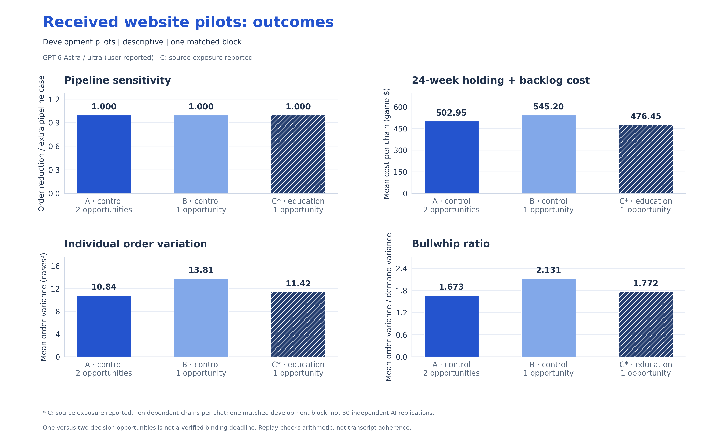
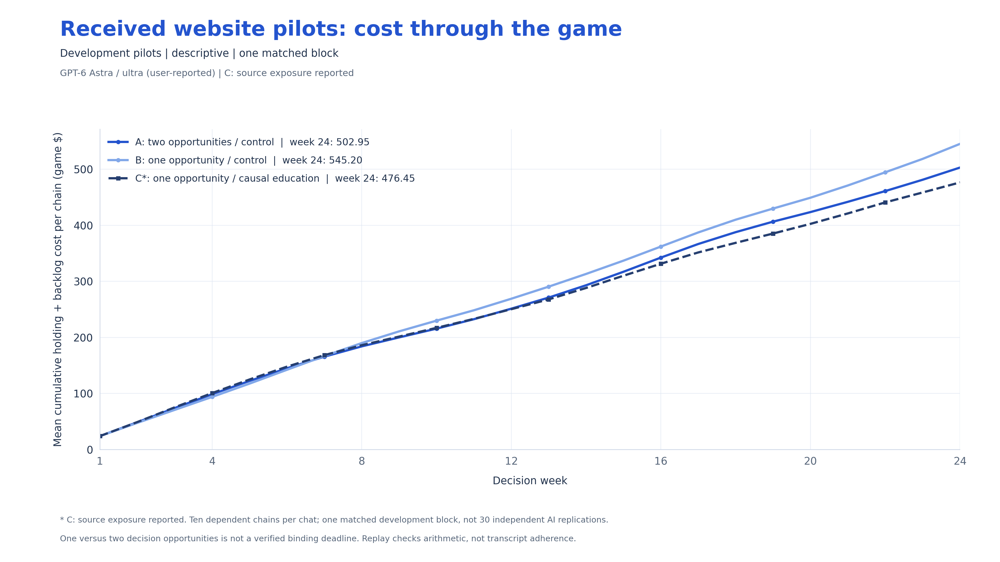

# Received pilot figures

**GPT-6 Astra / ultra, user-reported. Three development chats form one matched block.** C's provenance file reports controller-source exposure. These plots show descriptive outcomes; they do not establish significance or literal deadline effects.

**Caption:** All three pilots finished 24 weeks. Pipeline sensitivity is 1.0 in every arm. B has higher mean cost than A; C has lower order variance and bullwhip than B. Each arm averages ten dependent chains. The pilot sample and C's reported deviation prevent a confirmatory treatment interpretation.

[PNG](figures/01_pilot_outcomes.png) · [PDF](figures/01_pilot_outcomes.pdf) · [SVG](figures/01_pilot_outcomes.svg)

**Caption:** Mean cumulative holding-plus-backlog cost per chain over the 24 scored weeks. Lines show the received pilot trajectories, without inferential uncertainty or p-values.

[PNG](figures/02_pilot_cumulative_cost.png) · [PDF](figures/02_pilot_cumulative_cost.pdf) · [SVG](figures/02_pilot_cumulative_cost.svg) · [Source tables and validation](figures/VALIDATION.json)
