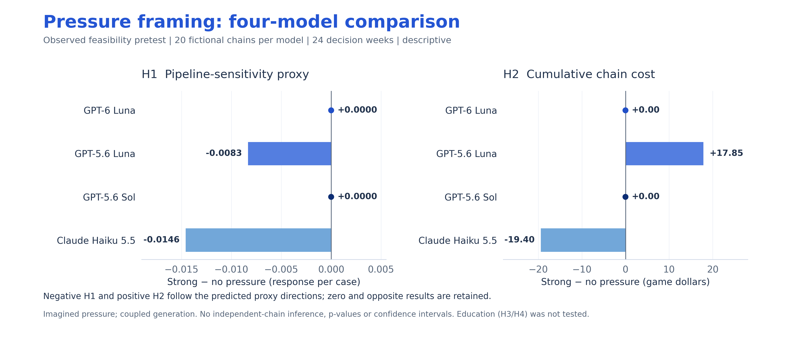
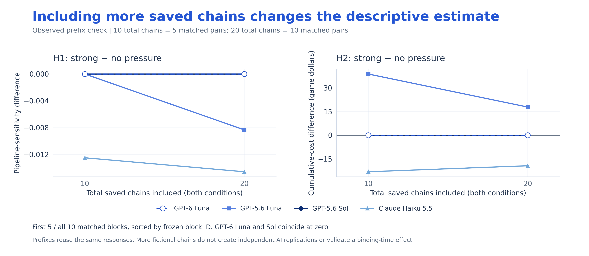
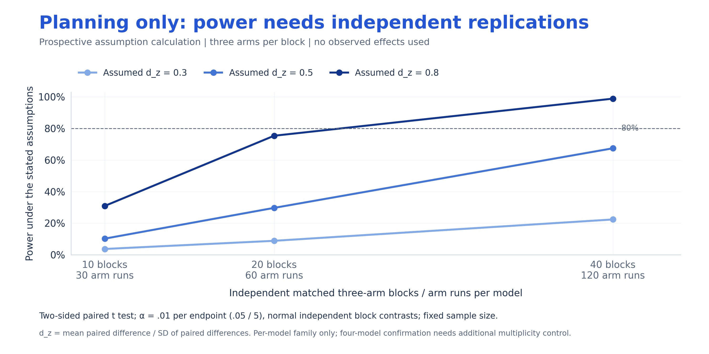
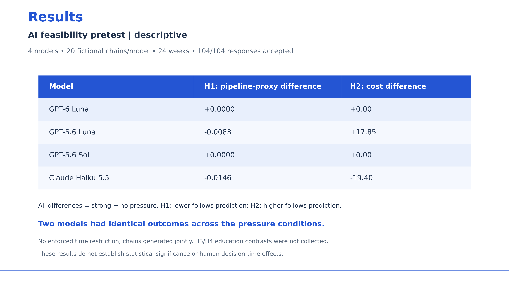

# Figures for the presentation

1. **These are observed AI feasibility results, not significant human-time effects.** Experiment 13 completed all 104 planned responses. Pressure was imagined in the prompt; both conditions used the same generation resources. Each model generated all chains together.
2. **H1/H2 only:** education and matched-control arms were absent. The new H3 and H4 were not tested by this sample.
3. **The power figure is separate prospective planning.** It uses assumed effect sizes and independent replications that were not collected here.

## 1. Four-model comparison: observed data



**Copyable caption:** Strong-minus-no-pressure differences in pipeline-sensitivity proxy and cumulative holding/backlog cost over 24 decision weeks. GPT-6 Luna and GPT-5.6 Sol produced zero contrasts. GPT-5.6 Luna followed both predicted proxy directions; Claude followed the H1 proxy direction but had lower cost under pressure. All comparisons are descriptive; chains within a model were generated jointly.

[PNG](figures/01_observed_model_comparison.png) · [PDF](figures/01_observed_model_comparison.pdf) · [SVG](figures/01_observed_model_comparison.svg) · [Exact plot values](figures/observed_model_comparison.csv)

## 2. Ten versus twenty saved chains: observed data



**Copyable caption:** Descriptive contrasts using the first five versus all ten frozen matched blocks: 10 versus 20 total chains across the two conditions. Blocks are included in ascending block-ID order. Both analyses reuse the same coupled collection; the larger prefix does not provide additional independent model replications. Coincident zero lines are retained.

[PNG](figures/02_observed_10_vs_20_chains.png) · [PDF](figures/02_observed_10_vs_20_chains.pdf) · [SVG](figures/02_observed_10_vs_20_chains.svg) · [Exact plot values](figures/observed_prefix_10_20_chains.csv)

## 3. Independent-block power: planning assumptions only



**Copyable caption:** Prospective power under assumed standardized paired effects of 0.3, 0.5 and 0.8, with 10, 20 or 40 independent matched three-arm blocks per model. Calculations use a two-sided paired t test, normally distributed independent block contrasts, a fixed sample size, and α = .01 per endpoint (Bonferroni .05/5). One three-arm block contributes one independent contrast per endpoint, not three independent paired observations. Effect sizes are assumptions and are not estimated from the pretest.

The five endpoints are H1, H2, H3, H4a and H4b. This correction covers a **within-model** family only. Confirmatory claims across four models require additional multiplicity control and a revised power calculation. These curves do not guarantee any effect or significance. H4a and H4b can be strongly related through their shared order variance.

[PNG](figures/03_prospective_power_assumptions.png) · [PDF](figures/03_prospective_power_assumptions.pdf) · [SVG](figures/03_prospective_power_assumptions.svg) · [Exact plot values and assumptions](figures/prospective_power_assumptions.csv)

## 4. Ready-to-use results slide



A standalone 16:9 slide in the presentation's white/blue style, headed **AI feasibility pretest | descriptive**. Insert this PDF/page or PNG into the blank Results section. It is a new artifact; the original presentation was not changed.

[PNG](figures/04_presentation_results_slide.png) · [PDF](figures/04_presentation_results_slide.pdf) · [SVG](figures/04_presentation_results_slide.svg)

## Reproduce and verify

From the repository root:

```powershell
.\.venv\Scripts\python.exe scripts/plot_weekly_review_20261025.py
```

Requires matplotlib, NumPy, pandas and SciPy. No credentials or API calls. The script reads the closed `b34972b65bf5` CSV exports, verifies all eight aggregate contrasts, checks 80 completed chains and confirms the source files' hashes remain unchanged. [Validation receipt](FIGURE_VALIDATION.json) records input/output hashes. H1 is a matched-state response proxy, not an identified structural underweighting coefficient; no p-values or inferential intervals are added to the observed results.
