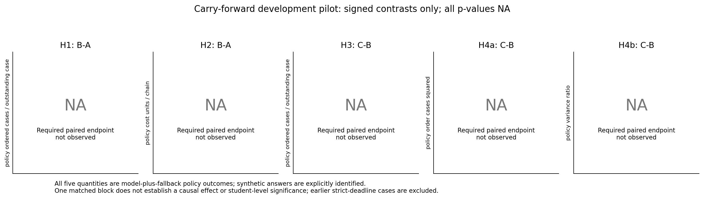
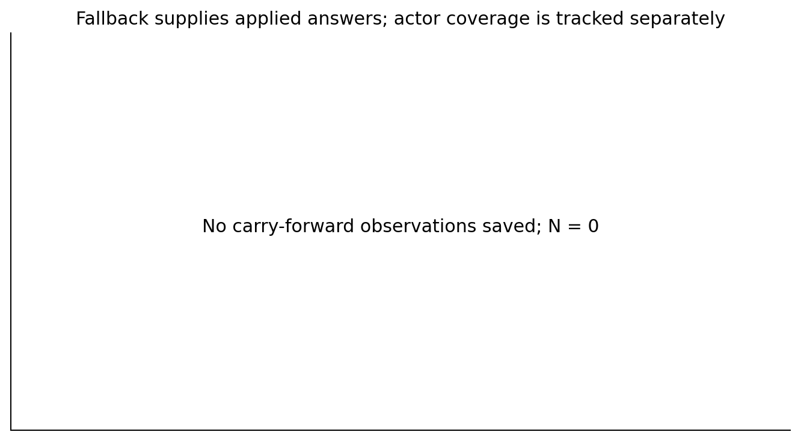

# Experiment 14: carry-forward policy

1. **Selected policy: repeat the previous applied four-role order packet when a game deadline expires.** A first-week timeout uses [4, 4, 4, 4]. On a probe timeout, each scenario receives its role's last applied game order. Every resolved opportunity therefore has an applied answer. Fallback answers are labeled synthetic; valid on-time model choices are unchanged.
2. New development pilot: **0/3 complete 24-week policy games** and **0/3 cases with all actor responses complete**; 0/3 contexts saved. Finishing the physical game does not mean every model response was received.
3. **All five primary quantities describe the model-plus-fallback policy.** Development contrasts are descriptive only; raw and adjusted p-values are NA. Unavailable paired quantities: H1, H2, H3, H4a, H4b.
4. Main: 0/30 contexts, 0/10 complete matched primary blocks. Main inference remains blocked until the separate frozen ten-block plan, full fixed endpoints and external reviews pass.

A = control reading with adequate deadlines; B = the same control reading with restricted deadlines; C = education reading with the same restricted deadlines as B. This amendment uses V1: A allows 30 seconds for both phases; B/C allow 4.0 seconds per game week and 3.8 seconds per probe page, inherited from latency-only calibration. The clock includes service, transport, scheduling and output, not measured hidden thinking time. Post-task questions are untimed.

Requested model: gpt-6-astra / xhigh, fresh isolated contexts. Actual reported labels remain separate in the case table. Temperature and reasoning-token allocation are not exposed. Human participants: 0. One matched chain block supplies one paired contrast; four roles and 24 weeks do not increase independent N.

[Figures](figures/README.md) | [Case outcomes](../../analysis/carry_forward_v2/tables/case_outcomes.csv) | [Validation](../../analysis/carry_forward_v2/VALIDATION.json)

## Model responses and fallback actions

| Arm / block | Policy weeks | Actor orders / 96 | Actor game fraction | Carry weeks / applied | Actor probes / 32 | Quiz |
|---|---:|---:|---:|---:|---:|---:|
| No saved development cases | NA | NA | NA | NA | NA | NA |

Actor fraction divides accepted actor orders by the planned 96 orders per context. Carry share uses physically applied weeks; unresolved future weeks are reported separately in the CSV. A probe fallback repeats the last applied game order of the displayed role; it never borrows another hypothetical scenario's answer. Quiz answers still come from the actor and remain NA until received. [Applied actions](../../analysis/carry_forward_v2/tables/applied_actions.csv), [all resolved opportunities](../../analysis/carry_forward_v2/tables/opportunities.csv) and [submission timings](../../analysis/carry_forward_v2/tables/latencies.csv) keep their sources distinct.

## Five hypothesis quantities

| Endpoint | Plain definition and units | Contrast; predicted sign |
|---|---|---|
| H1 | How much the applied scenario order falls per extra case already on the way, averaged equally over eight fixed pipeline pairs; policy ordered cases per outstanding case | B-A; negative |
| H2 | Four-role total holding plus backlog cost over 24 weeks under model choices plus carry-forward; policy cost units per chain | B-A; positive |
| H3 | The same applied-policy pipeline response measure, comparing education with control under restricted deadlines | C-B; positive |
| H4a | Sample variance of the 24 applied weekly orders within each role (denominator 23), averaged over four roles; policy order cases squared | C-B; negative |
| H4b | Role order variance divided by the same chain's external-customer sample demand variance, then averaged over roles; policy bullwhip ratio | C-B; negative |

All H1-H4 quantities measure the model-plus-fallback policy. A smaller order variance can arise mechanically when an earlier order is repeated; a zero pipeline slope can arise mechanically when the same role's game order answers both hypothetical scenarios. Neither identifies pure actor cognition. Holding costs 0.5 per remaining case per week; backlog costs 1 per unfilled case per week. A prefix has no full 24-week H2/H4 outcome. Zero customer-demand variance makes H4b undefined. H4a/H4b share a numerator and are not independent confirmations.

## Development contrasts

| Test | Pairs | Signed contrast | Units | Raw p | Holm 5 | Direction |
|---|---:|---:|---|---:|---:|---|
| H1 B-A | 0 | NA | policy ordered cases / outstanding case | NA | NA | NA |
| H2 B-A | 0 | NA | policy cost units / chain | NA | NA | NA |
| H3 C-B | 0 | NA | policy ordered cases / outstanding case | NA | NA | NA |
| H4a C-B | 0 | NA | policy order cases squared | NA | NA | NA |
| H4b C-B | 0 | NA | policy variance ratio | NA | NA | NA |

The primary pipeline aggregate uses all eight fixed applied-answer pairs with equal weight. The separate actor-only aggregate requires all eight pairs of accepted actor answers; otherwise it is NA, without reweighting or using defaults. [Pair slopes](../../analysis/carry_forward_v2/tables/probe_pairs.csv) and [role/zero-response diagnostics](../../analysis/carry_forward_v2/tables/probe_diagnostics.csv) also show the separate eight-pair backlog response assay. Pipeline response is a proxy, not an identified normative underweighting coefficient; flat choices in both assays do not establish pipeline-specific neglect. Two levels per pair cannot identify curvature. Quiz scores are manipulation checks, never inclusion rules based on low performance.

| Arm | Policy pipeline slope | Actor-only pipeline slope | Actor pairs absent / 8 | Probe fallback fraction |
|---|---:|---:|---:|---:|
| No saved development cases | NA | NA | NA | NA |

[Fallback fractions by role](../../analysis/carry_forward_v2/tables/probe_answer_sources_by_role.csv) and the pair table distinguish actor and synthetic answers at each source. Late raw submissions remain in the record and never overwrite an applied answer.

## Development readiness

Current readiness: **not qualified**. The prospective actor-coverage gate has not yet been frozen in the saved plan. This gate is checked before launching a new main sample. Once main cases are assigned, low actor coverage is reported as a diagnostic; it never removes assigned cases or valid complete policy contrasts.

## Main status and provenance

A main test requires exactly ten matched independent blocks, all thirty assigned contexts, complete 24-week policy trajectories, all fixed primary endpoints and passing external reviews bound to exact RESULT bytes and the canonical CASE digest. Synthetic game and probe fallbacks are valid components of the selected policy outcome. No actor-coverage threshold excludes assigned main cases; low coverage instead limits cognitive interpretation. Use the separately frozen CARRY_FORWARD_V2_MAIN_PLAN.json, never the earlier strict-deadline plan. Tests, when eligible, use two-sided paired sign flips with a five-endpoint Holm family and unadjusted paired-block bootstrap intervals. The independent symmetric/exchangeable paired-null assumption remains necessary; ten blocks do not guarantee significance. Missing or opposite results are retained; no significance-driven extension, replacement or prompt selection is allowed.

This report reads only data/carry_forward_v2/development and data/carry_forward_v2/main. The original sixteen strict-deadline cases remain separate and unchanged. Public transcript review is operator-attested evidence, not provider authentication or a hidden reasoning trace. No participant or API requests are made by this analysis.

Rebuild: `.venv/Scripts/python.exe scripts/report_exp14_carry.py`. [Exact source/data hashes and validation](../../analysis/carry_forward_v2/VALIDATION.json). Input fingerprint: `fc1a02d35589fb63a38b5a2496a0c81bd6cc93ce7e4aae116c65f17a527b18a0`. Previous generated bytes are preserved in this amendment's history folders before regeneration.

## Development figures

NA is an unavailable paired applied-policy endpoint, not a zero effect. All five quantities include synthetic fallback answers. All pilot p-values remain NA.

Game fallback weeks and probe fallback pages are different opportunities; each probe page supplies four applied answers while retaining the actor-missing flag.
