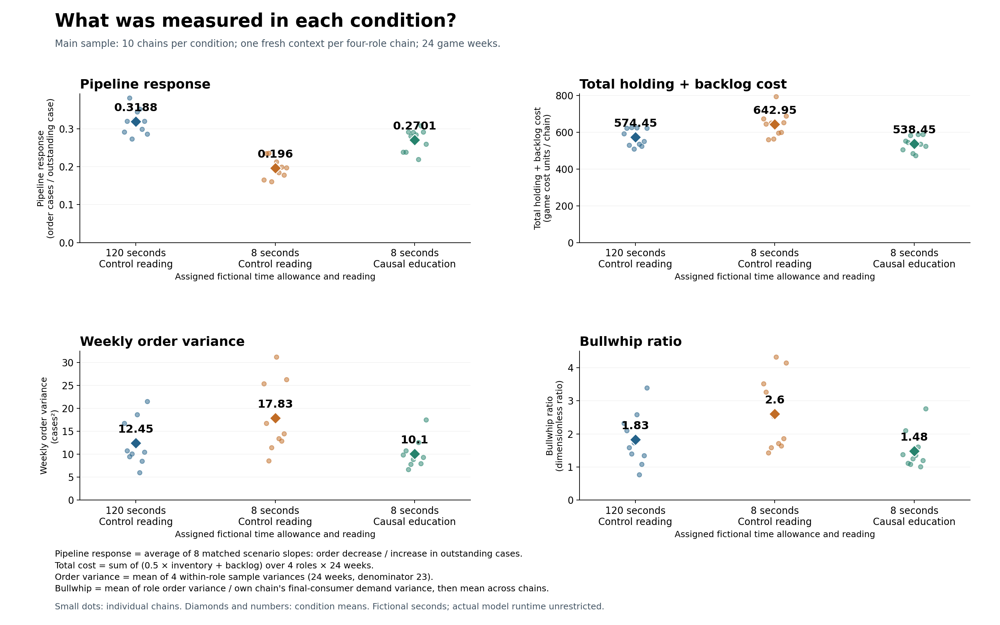
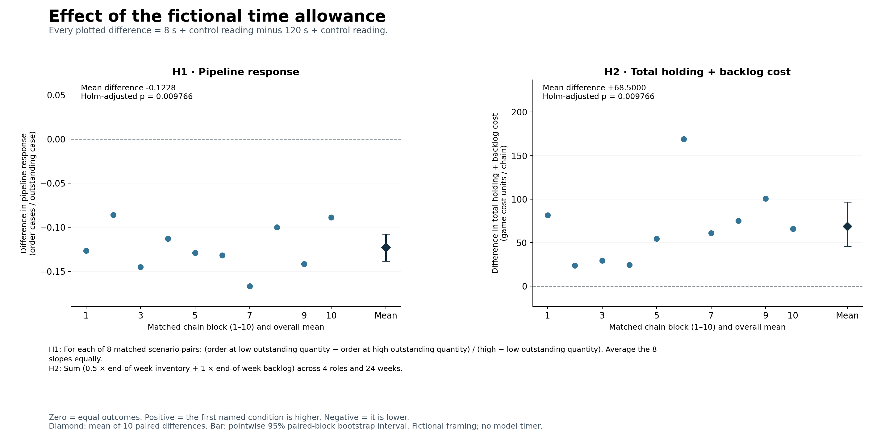
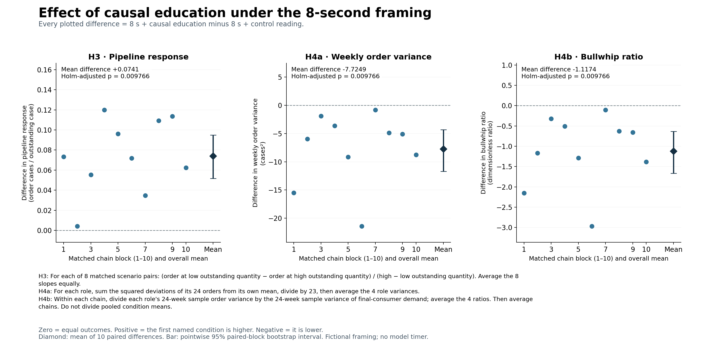
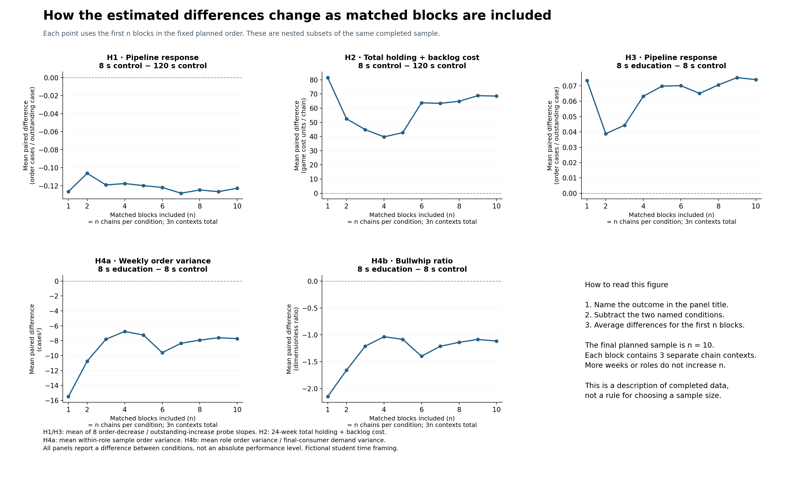
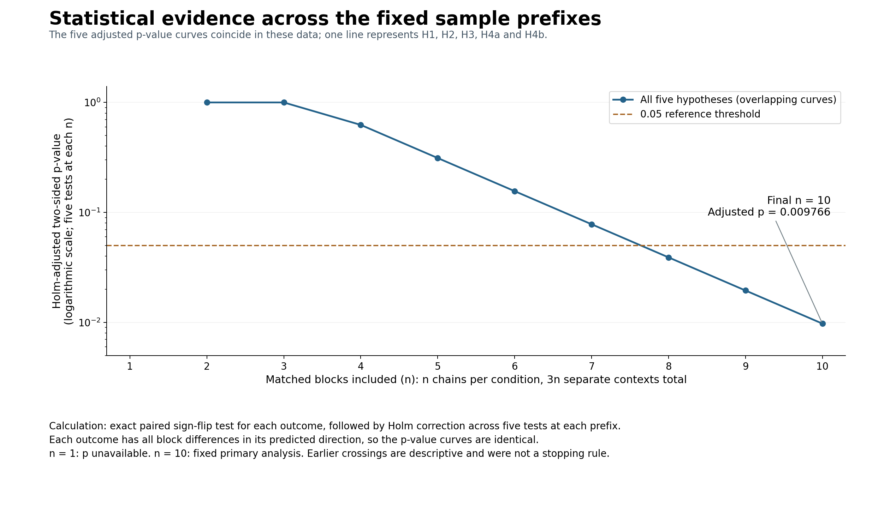

# Experiment 14 — student time-pressure framing

## 1. Conclusions first

1. **Fictional pressure reduced pipeline response:** 120 s + control reading = **0.3188**; 8 s + control reading = **0.196** ordered cases reduced per extra outstanding case. The pressure-minus-adequate difference is **−0.122830** (H1 response proxy).
2. **Fictional pressure increased total cost:** **574.45 → 642.95** game cost units per chain, an increase of **68.50** (H2). This comprises **60.00 additional holding cost + 8.50 additional backlog cost**.
3. **Education under the same 8-second framing increased pipeline response:** **0.196 → 0.2701**, a difference of **+0.074115** (H3 response proxy). It did not restore the mean to the 120-second control level.
4. **Education reduced order variation and bullwhip under the 8-second framing:** order variance **17.8294 → 10.1045 cases²** (H4a); bullwhip **2.6016 → 1.4841** (H4b).
5. **All five planned comparisons have Holm-adjusted p = 0.009766 in the ten matched blocks.** These are model responses to fictional student conditions. There was no actual model timer, no human sample, and no identified optimal pipeline-weighting coefficient. H1/H3 support the measured response direction; they do not establish normative underweighting in people.

**Read the values:** the tables show actual condition levels before their differences. A/B/C are three conditions within ONE student_framing_v3 study, not three unrelated experiments. One case of beer is the quantity unit; game cost units are not API dollars.

[PDF of this same report](REPORT.pdf) · [All values in one workbook](tables/ALL_VALUES.xlsx) · [Figures with axis/calculation explanations](figures/README.md) · [All original export fields explained](tables/SOURCE_FIELD_DICTIONARY.csv)

## 2. Independent variables: exactly what was changed

There are **two assigned between-condition independent variables**: (1) the fictional student's time allowance, and (2) the reading. Neither is an observed behavioral outcome.

| Condition | Independent variable 1: fictional allowance | Independent variable 2: reading | Actual model procedure |
|---|---|---|---|
| A — 120 s + control | 120 seconds per fictional student's game/probe decision | 170-word control reading | One committed response; unrestricted actual runtime |
| B — 8 s + control | 8 seconds per fictional student's game/probe decision | Same 170-word control reading | Same procedure and settings as A |
| C — 8 s + education | 8 seconds per fictional student's game/probe decision | 170-word causal supply-chain education | Same procedure and settings as A/B |

**What the readings contain:** the [control reading](../prompts/CONTROL.md) discusses ordinary business-document presentation (headings, layout and audiences). The [causal education reading](../prompts/EDUCATION.md) explains that requests and deliveries occur at different times, earlier outstanding orders can arrive together, and local requests can differ from final-consumer demand. It distinguishes inventory, customer obligations and replenishment already requested. Neither reading supplies an ordering formula or a preferred order quantity.

The 120/8 numbers were instructions about a fictional student's classroom situation. They were **not measured response durations** and were **not enforced on the model**. Readings and the final quiz were untimed. There was no revision round in any condition. This differs from experiment 13's revision-opportunity design.

**What each planned comparison isolates:**

| Question | Exact subtraction | Variable changed | Held fixed |
|---|---|---|---|
| H1/H2: What changes under the pressure framing? | 8 s + control reading minus 120 s + control reading (B minus A) | 120 seconds becomes 8 seconds | Control reading |
| H3/H4a/H4b: What changes with education under pressure? | 8 s + causal education minus 8 s + control reading (C minus B) | Control reading becomes causal education | 8-second framing |

**Sign rule:** calculate the first named condition minus the second. Positive means the first condition is higher; negative means it is lower. **A minus B reverses the sign of B minus A.** There is no 120-second education condition, so this design cannot identify a full time-by-education interaction. C minus A changes both assigned factors and is not one of the five planned comparisons.

**Held constant:** requested GPT-6 Astra, requested extra-high (`xhigh`) effort, four supply-chain roles, 24 weeks, information-sharing displays, one submitted choice per decision, the physical game rules, and costs of 0.5 per inventory case/week and 1 per backlog case/week. Each matched block uses the same customer-demand path and role profiles in three fresh contexts. Requested settings are operator-recorded; provider-authenticated model/effort remain unverified. Temperature and hidden reasoning-token use were not measured.

**Sample:** 10 matched blocks × 3 conditions = 30 main chain contexts; 10 chains and 40 role instances per condition. Each chain has 96 game orders, 32 probe answers and 4 quiz answers. Main totals: 2,880 game orders, 960 probe answers and 120 quiz answers. The inferential sample is 10 paired block differences, not 120 independent human participants. The separate 3-context development block is excluded from every main value below.

## 3. Dependent variables: measured levels in all three conditions

These are **four unique primary quantities** used in five hypothesis tests. H1 and H3 reuse the same pipeline-response measurement with different condition comparisons. Values below are arithmetic means across the ten chains in each condition.

| Dependent variable and unit | 120 s + control (A) | 8 s + control (B) | 8 s + education (C) |
|---|---|---|---|
| Pipeline response (order cases / outstanding case) | 0.3188 | 0.196 | 0.2701 |
| Total holding + backlog cost (game cost units / chain) | 574.45 | 642.95 | 538.45 |
| Weekly order variance (cases²) | 12.4501 | 17.8294 | 10.1045 |
| Bullwhip ratio (dimensionless ratio) | 1.831 | 2.6016 | 1.4841 |

**Figure 1:** the x-axis names the assigned allowance and reading; each y-axis names the measured outcome and unit. Small dots show ten chain values; the diamond and printed number show their mean. These are levels, not subtractions. [Exact means, SDs and ranges](tables/CONDITION_OUTCOMES.csv).

### How each primary variable is calculated

**Pipeline response — order cases / outstanding case.** For each of 8 matched scenario pairs: (order at low outstanding quantity − order at high outstanding quantity) / (high − low outstanding quantity). Average the 8 slopes equally.

**Total holding + backlog cost — game cost units / chain.** Sum (0.5 × end-of-week inventory + 1 × end-of-week backlog) across 4 roles and 24 weeks.

**Weekly order variance — cases².** For each role, sum the squared deviations of its 24 orders from its own mean, divide by 23, then average the 4 role variances.

**Bullwhip ratio — dimensionless ratio.** Within each chain, divide each role's 24-week sample order variance by the 24-week sample variance of final-consumer demand; average the 4 ratios. Then average chains. Do not divide pooled condition means.

**Pipeline interpretation:** a response of 0.30 means the model reduces its order by 0.30 cases per additional outstanding case, averaged over the fixed probes. Zero means unchanged orders in those pairs. The probe is a response measurement; there is no established optimal response of 1 in every displayed state. This study did not estimate a structural behavioral beta coefficient.

**Variance interpretation:** calculate variance within each role across its 24 weeks, then average the four roles. Do not calculate variance by mixing roles or pooling all chains first. The denominator is 23 because it is a sample variance.

**Bullwhip interpretation:** 2.60 means role orders are, on average under this calculation, about 2.60 times as variable as final-consumer demand. A ratio above 1 denotes amplification relative to that denominator. Use the external customer's demand, not each upstream role's incoming orders. H4a and H4b share the order-variance numerator; they are related measures, not independent replications.

## 4. Comparisons with both condition values shown

### Pressure comparison: 8 s + control reading minus 120 s + control reading

| Test / dependent variable | 8 s + control reading | 120 s + control reading | First minus second | Holm-adjusted p |
|---|---|---|---|---|
| H1: Pipeline response | 0.196 | 0.3188 | -0.122830 | 0.009766 |
| H2: Total holding + backlog cost | 642.95 | 574.45 | +68.500000 | 0.009766 |

### Education comparison: 8 s + causal education minus 8 s + control reading

| Test / dependent variable | 8 s + causal education | 8 s + control reading | First minus second | Holm-adjusted p |
|---|---|---|---|---|
| H3: Pipeline response | 0.2701 | 0.196 | +0.074115 | 0.009766 |
| H4a: Weekly order variance | 10.1045 | 17.8294 | -7.724909 | 0.009766 |
| H4b: Bullwhip ratio | 1.4841 | 2.6016 | -1.117448 | 0.009766 |

**Worked cost example:** 642.95 (8 s + control) − 574.45 (120 s + control) = **+68.50 cost units per chain**. Positive means the pressure-framed condition cost more. **Worked education example:** 10.104529 (8 s + education order variance) − 17.829438 (8 s + control order variance) = **−7.724909 cases²**. Negative means education produced less variable orders in this sample.

| Test and comparison | 95% pointwise interval for difference | Raw two-sided p | Holm-adjusted p (5 tests) |
|---|---|---|---|
| H1: 8 s + control reading minus 120 s + control reading | -0.138351 to -0.107569 | 0.001953125 | 0.009765625 |
| H2: 8 s + control reading minus 120 s + control reading | 45.49875 to 96.55125 | 0.001953125 | 0.009765625 |
| H3: 8 s + causal education minus 8 s + control reading | 0.051597 to 0.094983 | 0.001953125 | 0.009765625 |
| H4a: 8 s + causal education minus 8 s + control reading | -11.717426 to -4.332828 | 0.001953125 | 0.009765625 |
| H4b: 8 s + causal education minus 8 s + control reading | -1.665969 to -0.633234 | 0.001953125 | 0.009765625 |

Intervals use 10,000 paired-block bootstrap resamples. Tests use exact two-sided paired sign flips under independent symmetric/exchangeable paired differences; Holm correction covers the five preplanned outcomes. All ten differences have the predicted sign for every endpoint, yielding the same exact raw p = 2/1024 = 0.001953125 and adjusted p = 0.009765625. A p-value is not the probability that a hypothesis is true.

**Figures 2–3:** x = matched block number 1–10; the separate Mean position summarizes all blocks. Y = the named outcome difference with units. Every figure states the full subtraction. A diamond is the mean; its bar is a pointwise 95% bootstrap interval. Zero means equal outcomes. [All comparison values](tables/HYPOTHESIS_COMPARISONS.csv).

## 5. Every measured quantity and its condition value

Each table below names the variable, its calculation and its aggregation. **Mean [minimum, maximum]** describes the observations being averaged; ranges are not confidence intervals. Rows labeled Count, Total, Overall minimum/maximum or Maximum use that stated operation instead of a mean. The workbook also contains SD and N for every numeric summary. 'Not available' is missing/undefined, never zero.

### Primary dependent variables

| Measured variable / unit | Calculation and aggregation | 120 s + control | 8 s + control | 8 s + education |
|---|---|---|---|---|
| Pipeline response (order cases / outstanding case) | For each of 8 matched scenario pairs: (order at low outstanding quantity − order at high outstanding quantity) / (high − low outstanding quantity). Average the 8 slopes equally. Aggregation: Mean across 10 chains. | 0.3188 [0.2733, 0.3809] | 0.196 [0.1602, 0.2359] | 0.2701 [0.2194, 0.308] |
| Total holding + backlog cost (game cost units / chain) | Sum (0.5 × end-of-week inventory + 1 × end-of-week backlog) across 4 roles and 24 weeks. Aggregation: Mean across 10 chains. | 574.45 [509, 627.5] | 642.95 [560.5, 794] | 538.45 [474, 589.5] |
| Weekly order variance (cases²) | For each role, sum the squared deviations of its 24 orders from its own mean, divide by 23, then average the 4 role variances. Aggregation: Mean across 10 chains. | 12.4501 [5.9796, 21.4914] | 17.8294 [8.5525, 31.1839] | 10.1045 [6.6291, 17.4968] |
| Bullwhip ratio (dimensionless ratio) | Within each chain, divide each role's 24-week sample order variance by the 24-week sample variance of final-consumer demand; average the 4 ratios. Then average chains. Do not divide pooled condition means. Aggregation: Mean across 10 chains. | 1.831 [0.7641, 3.3895] | 2.6016 [1.4323, 4.3217] | 1.4841 [1.0131, 2.7595] |

### Cost components

| Measured variable / unit | Calculation and aggregation | 120 s + control | 8 s + control | 8 s + education |
|---|---|---|---|---|
| Inventory-holding cost (game cost units / chain) | Sum 0.5 × inventory across 4 roles and 24 weeks, per chain. Aggregation: Mean across 10 chains. | 562.65 [484, 622.5] | 622.65 [554.5, 734] | 527.95 [462, 588.5] |
| Backlog cost (game cost units / chain) | Sum 1 × unfilled demand across 4 roles and 24 weeks, per chain. Aggregation: Mean across 10 chains. | 11.8 [0, 35] | 20.3 [0, 60] | 10.5 [0, 48] |

### Observed weekly game variables

| Measured variable / unit | Calculation and aggregation | 120 s + control | 8 s + control | 8 s + education |
|---|---|---|---|---|
| New replenishment order (cases / role-week) | Literal integer order chosen by the model for a role in a week. Aggregation: Mean across 960 role-week observations per condition. | 3.9625 [0, 20] | 4.0771 [0, 28] | 3.8271 [0, 19] |
| Incoming demand at a role (cases / role-week) | Customer demand at retailer; downstream orders arriving at each upstream role. Aggregation: Mean across 960 role-week observations per condition. | 4.0583 [0, 16] | 4.1104 [0, 18] | 3.9813 [0, 15] |
| Replenishment received (cases / role-week) | Cases delivered to this role at the start of the current week. Aggregation: Mean across 960 role-week observations per condition. | 4.0229 [0, 19] | 4.1719 [0, 28] | 3.9073 [0, 15] |
| Cases shipped to downstream customer (cases / role-week) | Cases sent to satisfy current or previously unfilled demand during the week. Aggregation: Mean across 960 role-week observations per condition. | 4.0406 [0, 14] | 4.099 [0, 17] | 3.9552 [0, 11] |
| End-of-week physical inventory (cases / role-week) | Stock remaining after receipts and shipments, before the new order. Aggregation: Mean across 960 role-week observations per condition. | 11.7219 [0, 35] | 12.9719 [0, 45] | 10.999 [0, 25] |
| End-of-week unfilled demand (cases / role-week) | Demand still waiting to be supplied after current shipments. Aggregation: Mean across 960 role-week observations per condition. | 0.1229 [0, 12] | 0.2115 [0, 21] | 0.1094 [0, 9] |
| Net inventory (cases / role-week) | Physical inventory minus backlog, for the same role and week. Aggregation: Mean across 960 role-week observations per condition. | 11.599 [-12, 35] | 12.7604 [-21, 45] | 10.8896 [-9, 25] |
| Outstanding replenishment before new order (cases / role-week) | Previously ordered cases not yet received; does not include this week's new order. Aggregation: Mean across 960 role-week observations per condition. | 8.0656 [0, 37] | 8.424 [0, 54] | 7.7771 [0, 24] |
| Outstanding replenishment after new order (cases / role-week) | Outstanding before order + current week's new order. Aggregation: Mean across 960 role-week observations per condition. | 12.0281 [0, 48] | 12.501 [0, 66] | 11.6042 [0, 38] |
| Weekly role cost (game cost units / role-week) | 0.5 × remaining inventory + 1 × backlog in this role/week. Aggregation: Mean across 960 role-week observations per condition. | 5.9839 [0, 17.5] | 6.6974 [0, 22.5] | 5.6089 [0, 12.5] |
| Final-consumer demand (cases / week) | Exogenous customer demand, counted once per chain/week (not four times). Aggregation: Mean across 240 chain-weeks per condition. | 4.2458 [0, 8] | 4.2458 [0, 8] | 4.2458 [0, 8] |
| Final-consumer demand variance (cases²) | Sample variance of the 24 customer-demand values (denominator 23); the denominator used for bullwhip. Aggregation: Mean across 10 chains. | 6.9629 [5.1232, 7.8261] | 6.9629 [5.1232, 7.8261] | 6.9629 [5.1232, 7.8261] |

### Ordering diagnostics

| Measured variable / unit | Calculation and aggregation | 120 s + control | 8 s + control | 8 s + education |
|---|---|---|---|---|
| Smallest observed game order (cases) | Minimum/maximum across all 960 orders in the condition. Aggregation: Overall min across 960 orders. | 0 | 0 | 0 |
| Largest observed game order (cases) | Minimum/maximum across all 960 orders in the condition. Aggregation: Overall max across 960 orders. | 20 | 28 | 19 |
| Fraction of game orders equal to zero (proportion (0–1)) | Count zero orders / 96 orders in a chain; average chains. Also equals pooled count / 960 because all chains are complete. Aggregation: Mean across 10 chains. | 0.2375 [0.1354, 0.2917] | 0.3052 [0.1979, 0.3646] | 0.2396 [0.1771, 0.3438] |

### End of week 24

| Measured variable / unit | Calculation and aggregation | 120 s + control | 8 s + control | 8 s + education |
|---|---|---|---|---|
| Final physical inventory (cases / chain) | Sum this quantity across the 4 roles at week 24; then average chains. Aggregation: Mean across 10 chains. | 46.3 [5, 77] | 55 [15, 84] | 43.4 [2, 81] |
| Final unfilled demand (cases / chain) | Sum this quantity across the 4 roles at week 24; then average chains. Aggregation: Mean across 10 chains. | 1.7 [0, 12] | 1.1 [0, 5] | 2.5 [0, 20] |
| Final outstanding replenishment (cases / chain) | Sum this quantity across the 4 roles at week 24; then average chains. Aggregation: Mean across 10 chains. | 42.2 [2, 127] | 38.9 [2, 107] | 40.3 [2, 119] |

### Probe diagnostics

| Measured variable / unit | Calculation and aggregation | 120 s + control | 8 s + control | 8 s + education |
|---|---|---|---|---|
| Response to unfilled demand (order cases / backlog case) | Mean of 8 separate matched-pair slopes: (order at high backlog − order at low backlog) / increase in backlog. Aggregation: Mean across 10 chains. | 0.725 [0.6474, 0.8458] | 0.7327 [0.6526, 0.8818] | 0.5939 [0.5521, 0.6536] |
| Fraction of probe answers equal to zero (proportion (0–1)) | Zero probe orders / 32 per chain, averaged across chains. Aggregation: Mean across 10 chains. | 0.1656 [0.1562, 0.2188] | 0.1406 [0.0938, 0.1562] | 0.1688 [0.1562, 0.2188] |
| Smallest probe order (cases) | Overall minimum/maximum across 320 probe answers. Aggregation: Overall min across 320 answers. | 0 | 0 | 0 |
| Largest probe order (cases) | Overall minimum/maximum across 320 probe answers. Aggregation: Overall max across 320 answers. | 40 | 38 | 32 |
| Chains with all 32 probe answers identical (chains) | Count chains whose 32 observed probe answers all have the same value. Aggregation: Count across 10 chains. | 0 | 0 | 0 |
| Pipeline: Smallest pair response (order cases / changed case) | Minimum of the 8 pair slopes in each chain; average chain minima. Aggregation: Mean across 10 chains. | 0 | 0 | 0 |
| Pipeline: Largest pair response (order cases / changed case) | Maximum of the 8 pair slopes in each chain; average chain maxima. Aggregation: Mean across 10 chains. | 0.6583 [0.5, 0.8333] | 0.3542 [0.3333, 0.5] | 0.7 [0.5, 0.8333] |
| Pipeline: SD across pair responses (order cases / changed case) | Sample SD of the 8 pair slopes in each chain (denominator 7); average chain SDs. Aggregation: Mean across 10 chains. | 0.2397 [0.1901, 0.2817] | 0.1312 [0.1072, 0.1689] | 0.227 [0.1649, 0.266] |
| Pipeline: Fraction of pairs with no response (proportion (0–1)) | Number of exactly zero slopes / 8 pairs in a chain; average chains. Aggregation: Mean across 10 chains. | 0.25 | 0.225 [0.125, 0.25] | 0.25 |
| Pipeline: Regression response (diagnostic) (order cases / changed case) | Pair-intercept regression; equivalent to average pair slopes weighted by squared quantity changes. This is NOT the equal-weight primary endpoint. Aggregation: Mean across 10 chains. | 0.3015 [0.2693, 0.3642] | 0.1945 [0.1589, 0.2384] | 0.249 [0.2053, 0.2859] |
| Backlog: Smallest pair response (order cases / changed case) | Minimum of the 8 pair slopes in each chain; average chain minima. Aggregation: Mean across 10 chains. | 0.4875 [0.375, 0.5] | 0.5042 [0.3333, 0.6667] | 0.3375 [0.25, 0.5] |
| Backlog: Largest pair response (order cases / changed case) | Maximum of the 8 pair slopes in each chain; average chain maxima. Aggregation: Mean across 10 chains. | 0.8821 [0.75, 1] | 0.9 [0.8333, 1] | 0.8375 [0.75, 0.875] |
| Backlog: SD across pair responses (order cases / changed case) | Sample SD of the 8 pair slopes in each chain (denominator 7); average chain SDs. Aggregation: Mean across 10 chains. | 0.1305 [0.0848, 0.1912] | 0.1342 [0.1078, 0.1915] | 0.174 [0.1219, 0.2236] |
| Backlog: Fraction of pairs with no response (proportion (0–1)) | Number of exactly zero slopes / 8 pairs in a chain; average chains. Aggregation: Mean across 10 chains. | 0 | 0 | 0 |
| Backlog: Regression response (diagnostic) (order cases / changed case) | Pair-intercept regression; equivalent to average pair slopes weighted by squared quantity changes. This is NOT the equal-weight primary endpoint. Aggregation: Mean across 10 chains. | 0.752 [0.6793, 0.8712] | 0.7563 [0.6768, 0.8965] | 0.6442 [0.5884, 0.6944] |

### Probe regression diagnostics

| Measured variable / unit | Calculation and aggregation | 120 s + control | 8 s + control | 8 s + education |
|---|---|---|---|---|
| Pipeline: Regression intercept (order cases) | Within each pair: mean order − raw common regression slope × mean quantity. Aggregation: Mean across 160 probe observations per condition. | 13.0126 [4.8477, 32.9205] | 11.1978 [2.8609, 30.543] | 10.4214 [3.6954, 25.2185] |
| Pipeline: Regression fitted order (order cases) | Pair intercept + raw common regression slope × displayed quantity. Aggregation: Mean across 160 probe observations per condition. | 8.1125 [-2.9139, 30.9603] | 8.0375 [-1.7925, 29.2715] | 6.375 [-2.287, 23.6093] |
| Pipeline: Regression residual (order cases) | Actual probe order − regression fitted order. Mean residual can be zero by construction; inspect individual values. Aggregation: Mean across 160 probe observations per condition. | -0 [-3.0993, 3.0993] | 0 [-1.7925, 1.7925] | -0 [-3.4503, 3.4503] |
| Backlog: Regression intercept (order cases) | Within each pair: mean order − raw common regression slope × mean quantity. Aggregation: Mean across 160 probe observations per condition. | 4.5378 [-3.9394, 14.8788] | 4.5227 [-2.3283, 11.7424] | 2.9336 [-4.1111, 9.5152] |
| Backlog: Regression fitted order (order cases) | Pair intercept + raw common regression slope × displayed quantity. Aggregation: Mean across 160 probe observations per condition. | 13.75 [-1.0909, 39.0404] | 13.7875 [0.2424, 38.1717] | 10.825 [-0.8535, 31.5556] |
| Backlog: Regression residual (order cases) | Actual probe order − regression fitted order. Mean residual can be zero by construction; inspect individual values. Aggregation: Mean across 160 probe observations per condition. | 0 [-1.5758, 1.5758] | 0 [-2.3788, 2.3788] | 0 [-2.2576, 2.2576] |

### Comprehension and recall

| Measured variable / unit | Calculation and aggregation | 120 s + control | 8 s + control | 8 s + education |
|---|---|---|---|---|
| Correct comprehension answers (answers / 4) | Score against the frozen four-item answer key after gameplay and probes. Aggregation: Mean across 10 chains. | 4 | 4 | 4 |
| Comprehension accuracy (proportion (0–1)) | Correct answers / answered questions; every case answered all four. Aggregation: Mean across 10 chains. | 1 | 1 | 1 |
| Correctly recalled fictional allowance (contexts) | Count literal public disclosures matching the assigned 120 or 8 seconds; absence is missing, never imputed. Aggregation: Count of correct observed disclosures; N reports disclosures found. | 10 | 10 | 10 |

### Observed response timing

| Measured variable / unit | Calculation and aggregation | 120 s + control | 8 s + control | 8 s + education |
|---|---|---|---|---|
| Weekly order packet (4 choices): mean of per-context median elapsed times (seconds / packet) | Median observed packet latency in each context, then mean across 10 contexts. Includes transport, scheduling and output; not measured thinking time. Aggregation: Mean across 10 context summaries. | 3.8007 [3.3985, 4.446] | 3.8757 [3.4215, 4.5] | 3.889 [3.422, 4.4845] |
| Weekly order packet (4 choices): mean of per-context 90th percentiles (seconds / packet) | Nearest-rank 90th percentile in each context (ceil(0.9 × count)), then mean across contexts. Includes transport, scheduling and output; not measured thinking time. Aggregation: Mean across 10 context summaries. | 4.7514 [3.812, 7.312] | 4.936 [3.938, 5.782] | 4.6485 [4, 5.609] |
| Weekly order packet (4 choices): largest observed elapsed time (seconds / packet) | Maximum packet latency across all 10 contexts. Includes transport, scheduling and output; not measured thinking time. Aggregation: Maximum across contexts. | 13.156 | 16.453 | 10.453 |
| Probe packet (4 choices): mean of per-context median elapsed times (seconds / packet) | Median observed packet latency in each context, then mean across 10 contexts. Includes transport, scheduling and output; not measured thinking time. Aggregation: Mean across 10 context summaries. | 4.0656 [3.445, 5.1485] | 4.057 [3.5315, 4.6245] | 4.0796 [3.531, 4.6715] |
| Probe packet (4 choices): mean of per-context 90th percentiles (seconds / packet) | Nearest-rank 90th percentile in each context (ceil(0.9 × count)), then mean across contexts. Includes transport, scheduling and output; not measured thinking time. Aggregation: Mean across 10 context summaries. | 5.5578 [3.625, 8.141] | 7.997 [3.781, 33.859] | 5.4248 [3.812, 9.906] |
| Probe packet (4 choices): largest observed elapsed time (seconds / packet) | Maximum packet latency across all 10 contexts. Includes transport, scheduling and output; not measured thinking time. Aggregation: Maximum across contexts. | 8.141 | 33.859 | 9.906 |
| Quiz packet (4 answers): mean of per-context median elapsed times (seconds / packet) | Median observed packet latency in each context, then mean across 10 contexts. Includes transport, scheduling and output; not measured thinking time. Aggregation: Mean across 10 context summaries. | 4.3173 [3.297, 7.937] | 4.2018 [3.375, 5.625] | 3.8531 [3.39, 4.375] |
| Quiz packet (4 answers): mean of per-context 90th percentiles (seconds / packet) | Nearest-rank 90th percentile in each context (ceil(0.9 × count)), then mean across contexts. Includes transport, scheduling and output; not measured thinking time. Aggregation: Mean across 10 context summaries. | 4.3173 [3.297, 7.937] | 4.2018 [3.375, 5.625] | 3.8531 [3.39, 4.375] |
| Quiz packet (4 answers): largest observed elapsed time (seconds / packet) | Maximum packet latency across all 10 contexts. Includes transport, scheduling and output; not measured thinking time. Aggregation: Maximum across contexts. | 7.937 | 5.625 | 4.375 |

### Completeness and procedure

| Measured variable / unit | Calculation and aggregation | 120 s + control | 8 s + control | 8 s + education |
|---|---|---|---|---|
| Completed game weeks (count / context) | Number of completed weeks per chain. Aggregation: Mean across 10 chains. | 24 | 24 | 24 |
| Actual probe answers (count / context) | Count literal answers to the 32 fixed hypothetical states. Aggregation: Mean across 10 chains. | 32 | 32 | 32 |
| Complete pipeline pairs (count / context) | Both orders present in each of the 8 planned pipeline pairs. Aggregation: Mean across 10 chains. | 8 | 8 | 8 |
| Missing pipeline pairs (count / context) | Planned pipeline pairs missing at least one answer. Aggregation: Mean across 10 chains. | 0 | 0 | 0 |
| Complete backlog pairs (count / context) | Both orders present in each of the 8 backlog pairs. Aggregation: Mean across 10 chains. | 8 | 8 | 8 |
| Answered quiz questions (count / context) | Number of submitted quiz answers per chain context. Aggregation: Mean across 10 chains. | 4 | 4 | 4 |
| Game display packets opened (packets / context) | Count accepted or opened packets in this phase; acceptance fraction = accepted / opened. Packets contain multiple choices. Aggregation: Mean across 10 chains. | 24 | 24 | 24 |
| Game packets accepted (packets / context) | Count accepted or opened packets in this phase; acceptance fraction = accepted / opened. Packets contain multiple choices. Aggregation: Mean across 10 chains. | 24 | 24 | 24 |
| Game accepted / opened (fraction) | Count accepted or opened packets in this phase; acceptance fraction = accepted / opened. Packets contain multiple choices. Aggregation: Mean across 10 chains. | 1 | 1 | 1 |
| Probe display packets opened (packets / context) | Count accepted or opened packets in this phase; acceptance fraction = accepted / opened. Packets contain multiple choices. Aggregation: Mean across 10 chains. | 8 | 8 | 8 |
| Probe packets accepted (packets / context) | Count accepted or opened packets in this phase; acceptance fraction = accepted / opened. Packets contain multiple choices. Aggregation: Mean across 10 chains. | 8 | 8 | 8 |
| Probe accepted / opened (fraction) | Count accepted or opened packets in this phase; acceptance fraction = accepted / opened. Packets contain multiple choices. Aggregation: Mean across 10 chains. | 1 | 1 | 1 |
| Quiz display packets opened (packets / context) | Count accepted or opened packets in this phase; acceptance fraction = accepted / opened. Packets contain multiple choices. Aggregation: Mean across 10 chains. | 1 | 1 | 1 |
| Quiz packets accepted (packets / context) | Count accepted or opened packets in this phase; acceptance fraction = accepted / opened. Packets contain multiple choices. Aggregation: Mean across 10 chains. | 1 | 1 | 1 |
| Quiz accepted / opened (fraction) | Count accepted or opened packets in this phase; acceptance fraction = accepted / opened. Packets contain multiple choices. Aggregation: Mean across 10 chains. | 1 | 1 | 1 |
| Displays with enforced deadlines (events) | Sum recorded events across 10 contexts. With no timer, zero late events does not demonstrate that decisions met the fictional allowance. Aggregation: Total across 10 contexts. | 0 | 0 | 0 |
| Timed displays accepted on time (events) | Sum recorded events across 10 contexts. With no timer, zero late events does not demonstrate that decisions met the fictional allowance. Aggregation: Total across 10 contexts. | 0 | 0 | 0 |
| Late events recorded (events) | Sum recorded events across 10 contexts. With no timer, zero late events does not demonstrate that decisions met the fictional allowance. Aggregation: Total across 10 contexts. | 0 | 0 | 0 |
| Rejected submissions (events) | Sum recorded events across 10 contexts. With no timer, zero late events does not demonstrate that decisions met the fictional allowance. Aggregation: Total across 10 contexts. | 0 | 0 | 0 |
| Fraction meeting an enforced deadline (fraction) | Timed accepted displays / timed displays. Undefined because there were zero timed displays. Aggregation: Mean across 10 chains. | Not available | Not available | Not available |
| Physical replay passed (contexts / 10) | Count contexts with this verified flag true. Aggregation: Count across 10 contexts. | 10 | 10 | 10 |
| Full task completed (contexts / 10) | Count contexts with this verified flag true. Aggregation: Count across 10 contexts. | 10 | 10 | 10 |
| All primary outcomes available (contexts / 10) | Count contexts with this verified flag true. Aggregation: Count across 10 contexts. | 10 | 10 | 10 |
| All choices supplied by the model (contexts / 10) | Count contexts with this verified flag true. Aggregation: Count across 10 contexts. | 10 | 10 | 10 |

**Timing distinction:** reported elapsed times cover one packet of four choices or four quiz answers. They include transport and scheduling and cannot be interpreted as a per-person thinking duration. No observed time was used to reject an order. Null deadline variables and undefined on-time fractions are intentional.

**Saved aliases:** because every chain completed 24 weeks, `completed_prefix_cost` equals total cost; `observed_holding_cost` equals complete holding cost; `observed_backlog_cost` equals complete backlog cost. These are duplicate representations, not extra outcomes. Shared-inventory displays repeat the four role inventories rather than creating new observations. Metadata identifiers, source hashes and status fields are documented in [the complete original-field dictionary](tables/SOURCE_FIELD_DICTIONARY.csv).

## 6. Probe inputs and actual answers: what changed within each pair

The probe bank has **8 pipeline pairs and 8 backlog pairs**, two pairs per role for each dimension: 16 pairs × 2 states = 32 actual answers per context. These within-pair quantity manipulations are measurement tasks, separate from the two assigned time/reading variables. Pipeline pairs change outstanding quantity and scale its arrival schedule proportionally. Backlog pairs change only backlog. Other displayed fields within a pair remain fixed.

Each cell below gives **mean low-quantity order → mean high-quantity order; mean pair slope**, averaging the ten main contexts in that condition. The low/high quantities are cases, and all returned orders are cases. The slope is ordered cases per extra outstanding/backlog case. The mean of the eight pipeline slopes is the primary response; the mean backlog slope is diagnostic.

### Outstanding replenishment: slope = (low order − high order) / quantity increase

| Pair / role | Displayed quantity (cases) | 120 s + control | 8 s + control | 8 s + education |
|---|---|---|---|---|
| pipeline_01 / retailer | 6 → 18 | 4.9 → 0.8; slope 0.3417 | 4.8 → 2.1; slope 0.225 | 4.3 → 0.8; slope 0.2917 |
| pipeline_02 / wholesaler | 8 → 24 | 15.2 → 7.5; slope 0.4813 | 13.9 → 9.9; slope 0.25 | 11.9 → 6.4; slope 0.3438 |
| pipeline_03 / distributor | 12 → 28 | 0 → 0; slope 0 | 0.2 → 0; slope 0.0125 | 0 → 0; slope 0 |
| pipeline_04 / factory | 6 → 18 | 31.3 → 23.4; slope 0.6583 | 27.5 → 23.3; slope 0.35 | 25.2 → 16.8; slope 0.7 |
| pipeline_05 / retailer | 8 → 20 | 9.6 → 4.1; slope 0.4583 | 8.3 → 5; slope 0.275 | 7.4 → 3.4; slope 0.3333 |
| pipeline_06 / wholesaler | 10 → 30 | 4 → 0; slope 0.2 | 4.6 → 0.6; slope 0.2 | 3.4 → 0; slope 0.17 |
| pipeline_07 / distributor | 9 → 27 | 18.2 → 10.8; slope 0.4111 | 16.5 → 11.9; slope 0.2556 | 14.1 → 8.3; slope 0.3222 |
| pipeline_08 / factory | 12 → 24 | 0 → 0; slope 0 | 0 → 0; slope 0 | 0 → 0; slope 0 |

### Backlog: slope = (high order − low order) / quantity increase

| Pair / role | Displayed quantity (cases) | 120 s + control | 8 s + control | 8 s + education |
|---|---|---|---|---|
| backlog_01 / retailer | 0 → 12 | 6 → 13.6; slope 0.6333 | 6.4 → 12.5; slope 0.5083 | 4.7 → 9.6; slope 0.4083 |
| backlog_02 / wholesaler | 4 → 16 | 11.5 → 21.6; slope 0.8417 | 10.3 → 20.6; slope 0.8583 | 8.6 → 17.8; slope 0.7667 |
| backlog_03 / distributor | 8 → 24 | 3.4 → 14.6; slope 0.7 | 5.4 → 18.2; slope 0.8 | 2.6 → 11.8; slope 0.575 |
| backlog_04 / factory | 0 → 8 | 1.4 → 5.3; slope 0.4875 | 1.8 → 6.5; slope 0.5875 | 0.9 → 3.8; slope 0.3625 |
| backlog_05 / retailer | 12 → 28 | 11.5 → 24.7; slope 0.825 | 13 → 25.3; slope 0.7688 | 9.7 → 19.2; slope 0.5938 |
| backlog_06 / wholesaler | 0 → 20 | 4.4 → 19.9; slope 0.775 | 4.2 → 19.1; slope 0.745 | 3.1 → 17.5; slope 0.72 |
| backlog_07 / distributor | 4 → 12 | 7.8 → 13.9; slope 0.7625 | 7.4 → 13.4; slope 0.75 | 5.8 → 9.9; slope 0.5125 |
| backlog_08 / factory | 16 → 32 | 24 → 36.4; slope 0.775 | 21.5 → 35; slope 0.8438 | 17.6 → 30.6; slope 0.8125 |

[Every actual probe answer and full displayed state](tables/PROBE_ANSWERS.csv) includes inventory, backlog, outstanding quantity, the three-arrival schedule, customer demand, recent demand history and all four shared inventories. [Every paired slope](tables/PROBE_PAIRS.csv) identifies both scenario IDs and literal orders. No hypothetical probe has a normatively required order.

## 7. Individual chain values and comprehension

The following table gives all 30 main contexts. Pipeline and backlog response units are order cases per extra outstanding/backlog case. Costs are game cost units over 24 weeks; variance is cases²; bullwhip is dimensionless.

| Matched block / full condition | Pipeline response | Total cost | Holding cost | Backlog cost | Order variance | Bullwhip |
|---|---|---|---|---|---|---|
| c3m001 / 120 s + control reading | 0.2915 | 592 | 577 | 15 | 16.7088 | 2.3203 |
| c3m001 / 8 s + control reading | 0.1649 | 673.5 | 640.5 | 33 | 25.361 | 3.5218 |
| c3m001 / 8 s + causal education | 0.2384 | 505 | 492 | 13 | 9.87 | 1.3706 |
| c3m002 / 120 s + control reading | 0.3201 | 623 | 621 | 2 | 10.7319 | 2.0948 |
| c3m002 / 8 s + control reading | 0.2342 | 646.5 | 616.5 | 30 | 16.7509 | 3.2696 |
| c3m002 / 8 s + causal education | 0.2384 | 553.5 | 541.5 | 12 | 10.7654 | 2.1013 |
| c3m003 / 120 s + control reading | 0.3809 | 531 | 529 | 2 | 9.4878 | 1.589 |
| c3m003 / 8 s + control reading | 0.2359 | 560.5 | 560.5 | 0 | 8.5525 | 1.4323 |
| c3m003 / 8 s + causal education | 0.2913 | 544.5 | 543.5 | 1 | 6.6291 | 1.1102 |
| c3m004 / 120 s + control reading | 0.2733 | 627.5 | 622.5 | 5 | 10.0974 | 1.3994 |
| c3m004 / 8 s + control reading | 0.1602 | 652 | 645 | 7 | 11.4457 | 1.5862 |
| c3m004 / 8 s + causal education | 0.2802 | 583.5 | 580.5 | 3 | 7.803 | 1.0814 |
| c3m005 / 120 s + control reading | 0.3236 | 509 | 484 | 25 | 12.3705 | 1.7349 |
| c3m005 / 8 s + control reading | 0.1944 | 563.5 | 554.5 | 9 | 18.0503 | 2.5314 |
| c3m005 / 8 s + causal education | 0.2906 | 484.5 | 471.5 | 13 | 8.8845 | 1.246 |
| c3m006 / 120 s + control reading | 0.3444 | 625 | 597 | 28 | 18.6553 | 2.5854 |
| c3m006 / 8 s + control reading | 0.2125 | 794 | 734 | 60 | 31.1839 | 4.3217 |
| c3m006 / 8 s + causal education | 0.2844 | 474 | 462 | 12 | 9.7758 | 1.3548 |
| c3m007 / 120 s + control reading | 0.3514 | 536 | 536 | 0 | 5.9796 | 0.7641 |
| c3m007 / 8 s + control reading | 0.1847 | 597 | 588 | 9 | 13.394 | 1.7115 |
| c3m007 / 8 s + causal education | 0.2194 | 589.5 | 586.5 | 3 | 12.5707 | 1.6062 |
| c3m008 / 120 s + control reading | 0.2984 | 525.5 | 524.5 | 1 | 8.4955 | 1.0858 |
| c3m008 / 8 s + control reading | 0.1986 | 600.5 | 590.5 | 10 | 12.8324 | 1.6401 |
| c3m008 / 8 s + causal education | 0.308 | 536.5 | 536.5 | 0 | 7.9266 | 1.0131 |
| c3m009 / 120 s + control reading | 0.3193 | 552 | 547 | 5 | 10.4828 | 1.3473 |
| c3m009 / 8 s + control reading | 0.1778 | 652.5 | 645.5 | 7 | 14.4393 | 1.8558 |
| c3m009 / 8 s + causal education | 0.2913 | 588.5 | 588.5 | 0 | 9.3234 | 1.1983 |
| c3m010 / 120 s + control reading | 0.2854 | 623.5 | 588.5 | 35 | 21.4914 | 3.3895 |
| c3m010 / 8 s + control reading | 0.1967 | 689.5 | 651.5 | 38 | 26.2844 | 4.1454 |
| c3m010 / 8 s + causal education | 0.2592 | 525 | 477 | 48 | 17.4968 | 2.7595 |

The individual 2,880 weekly role observations, 960 probe answers, 120 quiz answers and 990 packet timings are supplied in [the workbook](tables/ALL_VALUES.xlsx) and [named CSV tables](tables/README.md). These preserve every value rather than asking readers to infer observations from a mean. [Role results](tables/ROLE_VALUES.csv) retain the individual retailer, wholesaler, distributor and factory outcomes.

### Post-task comprehension: observed answers

| Measured quiz item | Frozen correct answer | 120 s + control | 8 s + control | 8 s + education |
|---|---|---|---|---|
| k01: Six cases were requested in week 1 and are scheduled to arrive in week 4. None have arrived or been canceled by the end of week 2. How many cases from that request remain outstanding? | B: Six cases, because the requested goods have not yet arrived. | 10/10 correct | 10/10 correct | 10/10 correct |
| k02: A station has no cases physically available, five unfilled customer cases, and eight earlier requested cases arriving later. Which statement correctly distinguishes these quantities? | D: Current stock is zero, five cases are customer obligations, and eight are outstanding replenishment. | 10/10 correct | 10/10 correct | 10/10 correct |
| k03: A shop observes a shortage for two weeks while its first replenishment request is still pending. It submits another request, and both requests later arrive. Which explanation accounts for the two arrivals? | A: Both earlier decisions created commitments that could arrive after the shortage was first observed. | 10/10 correct | 10/10 correct | 10/10 correct |
| k04: Final consumer purchases rise briefly and then return to their previous level. Businesses farther upstream receive changing requests over the following weeks. Which explanation is possible? | C: Businesses' separate responses and delivery delays can propagate a temporary change across later requests. | 10/10 correct | 10/10 correct | 10/10 correct |

All main quiz responses were recorded after the behavioral tasks and did not determine case inclusion. Recall of the fictional allowance is a separate instruction-recall diagnostic, not proof of subjective pressure. Exact recall disclosures and missingness are in [TIME_ALLOWANCE_RECALL.csv](tables/TIME_ALLOWANCE_RECALL.csv).

## 8. What the sample-size plots measure

The horizontal axis is **n matched blocks included**, not the number of weeks or individual roles. At n=10 there are 10 chains per condition, 30 distinct chain contexts and 120 role instances. Prefixes use c3m001 through c3m00n in the planned order and overlap; they are not ten new experiments.

**Figure 4:** each y-axis is the arithmetic mean of that panel's named condition difference for the first n blocks, with the dependent variable's units. Positive/negative retain the same subtraction rule as the full sample. The final point n=10 equals the main comparison table exactly.

**Figure 5:** y is the exact two-sided sign-flip p-value after Holm adjustment across five endpoints at each prefix, displayed on a logarithmic scale. All five curves coincide because their paired differences align in sign; the single line is labeled accordingly. n=1 has no p-value. The 0.05 line is a reference; n=10 was the fixed stopping point. Earlier threshold crossings neither estimate a required sample size nor justify selecting a smaller favorable sample. [All plotted prefix values](tables/SAMPLE_SIZE_VALUES.csv).

## 9. Interpretation limits and source checks

This is an AI portrayal of fictional students. The study measures changes under time/reading framing; actual model runtime was unlimited, hidden reasoning tokens were unavailable, and no human pressure, understanding or realism was validated. The same context controlled all four roles of one chain. Fresh chain/arm contexts reduce direct sharing across conditions but do not make the role instances independent people.

The project/environment instructions were also visible to the agents and mentioned the overall design. The assigned prompt was not their sole context, and this was not a blinded study. Public reviews support visible procedure adherence; they are attributed local/operator evidence, not independent provider authentication or access to hidden reasoning. Block 6 resumed in the same contexts after an account usage interruption; prior choices and settings were retained. All ten planned blocks remain included.

The 16 earlier strict-clock cases and the separate development block are not pooled with this main sample. Previously published reports and figures are archived byte-for-byte at [the archive index](../archive/README.md). Current numerical sources remain the unchanged [saved analysis](../analysis/student_framing_v3/RESULTS.json), [original verification receipt](../analysis/student_framing_v3/FINAL_VERIFICATION.json), [protocol](../hypotheses/STUDENT_FRAMING_V3.md) and [closed collection receipt](../data/student_framing_v3/COLLECTION_CLOSED.json).

## 10. Files and reproduction

Current report: `reports/REPORT.md` and `reports/REPORT.pdf`. Current figures: `reports/figures/`. Every current table and variable dictionary: `reports/tables/`. Previous publications: `archive/`. No other report set is current.

Rebuild this publication offline from the closed records: `python scripts/report_exp14_framing.py`. The slide-export command uses the same publisher. No new participant or API calls are made. [Publication source hashes and checks](PUBLICATION.json).

The scientific result fingerprint is `639461b7da7841ffba4a64d2f940ed7f8fa0a436dcb1d9295447c8c728a909b9`. This publication reformats and expands the explanation; it preserves the recorded observations, original endpoint definitions and all five test results.

## 11. Plain-language guide: what each outcome means and how it tests a hypothesis

The measured outcomes describe decisions or game performance. The assigned fictional time allowance and reading are the independent variables. A model setting, an observed behavior, and a statistical test are different things.

**The three conditions:** 120 seconds + control reading; 8 seconds + the same control reading; 8 seconds + causal supply-chain education. Seconds describe a fictional student's decision situation. The actual model had no enforced deadline. The pressure comparison holds the reading fixed; the education comparison holds the 8-second framing fixed.

**How to read the equations:** q means a new order in cases of beer; P means replenishment already ordered but not received; I means physical inventory remaining; U means unfilled customer demand (backlog); D means final-consumer demand. A chain has four roles (r = 1 to 4), observed for 24 weeks (t = 1 to 24). Each condition contains ten chains. SUM means add the indicated observations. Condition values below are means across ten chains unless stated otherwise.

### 11.1 Pipeline response: the outcome used for H1 and H3

**Question answered:** when more beer is already on order, how much does the model reduce its NEW order? Pipeline means previously requested replenishment still outstanding, including goods in transit and orders awaiting upstream fulfillment. It is different from stock already on the shelf.

**Measurement task:** after the 24-week game, the model answered hypothetical ordering scenarios. Eight matched pairs vary outstanding replenishment. Within each pair, inventory, backlog and the other displayed quantities stay fixed; the arrival quantities scale proportionally with the outstanding total, keeping relative arrival timing fixed. Thus the score measures response to this replenishment change. It is not a regression of ordinary game orders on outstanding orders.

**Equation for one matched pair:** `response = (order with LOW outstanding replenishment − order with HIGH outstanding replenishment) / (HIGH outstanding quantity − LOW outstanding quantity)`.

In symbols: `R(j) = [q_low(j) − q_high(j)] / [P_high(j) − P_low(j)]`. For a chain: `S = SUM over j=1..8 of R(j) / 8`. For a condition: `mean S = SUM of the 10 chain scores / 10`. Every pair has equal weight after dividing by its own quantity change.

**Actual example from the saved data:** block c3m001, retailer, pipeline_01, 120 seconds + control reading:

| Displayed scenario | Outstanding replenishment, cases | Actual new order, cases |
|---|---|---|
| Low outstanding quantity | 6 | 5 |
| High outstanding quantity | 18 | 1 |

Calculation: (5 − 1) / (18 − 6) = 4 / 12 = **0.333333**. The extra 12 outstanding cases led to an order 4 cases smaller: about one-third of a case less ordered per extra outstanding case. This is one observed pair; it is not the full condition mean. [Verify the actual pair](tables/PROBE_PAIRS.csv).

**Units and interpretation:** ordered cases reduced per additional outstanding case. A score of 0 means identical orders in that pair. A positive score means the high-pipeline order is smaller; a negative score means it is larger. A score of 0.30 means an average reduction of 0.30 ordered cases per extra outstanding case over the tested changes. It is neither 30% of all orders nor a measured attention percentage, and it does not assume a linear response outside these scenarios.

**Observed condition means:** 120 s + control reading = 0.318837; 8 s + control reading = 0.196007; 8 s + causal education = 0.270122.

**H1 connection:** H1 predicts that pressure increases the underweighting of outstanding orders. Its operational prediction here is LESS pipeline response under the pressure framing. The tested difference is **8 s + control minus 120 s + control = -0.122830**. The observed reduction is consistent with H1's response prediction: the same extra outstanding replenishment changes the new order less under the 8-second framing.

**What H1 does not establish:** less responsiveness is not automatically incorrect or below optimal. The study did not calculate a validated optimal response for each state, and a coefficient of 1 is not automatically the correct benchmark. A zero-order floor can also limit how much an order falls. Probes show final choices, not attention or hidden reasoning. Consequently this is evidence for the H1 responsiveness proxy, not proof of normative underweighting or an effect of a genuinely binding deadline on real students. The full literal H1 remains broader than this measurement.

**H3 connection:** H3 asks whether education restores pipeline responsiveness under the same pressure framing. **8 s + education minus 8 s + control = +0.074115**. This supports increased response under education; the education mean is still below the 120-second control mean. It does not establish an optimal response or directly observe the model's understanding.

### 11.2 Total holding and backlog cost: the outcome used for H2

**Question answered:** how costly was the complete chain's operation over the 24 observed weeks? Too much stock creates holding cost; unfilled customer demand creates backlog cost. The tradeoff means simply ordering as much as possible or keeping no stock is not generally cost-free.

**Equation:** `total chain cost = SUM over r=1..4 and t=1..24 of [0.5 × I(r,t) + 1 × U(r,t)]`. I and U are remaining inventory and backlog after that week's receipts and shipments. First add all 96 role-week costs for a chain; then average the ten chain totals in a condition.

**Illustrative accounting example, not an experimental observation:** in one week, a retailer with 10 cases left and no backlog costs 0.5 × 10 = 5 units. A wholesaler with no stock and 3 unfilled cases costs 1 × 3 = 3 units. Together those two role-weeks contribute 8 units. Add every role and week in the same way. A case still in inventory or backlog next week can incur another weekly charge.

**Observed condition means:** 120 s + control reading = 574.45; 8 s + control reading = 642.95; 8 s + causal education = 538.45 game cost units per chain.

**H2 connection:** H2 predicts higher cumulative holding and backlog costs under pressure. **8 s + control minus 120 s + control = 642.95 − 574.45 = +68.50**, or **11.92% higher** relative to the 120-second control mean. This outcome directly measures the stated cost criterion and supports its predicted direction in this framing study.

**Limits:** cost includes only holding and backlog over weeks 1–24. It excludes revenue, purchase/production charges, API spending and costs after week 24; it is not a profit measure. The education condition's lower cost is visible descriptively, but education versus control cost was not one of the five planned primary tests. H1 and H2 occurring together does not prove that reduced pipeline response caused the additional cost; that mechanism was not separately identified.

### 11.3 Inventory-holding cost: the stock component of H2

**Question answered:** how much cost came from carrying physical stock? **Equation:** `holding cost = 0.5 × SUM of I(r,t) over all 4 roles and 24 weeks`. Each stored case costs 0.5 game units for each week it remains. Illustrative example: 10 remaining cases cost 5 units in that role-week.

**Observed condition means:** 120 s + control reading = 562.65; 8 s + control reading = 622.65; 8 s + causal education = 527.95 game cost units per chain.

**Hypothesis connection:** holding cost increased by **60.00** in 8 s + control compared with 120 s + control. This explains **87.6% of the observed +68.50 total-cost difference**. It is a decomposition of H2, not a separately tested primary hypothesis. Holding cost alone does not measure total performance: reducing inventory may increase shortages.

### 11.4 Backlog cost: the shortage component of H2

**Question answered:** how much cost came from customers waiting for unfilled orders? Backlog is demand owed to customers. It is different from pipeline replenishment owed to the role by its supplier. **Equation:** `backlog cost = 1 × SUM of U(r,t) over all 4 roles and 24 weeks`. Illustrative example: 3 unfilled cases cost 3 units for that role-week; if still unfilled the next week, they can be charged again.

**Observed condition means:** 120 s + control reading = 11.8; 8 s + control reading = 20.3; 8 s + causal education = 10.5 game cost units per chain.

**Hypothesis connection:** backlog cost increased by **8.50** under 8 s + control relative to 120 s + control. The exact cost decomposition is **+60.00 holding + 8.50 backlog = +68.50 total**. This explains the remaining part of H2's observed difference; no separate primary significance test was assigned to this component. Backlog cost is a sum of weekly unfilled quantities, not the count of unique customers or only the final week's backlog.

### 11.5 Weekly order variance: the outcome used for H4a

**Question answered:** how strongly do a role's orders fluctuate from week to week? The variable measures variability, not the average order size. Two order sequences can have the same mean but very different variance.

**Equations:** for each role, `mean order(r) = SUM over t=1..24 of q(r,t) / 24`; then `V(r) = SUM over t=1..24 of [q(r,t) − mean order(r)]² / 23`. The chain score is `V_chain = [V(retailer) + V(wholesaler) + V(distributor) + V(factory)] / 4`. The condition value averages ten chain scores. The denominator is 24 − 1 = 23 because the specified statistic is sample variance. Do not pool roles before calculating it.

**Illustrative four-week example, not study data:** orders [4, 4, 4, 4] have mean 4 and variance 0. Orders [0, 8, 0, 8] also have mean 4, but sample variance is (16 + 16 + 16 + 16) / (4 − 1) = 21.3333 cases². The actual study uses 24 weeks and divisor 23. Squaring the deviations gives the unit cases².

**Observed condition means:** 120 s + control reading = 12.4501; 8 s + control reading = 17.8294; 8 s + causal education = 10.1045 cases².

**H4a connection:** H4a predicts that education reduces order variability under pressure. **8 s + education minus 8 s + control = -7.724909 cases²**. The negative difference supports this prediction. The 120-second control value is descriptive context; H4a's planned comparison is between the two 8-second conditions.

**Limits:** smaller variance does not necessarily mean a better ordering policy. Constant zero orders have zero variance but may create severe backlog; some variation may be an appropriate response to demand. Interpret this outcome together with total cost, actual demand and the recorded inventory/backlog. It does not directly test pipeline underweighting.

### 11.6 Bullwhip ratio: the outcome used for H4b

**Question answered:** are replenishment orders more variable than final-consumer demand, and by how much? This normalizes order variance against the demand variation faced by the chain.

**Equations:** `mean demand = SUM over t=1..24 of D(t) / 24`; `V_D = SUM over t=1..24 of [D(t) − mean demand]² / 23`. For each role, `bullwhip(r) = V(r) / V_D`. The chain score averages its four role ratios, and the condition value averages ten chain scores. D is external final-consumer demand, not an upstream role's incoming orders. Calculate each chain's ratios before averaging; a ratio of pooled condition averages generally gives a different answer. A zero demand variance would make this ratio undefined.

**Illustrative example, not study data:** if a role's order variance is 18 cases² and its chain's consumer-demand variance is 6 cases², bullwhip = 18 / 6 = 3. Its orders have three times the variance of consumer demand, not three times the average volume. Both variances have the same units, so the ratio has no unit. Above 1 means amplification; 1 means equal variance; below 1 means smoothing relative to this demand denominator.

**Observed condition means:** 120 s + control reading = 1.831; 8 s + control reading = 2.6016; 8 s + causal education = 1.4841. The 8-second control mean of about 2.60 describes an average variance ratio; it does not mean every role or chain has exactly that ratio.

**H4b connection:** H4b predicts that education reduces bullwhip under pressure. **8 s + education minus 8 s + control = -1.117448**. This supports reduced amplification. The education mean remains above 1, so amplification was reduced rather than eliminated on this aggregate measure.

**Limits:** H4a and H4b share the same order-variance numerator, and demand paths are matched within each block. They are related views of order fluctuation, not two independent demonstrations of a mechanism. This across-role average alone does not establish that variance increases at every successive upstream stage; inspect the individual role values for that question.

### 11.7 What the other recorded quantities tell you

The six outcomes explained above comprise four unique primary quantities plus the two cost components. The other rows in section 5 are state descriptions, secondary behavioral measures or procedure diagnostics. Their definitions, formulas, exact values and denominators remain listed there and in the workbook. They help explain or audit the experiment; they do not each create another H1–H4 test.

| Recorded quantity | Meaning and calculation | Connection to the hypotheses |
|---|---|---|
| Orders, incoming demand, receipts and shipments | Cases chosen, requested, received or sent in a role-week. Weekly averages use 960 role-week records per condition; final-consumer demand uses 240 chain-weeks to avoid counting it four times. | Describe how the chain operated. A low mean order or many zeros alone does not establish pipeline neglect. |
| Inventory, backlog and net inventory | I is stock remaining; U is unfilled demand; net inventory = I − U. Mean weekly states and week-24 totals answer different questions. | Inventory and backlog generate the cost components. A final snapshot cannot substitute for cumulative H2 cost. |
| Outstanding replenishment before/after ordering | P is earlier orders not yet received. Immediately after the current decision it is P + q. This is a quantity in cases; pipeline response is the change in q per change in P. | Separates the state being reacted to from the H1/H3 behavioral response measurement. |
| Backlog response | For each of eight separate backlog pairs, (order at high backlog − order at low backlog) / increase in backlog; then average pairs and chains. Means: 120 s + control reading = 0.725; 8 s + control reading = 0.7327; 8 s + causal education = 0.5939. | Checks response to unfilled demand. It is secondary, not an alternative primary H1 test or a fixed unaffected benchmark. |
| Zero fractions and observed minimum/maximum orders | Game zero fraction = number of zero orders / 96 per chain; probe zero fraction = zero answers / 32. Fractions average chains; overall extremes use the whole condition. Game zero fractions: 120 s + control reading = 0.2375; 8 s + control reading = 0.3052; 8 s + causal education = 0.2396. | Reveal flat choices, boundaries and unusual patterns. Zero is an admissible order; its presence alone is not evidence of irrationality. |
| Probe-slope spread and regression diagnostics | Minimum, maximum, sample SD and zero fraction summarize the eight pair slopes. The alternative regression response weights slopes by squared quantity changes; it differs from the equal-weight primary score. Fitted order = pair intercept + raw slope × quantity; residual = actual − fitted order. | Check how the response varies across scenarios. Mean residual near zero can arise by construction. These are not a newly estimated optimal beta or replacement hypothesis tests. |
| Comprehension and allowance recall | Quiz score = correct answers / 4; all conditions averaged 4/4. Recall counts correct literal reports of the assigned allowance; all conditions had 10/10. | Check stated knowledge and remembered instructions. Correct answers do not prove correct gameplay, subjective pressure or an optimal decision policy. |
| Elapsed response times | Observed display-to-submission packet latency. Reported medians and 90th percentiles are calculated within contexts then averaged; maximum is the largest observed latency. A packet contains four choices. | Operational timing includes service/transport/scheduling. It is not per-student thinking time and cannot validate a binding 8-second model deadline. |
| Completeness, acceptance and replay | Count submitted weeks/probes/questions and accepted/opened packets. Replay checks that recorded choices reproduce game states. All main contexts completed; there were zero enforced-deadline displays, so an on-time fraction is undefined. | Check whether outcomes are available and accounting is consistent. Completion or replay success does not demonstrate human realism or confirm a hypothesis. |

### 11.8 When does a result support, contradict or leave a hypothesis unresolved?

First choose the planned outcome and the full named subtraction. For each of the ten matched blocks, subtract its two condition values. Average those ten differences, then assess uncertainty using the frozen paired analysis. The independent comparison count is ten, not 2,880 independent orders.

| Test | Full comparison and prediction | Observed mean difference | Interpretation in this study |
|---|---|---|---|
| H1 | 8 s + control reading minus 120 s + control reading; pipeline response should be LOWER | -0.122830 | Supports reduced responsiveness; normative underweighting and a binding human deadline are not established. |
| H2 | 8 s + control reading minus 120 s + control reading; total cost should be HIGHER | +68.50 cost units/chain | Supports higher cumulative cost under pressure framing. |
| H3 | 8 s + causal education minus 8 s + control reading; pipeline response should be HIGHER | +0.074115 | Supports increased responsiveness under education. |
| H4a | 8 s + causal education minus 8 s + control reading; order variance should be LOWER | -7.724909 cases² | Supports less order variability under education. |
| H4b | 8 s + causal education minus 8 s + control reading; bullwhip should be LOWER | -1.117448 | Supports a lower order-to-demand variance ratio under education. |

**Statistical evidence:** all ten block differences have the predicted sign for each endpoint. Each exact two-sided paired sign-flip test has raw p = 2/1024 = 0.001953125; adjustment across the five planned tests gives Holm p = 0.009765625. These calculations rely on the stated independent symmetric/exchangeable paired-null assumptions. The endpoint intervals and all individual differences appear in section 4 and the linked comparison table.

**Decision rule for interpretation:** an effect in the predicted direction with statistical support is evidence supporting that operational prediction. A clearly supported opposite-direction effect contradicts that prediction in the studied setting. An imprecise or nonsignificant estimate leaves it unresolved; failure to find significance is not proof of no effect. A p-value is not the probability that the hypothesis is true. Demonstrating a negligible effect would require a prospectively justified equivalence margin and appropriate analysis, which this study did not perform.

**Scope of the conclusions:** statistical significance does not validate an outcome's psychological meaning or establish human behavior. This experiment finds differences in an AI model's portrayal of fictional student conditions. Because actual model runtime was unrestricted and no appropriate optimal pipeline weight was identified, it cannot prove the original literal claim that binding human time pressure causes normative underweighting. The measured response and game-cost results should be reported with that distinction.

### 11.9 Are these established research measures or measures created for this study?

**Both, with an important distinction.** Holding cost, backlog cost, total cost and order variance are established observable performance quantities. Bullwhip as a variance ratio is established too, although the reference demand and aggregation must be specified. Supply-line underweighting is a long-studied behavioral concept; our particular eight-pair pipeline-response score is a study-specific operational measure of responsiveness. Most numbers here are outcome statistics, not parameters of a fitted behavioral model.

| Outcome | Use in established research | What is specific to experiment 14 |
|---|---|---|
| Holding cost, backlog cost and total cost | Beer-game research charges for remaining inventory and unfilled demand. Croson and Donohue (2006), experimental setup, uses holding/backlog rates of 0.50/1 per case-period. [Paper](https://pubsonline.informs.org/doi/10.1287/mnsc.1050.0436). | Our 24-week window, exact realized paths, four-role totals and ten-chain condition means. Matching cost rates does not make studies with different horizons and rules numerically interchangeable. |
| Order variance | A standard statistic used to quantify ordering fluctuations. Croson and Donohue (2006), Table 1, compares average order variance by role across information conditions. [Paper](https://pubsonline.informs.org/doi/10.1287/mnsc.1050.0436). | Our primary summary averages four role-specific sample variances over 24 weeks. The individual role values remain available; role averaging is an explicit design choice. |
| Bullwhip ratio | Chen et al. (2000), sections 2.2 and 3, measures order variance relative to demand variance and extends the analysis to multiple stages. [Paper](https://pubsonline.informs.org/doi/10.1287/mnsc.46.3.436.12069). | Our denominator is each chain's observed final-consumer demand variance. We average within-chain role ratios, then chains. Other studies may use adjacent-stage comparisons or different time windows. |
| Pipeline response / supply-line underweighting | Sterman (1989) estimates an ordering heuristic; Croson and Donohue (2006) examines supply-line underweighting, including with shared inventory information. [Sterman](https://pubsonline.informs.org/doi/10.1287/mnsc.35.3.321); [Croson and Donohue](https://pubsonline.informs.org/doi/10.1287/mnsc.1050.0436). | Our eight controlled hypothetical pair slopes are specified in our protocol. These citations do not validate this exact probe bank, establish its optimal score, or turn its mean into a structural beta. |
| State variables and diagnostics | Inventory, backlog, orders and receipts are ordinary observable game quantities. Variance, SD, minima and proportions are standard summaries. | Our probe bank, quiz, recall check, packet-latency summaries and completeness flags are experiment-specific diagnostics. Their reproducibility does not establish a validated human time-pressure measure. |

**Why our pipeline score is not automatically the literature's beta:** an illustrative linear rule is `new order = forecast + a × (target stock − current stock) + b × (target pipeline − current pipeline)`. If its targets and other inputs are fixed, and neither order is clipped at zero, the pair response equals b. A relative pipeline-versus-stock weight would instead be b/a when a is nonzero. Thus the same observed b can coexist with different relative weights if a changes. This is an algebraic illustration, not a fitted model or a new estimate for these agents. The current assay does not estimate the needed matched stock-response coefficient, and its backlog-response diagnostic is not automatically a substitute.

**How to describe this study accurately:** established supply-chain cost and variability outcomes, plus a pre-specified matched-scenario measure of pipeline responsiveness. The behavior of interest has a literature foundation; the exact probe score still needs validation before being presented as a standard measure of normative underweighting. Existing statistical significance does not supply that validation.

**Primary research references:**

1. John D. Sterman (1989). [Modeling Managerial Behavior: Misperceptions of Feedback in a Dynamic Decision Making Experiment](https://pubsonline.informs.org/doi/10.1287/mnsc.35.3.321). Management Science 35(3), 321–339. Relevant to estimating behavioral ordering rules and supply-line response.

2. Rachel Croson and Karen Donohue (2006). [Behavioral Causes of the Bullwhip Effect and the Observed Value of Inventory Information](https://pubsonline.informs.org/doi/10.1287/mnsc.1050.0436). Management Science 52(3), 323–336. Relevant to beer-game cost rules, order variance, inventory information and supply-line underweighting.

3. Frank Chen, Zvi Drezner, Jennifer K. Ryan and David Simchi-Levi (2000). [Quantifying the Bullwhip Effect in a Simple Supply Chain: The Impact of Forecasting, Lead Times, and Information](https://pubsonline.informs.org/doi/10.1287/mnsc.46.3.436.12069). Management Science 46(3), 436–443. Relevant to the order-variance/demand-variance measure.
