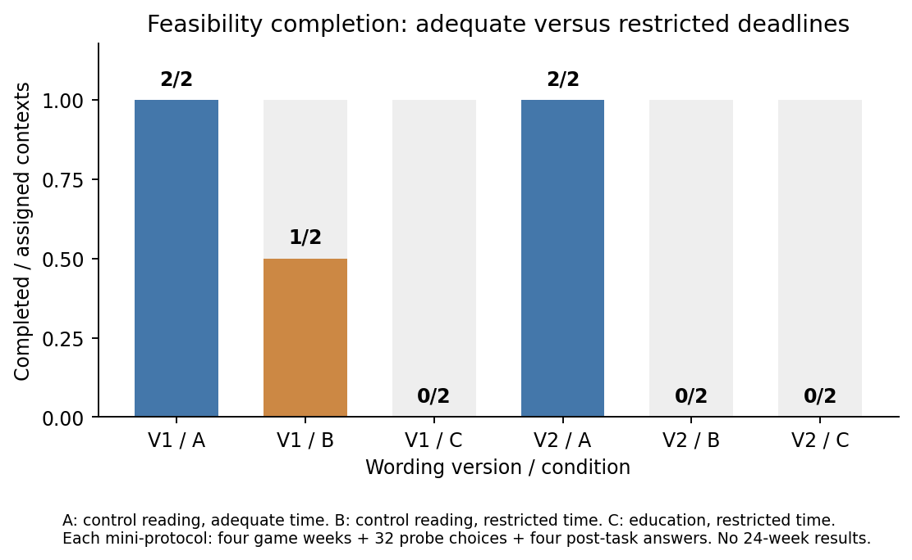
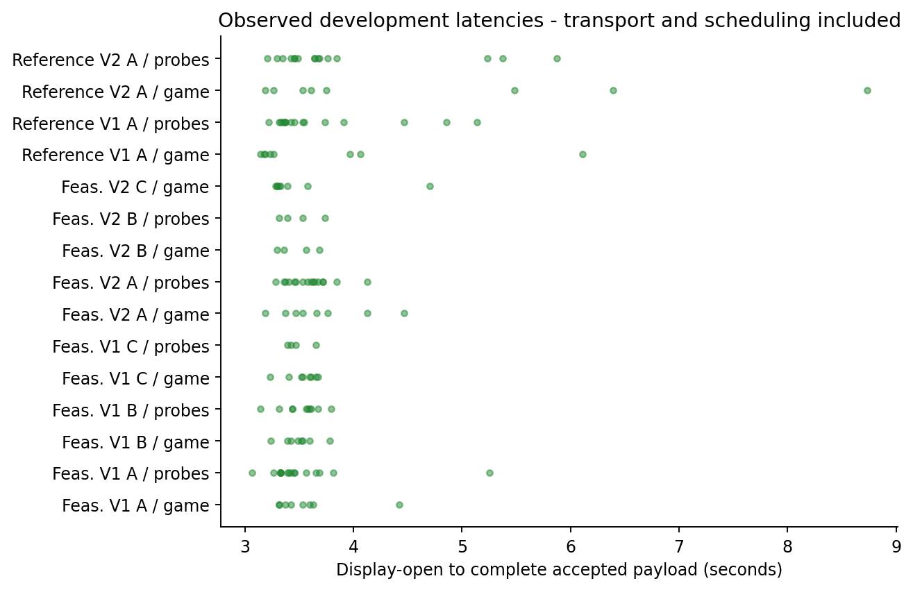

# Experiment 14: current results

1. **Feasibility: 4/4 adequate-time contexts and 1/8 restricted-time contexts completed the full mini-protocol; 7 contexts stopped at a deadline.** By arm: A 4/4, B 1/4, C 0/4. Each assigned mini-protocol contains 4 game weeks, 32 probe choices and four post-task answers. These are development checks, not full 24-week results.
2. **Development complete; main not yet ready.** Saved development attempts: 4 latency and 12 feasibility. Held-out main: **0/10 complete matched A/B/C blocks**; 0/30 saved main contexts (30 not received), and 0/30 complete 24-week games. The main sample remains unlaunched because the completion requirement failed. This decision uses missingness and protocol feasibility, not a desired hypothesis direction or p-value.
3. Post-task knowledge was observed in 5 feasibility cases; 5 scored 4/4 (100%). All observed scores came from completed A/B control-reading cases and are at ceiling. C scores remain **NA**, not zero; education learning was not measured in the failed cases.
4. A context controls one four-role chain; the planned unit of inference is ten independent matched block contrasts, not forty independent students. Human participants: 0. Stopped prefixes, zero choices, opposite responses and failures are retained. Partial cost is not full-horizon cost; missing choices are never filled.

Requested model/effort: gpt-6-astra / xhigh. Actually reported labels appear per case in the outcome table; unverified labels remain unverified. Launcher temperature and reasoning-token allocation are not exposed.

[Figures and status](figures/README.md) | [Case outcomes](../analysis/tables/case_outcomes.csv) | [Validation and exact input hashes](../analysis/VALIDATION.json)

## Conditions and deadlines

A uses the control reading and an adequate response window. B uses the same control reading and a restricted response window. C uses the education reading and the same restricted window as B. Every condition allows one accepted decision per week or probe page. Post-task questions are untimed and come after all behavior.

Deadline values were calibrated from latency-only reference cases before feasibility collection. The restricted window is the phase-specific 75th percentile of reference latency, rounded upward to 0.1 seconds. The adequate window is the larger of 30 seconds and three times the maximum reference latency. Hypothesis outcomes were not used.

| Wording | Restricted game (s) | Restricted probe page (s) | Adequate game/probe (s) | Feasibility gate |
|---|---:|---:|---:|---|
| V1 | 4 | 3.8 | 30/30 | failed |
| V2 | 5.8 | 3.8 | 30/30 | failed |

Saved receipts: [V1 calibration](../hypotheses/CALIBRATION_V1.json); [V2 calibration](../hypotheses/CALIBRATION_V2.json); [V1 qualification](../analysis/qualification/V1_788f8f5575e36507.json); [V2 qualification](../analysis/qualification/V2_7ee2404f6a0a2494.json). Both complete reference cases and all six feasibility cases for a wording must pass before it can qualify. No wording was selected using hypothesis signs or p-values.

## Main hypotheses and quantities

| Endpoint | Quantity and units | Contrast; predicted sign |
|---|---|---|
| H1 | How much the new order falls for each extra case already on the way; average of eight paired scenario responses, in ordered cases per outstanding case | B-A; negative |
| H2 | Total holding + backlog cost over four roles and 24 weeks; game cost units per chain | B-A; positive |
| H3 | The same response to outstanding orders, comparing educated and control students while both face the shorter deadline | C-B; positive |
| H4a | How much each role's orders fluctuate across 24 weeks: sample order variance, averaged over four roles; cases squared | C-B; negative |
| H4b | Order variance divided by external customer-demand variance, averaged over roles: the bullwhip ratio; dimensionless | C-B; negative |

Holding costs 0.5 per remaining case per week; backlog costs 1 per unfilled case per week. H4b is undefined for zero demand variance. H4a/H4b share a numerator and are not independent replications. [Role outcomes](../analysis/tables/role_outcomes.csv) include final observed inventory, backlog and outstanding after the last accepted order; consequences after week 24 are unmeasured.

| Test | Available pairs | Mean contrast | Pointwise 95% interval | Two-sided p | Holm, family of 5 | Direction/status |
|---|---:|---:|---|---:|---:|---|
| H1 | 0 | NA | NA to NA | NA | NA | unavailable; inference withheld |
| H2 | 0 | NA | NA to NA | NA | NA | unavailable; inference withheld |
| H3 | 0 | NA | NA to NA | NA | NA | unavailable; inference withheld |
| H4a | 0 | NA | NA to NA | NA | NA | unavailable; inference withheld |
| H4b | 0 | NA | NA to NA | NA | NA | unavailable; inference withheld |

NA means unavailable or deliberately withheld. Before the whole fixed sample and external reviews pass, any available-pair effects are descriptive only; treatment-related noncompletion can bias completer comparisons. There is no completer-only causal claim and no significance-based stopping or replacement.

The fixed-sample and provenance conditions still outstanding are listed in the [validation receipt](../analysis/VALIDATION.json).

When eligible, tests reuse the separately frozen paired sign-flip implementation; the entire five-endpoint family receives Holm correction. A significant opposite effect is reported as opposite evidence. Intervals are unadjusted paired-block percentile bootstrap intervals (10,000 resamples), not simultaneous intervals. The sign-flip null requires independent symmetric/exchangeable paired differences; a hash receipt alone cannot verify independence or this assumption. [Each block contrast](../analysis/tables/main_contrasts.csv).

## Completion, timing and knowledge checks

| Stage | Saved attempts | Complete cases | Complete 24-week games | Replay-valid | Passing external reviews |
|---|---:|---:|---:|---:|---:|
| latency | 4 | 4 | 0 | 4 | 4 |
| feasibility | 12 | 5 | 0 | 12 | 12 |
| main | 0 | 0 | 0 | 0 | 0 |

Development qualification checks (fractions range from 0 to 1):

| Stage/version/arm | Complete cases | On time / timed displays | Game median (s) | Probe median (s) | Knowledge fraction |
|---|---:|---:|---:|---:|---:|
| feasibility/V1/A | 2/2 | 1 | 3.50375 | 3.44525 | 1 |
| feasibility/V1/B | 1/2 | 0.947368 | 3.48825 | 3.54275 | 1 |
| feasibility/V1/C | 0/2 | 0.857143 | 3.5505 | 3.4845 | NA |
| feasibility/V2/A | 2/2 | 1 | 3.5665 | 3.6015 | 1 |
| feasibility/V2/B | 0/2 | 0.8 | 3.461 | 3.4605 | NA |
| feasibility/V2/C | 0/2 | 0.8 | 3.33175 | NA | NA |
| latency/V1/A | 2/2 | NA | 3.598 | 3.5155 | 1 |
| latency/V2/A | 2/2 | NA | 4.0935 | 3.5745 | 1 |

[Prompt qualification by version/stage/arm](../analysis/tables/prompt_qualification.csv) reports complete fractions, on-time accepted responses per opened timed display, game/probe case-median and maximum latencies, and post-task knowledge. Untimed calibration has no on-time fraction. Latencies measure display-open to complete-payload reception, including transport, scheduling and output; they are not thinking time. A stopped case can have zero late submission events when no payload arrives. Open decisions remain pending until the controller persists their expiry.

[All submission timings](../analysis/tables/latencies.csv) retain rejections. [Post-behavior item scores](../analysis/tables/knowledge_items.csv) use private answer keys; scores never exclude main cases. Qualification status above comes from the saved procedure review receipts; this report does not select a wording.

## Probe interpretation

[Pair slopes](../analysis/tables/probe_pairs.csv), [role summaries](../analysis/tables/probe_diagnostics.csv), and [pair-fixed-effect fits/residuals](../analysis/tables/probe_regression_residuals.csv) preserve all observed responses. The pipeline aggregate weights eight pairs equally. The backlog comparison uses (q_highB - q_lowB)/(B_high - B_low) over eight separate pairs, also in ordered cases per backlog case. A missing pair makes the fixed aggregate unavailable. Fixed-effect regression is supplementary and weights pair slopes by squared quantity differences; it does not replace the primary equal-pair mean.

Report zero-choice and zero-slope fractions, order minima/maxima, role-level slopes and cross-pair spread without deleting extremes. Two levels per pair cannot identify curvature; cross-regime variation is a descriptive heterogeneity diagnostic. The pipeline slope is a responsiveness proxy, not an identified normative underweighting coefficient. Flat choices across both dimensions cannot establish pipeline-specific neglect. Known assay arrival schedules differ from uncertain gameplay fulfillment.

## Planning and reproducibility

[Minimum attainable p versus independent chain blocks](figures/planning_minimum_p.png) is a mathematical planning figure, not observed evidence or power. With ten nonzero pairs the exact two-sided minimum is 2/1024 = 0.001953125; zero differences/ties may raise it. The fixed N=10 sample does not promise significance.

Rebuild offline: `.venv/Scripts/python.exe scripts/report_exp14.py`. It scans only `data/{latency,feasibility,main}/*/RESULT.json`, never other experiments, never an API, and never a hidden reasoning trace. It checks controller replay, exact CASE/result binding and external review receipts. A main external `ADHERENCE_REVIEW.json` must contain `passed: true`, `result_sha256` (exact file bytes), and `case_sha256` (controller canonical digest). Its `full_public_context_reviewed`, `fresh_context_confirmed`, `literal_model_choices_confirmed`, and `fixed_requested_settings_confirmed` checks must all be true. `hypotheses/MAIN_PLAN.json` must freeze exactly ten `block_ids`, the selected `prompt_version`, and `independent_blocks_confirmed: true` with `frozen: true`. Reviews must assess full-display access, literal choices, isolation and source/reading exposure without using effect direction or p-values.

Current input fingerprint: `cea5b51a68c666f45fd2d6ca65c3575c81c9866c01a57fdb3c63e3ad91e68669`. Changed-input regenerations first preserve prior generated bytes under `reports/history/<fingerprint>/` and `analysis/history/<fingerprint>/`. [Current generated-file manifest](../analysis/CURRENT.json). The local event hash chain is reproducibility evidence, not tamper-proof authentication.

## Development figures

Completed means all four development game weeks, all probe pages and the post-task questions. The denominator retains every assigned feasibility context. These are not 24-week main outcomes.

Each dot is an accepted response's measured display-to-reception latency, including transport and scheduling. Comprehension is untimed. Failed or absent responses are not additional latency dots; their stopped cases remain in the completion results and raw records.
