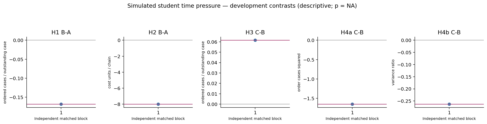
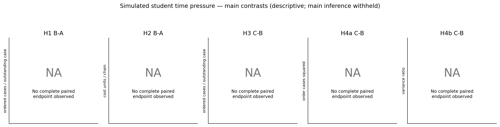
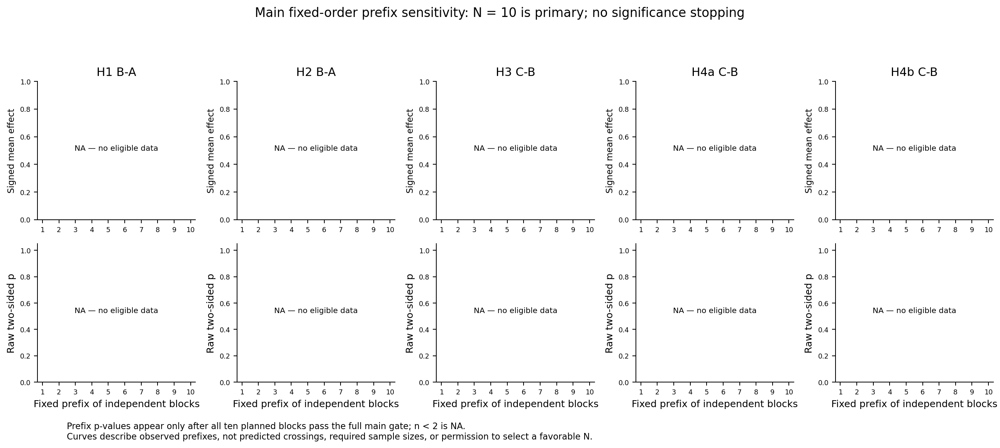

# Simulated student time pressure

1. **The treatment is fictional student time-pressure framing: 120 seconds in A versus 8 seconds in B/C.** The model has no actual runtime or response-admission deadline. Every scored game order and probe answer is an accepted model choice; no defaults or carry-forward actions are used.
2. Development: 3/3 fresh contexts saved, 3/3 complete 24-week games, 1/1 complete matched block. Development effects are descriptive; all development p-values are NA.
3. Main: 0/30 contexts saved; **0/10 complete matched blocks**. Main hypothesis inference remains withheld until the full fixed sample and external reviews pass.
4. This measures model responses to a classroom framing, not real student behavior, actual thinking time, or a verified cognitive time limit. Four roles and 24 weeks are repeated observations within a context. The independent main sample is ten matched chain blocks, not forty students.

A receives the control reading and the 120-second student framing. B receives the same control reading and the 8-second framing. C receives the education reading and the same 8-second framing as B. All arms use one accepted choice per decision; post-task questions follow the game and 32 probes. Requested model/effort is gpt-6-astra / xhigh. Actual reported labels remain separate; temperature and hidden reasoning-token allocation are not exposed.

[Figures](figures/README.md) | [Case outcomes](../../analysis/student_framing_v3/tables/case_outcomes.csv) | [Validation](../../analysis/student_framing_v3/VALIDATION.json)

## Five hypothesis quantities

| Endpoint | Plain definition and units | Contrast; predicted sign |
|---|---|---|
| H1 | How much the order falls per extra case already on the way, averaged equally over eight fixed pipeline pairs; ordered cases per outstanding case | B-A; negative |
| H2 | Holding plus backlog cost across four roles and all 24 weeks; game cost units per chain | B-A; positive |
| H3 | The same pipeline-response measure, comparing education with control under the 8-second student framing | C-B; positive |
| H4a | Sample variance of weekly orders within each role (denominator 23), averaged over four roles; order cases squared | C-B; negative |
| H4b | Role order variance divided by the chain's external-customer sample demand variance, averaged over roles; dimensionless bullwhip ratio | C-B; negative |

Holding costs 0.5 per remaining case per week; backlog costs 1 per unfilled case per week. Partial trajectories have no complete-horizon H2/H4 estimate. H4b is undefined if customer-demand variance is zero. H4a/H4b share their numerator and are not independent confirmations. The pipeline assay is a responsiveness proxy, not an identified normative underweighting coefficient; flat answers in both pipeline and backlog assays do not establish pipeline-specific neglect.

## Development contrasts

| Test | Pairs | Signed contrast | 95% interval | Raw two-sided p | Holm 5 | Direction |
|---|---:|---:|---|---:|---:|---|
| H1 B-A | 1 | -0.168403 | NA to NA | NA | NA | predicted |
| H2 B-A | 1 | -8 | NA to NA | NA | NA | opposite |
| H3 C-B | 1 | 0.0614583 | NA to NA | NA | NA | predicted |
| H4a C-B | 1 | -1.65399 | NA to NA | NA | NA | predicted |
| H4b C-B | 1 | -0.263264 | NA to NA | NA | NA | predicted |

## Main contrasts

| Test | Pairs | Signed contrast | 95% interval | Raw two-sided p | Holm 5 | Direction |
|---|---:|---:|---|---:|---:|---|
| H1 B-A | 0 | NA | NA to NA | NA | NA | NA |
| H2 B-A | 0 | NA | NA to NA | NA | NA | NA |
| H3 C-B | 0 | NA | NA to NA | NA | NA | NA |
| H4a C-B | 0 | NA | NA to NA | NA | NA | NA |
| H4b C-B | 0 | NA | NA to NA | NA | NA | NA |

NA means no complete paired endpoint or inference deliberately withheld. Available-pair contrasts before the full main gate are descriptive only; they do not justify a completer-only causal claim. Significant opposite effects, if observed in the completed main sample, remain opposite evidence.

## Completion, comprehension and source checks

| Stage / arm / block | Weeks | Pipeline pairs / 8 | Post-task score | Replay | Review |
|---|---:|---:|---:|---|---|
| development / A / sf3_d001 | 24 | 8/8 | 4/4 | pass | pass |
| development / B / sf3_d001 | 24 | 8/8 | 4/4 | pass | pass |
| development / C / sf3_d001 | 24 | 8/8 | 4/4 | pass | pass |

All readings, hypothetical states, actual choices and public transcripts remain source records. [Pair/role diagnostics](../../analysis/student_framing_v3/tables/probe_diagnostics.csv) retain zero choices, zero slopes, extremes and separate backlog response. [Pair slopes](../../analysis/student_framing_v3/tables/probe_pairs.csv) keep all eight fixed pipeline pairs; an absent pair makes the aggregate unavailable rather than changing its weights. Two levels within a pair cannot identify curvature. Comprehension is scored after behavior; low scores never select individual main cases. Recorded wall latency includes transport and scheduling and is observational, never a response-admission cutoff.

## Fixed main inference and prefix curves

Only the complete frozen ten-block main sample receives primary two-sided paired sign-flip inference, with Holm correction across five endpoints. Pointwise 95% intervals use 10,000 paired-block bootstrap resamples and are not simultaneous intervals. Independent symmetric/exchangeable paired differences are required by the sign-flip null. A receipt cannot establish that assumption or authenticate hidden reasoning.

Chain-prefix curves use the frozen order at n=1 through 10; n=10 is primary. Prefix effects use only fully available prefixes, and raw prefix p-values appear only after the entire main gate passes. n<2 has p=NA. These are descriptive sensitivity plots, not predicted significance crossings, power estimates, or a rule to extend, stop, replace, or select a sample. No favorable outcome, slope, direction or p-value is used for wording selection or main-case inclusion.

## Reproduction

Rebuild: `.venv/Scripts/python.exe scripts/report_exp14_framing.py`. Only data/student_framing_v3/development and data/student_framing_v3/main are read. The strict-deadline study and unused carry-forward draft stay separate. No API requests, participant launches, fabricated missing decisions, or hidden reasoning traces are used. Main requires STUDENT_FRAMING_V3_MAIN_PLAN.json, thirty complete replay-valid actual-response contexts and hash-bound external reviews. [Full gate reasons and input hashes](../../analysis/student_framing_v3/VALIDATION.json).

Input fingerprint: `0c43a4c0fd5ce14aa58d2636b82a88383252f6c5d16deae432f674cbd6e86208`. Earlier generated bytes are preserved in this amendment's history folders before regeneration.

## Development figures

Each point is one matched block; NA contains no fabricated observation. All development p-values remain NA.

The full ten-block sample is required for primary main inference.

The frozen n=10 sample is primary. Curves do not predict a significant crossing or authorize a stopping change.
