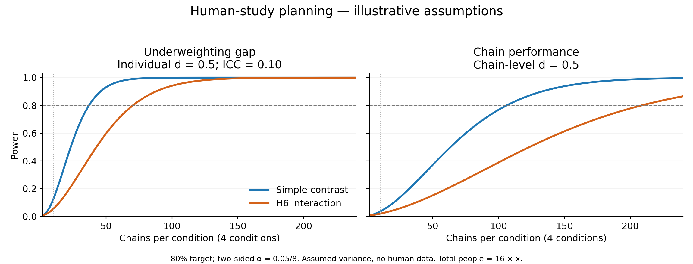

# 3. Sample size: what can the experiment detect?

**No human effect size or variance is available yet.** The numbers below are sensitivity calculations, not recruitment promises. They use hypothetical human variability and include all eight planned H1–H6 tests. The AI sample is not used for human power.

## Define the quantity before choosing N

For the underweighting gap, choose a smallest meaningful difference ΔG in **order units per stock unit**, and estimate SD σG from observed participant gap estimates in a human pilot. For example, ΔG=0.20 means the two treatments differ by two ordered units in their inventory-versus-pipeline response to a ten-unit cue difference. This is an example interpretation, not a validated threshold.

Use σG² = between-person gap variance + gap-estimation error variance. The error term depends on the number and quality of diagnostic trials; it cannot be ignored simply because many weekly orders were recorded. Also estimate within-chain intraclass correlation ρ. A 16-person pilot yields imprecise SD/ICC estimates: use a plausible range or an upper uncertainty bound, not a favorable point estimate.

For chain cost, use a meaningful currency difference ΔC and the **between-chain SD of total cost**, σC. For order variance and bullwhip use their own chain-level Δ and SD. Do not divide a chain cost SD by four or apply a second participant-clustering correction. H6 requires a meaningful **difference between education effects**, which may be much smaller than either simple effect.

## Equations for the core four-condition study

Let k be the number of complete randomization blocks. There are k chains per cell, four participants per chain, four cells, and **N=16k people**. Let m=4, dG=ΔG/σG and

\[
DE=1+(m-1)\rho=1+3\rho,\qquad
v_G=\operatorname{Var}(\bar G_{chain})=\sigma_G^2 DE/m. \tag{P1}
\]

This exchangeable-correlation approximation concerns the participant endpoint G, including measurement error. It does not treat the 32 task decisions as 32 students. If role variances/covariances differ, estimate the full covariance instead of assuming exchangeability.

Within a block, write Yb=(YA,YB,YD,YC). For contrast weights a:

\[
V_L=a^T\Sigma_{block}a,\qquad
\operatorname{Var}(\hat\Delta)=V_L/k. \tag{P2}
\]

For initial planning assume equal cell variances v and zero covariance between the four distinct human chains. This gives VL=2v for a simple difference and VL=4v for the H6 interaction. Common demand can improve precision, but no benefit from matching is assumed without pilot evidence. Negative or heterogeneous covariance can increase the required sample; zero covariance is a starting scenario, not a universal conservative bound.

For two-sided per-test α* and target power 1−β, the normal approximation is

\[
k_{simple}\approx\left\lceil\frac{2v(z_{1-\alpha^*/2}+z_{1-\beta})^2}{\Delta^2}\right\rceil,
\quad
k_{H6}\approx\left\lceil\frac{4v(z_{1-\alpha^*/2}+z_{1-\beta})^2}{\Delta_{int}^2}\right\rceil. \tag{P3}
\]

Insert v=σG²DE/4 for G, or v=σC² for chain cost. Equal standardized magnitudes imply roughly twice as many blocks for an interaction as a two-cell simple effect; interactions are often smaller in practice.

The supplied calculator improves on P3 by using the proposed **one-sample t-test on block contrasts**, with ν=k−1 and noncentrality λ=Δ√(k/VL):

\[
Power(k)=\Pr\{T_{\nu,\lambda}>t_{1-\alpha^*/2,\nu}\}
+\Pr\{T_{\nu,\lambda}<-t_{1-\alpha^*/2,\nu}\}. \tag{P4}
\]

It searches for the smallest integer k reaching the target. This is exact under independent Gaussian, equal-variance block-contrast assumptions, not an exact prediction for unknown human cost distributions. The normal formula is an approximation; the tables use P4, so rounded results differ.

### Multiplicity

Final testing uses Holm across eight endpoints: H1, H2, H3, H4a, H4b, H5, H6a and H6b. Planning uses **α*=0.05/8=0.00625** for each endpoint, sufficient for its Bonferroni threshold and conservative relative to Holm. **80% per-endpoint power is not 80% probability that all eight tests succeed.** If joint success is the planning target, simulate their joint covariance and rejection rule; even independent 80%-power tests would all succeed only 0.8⁸≈0.168 of the time.

## Calculated scenarios

Assumptions for this table: participant G SD standardized to one; four people per chain; ICC=0.10; α*=0.00625; 80% power; no cross-arm covariance benefit. All counts exclude the timing/variance pilot and separate H5 cohort.

| Assumed standardized effect dG | Chains per cell: simple contrast | Total people in four cells | Chains per cell: H6a interaction | Total people in four cells |
|---:|---:|---:|---:|---:|
| 0.30 | 97 | 1,552 | 189 | 3,024 |
| 0.50 | 38 | 608 | 71 | 1,136 |
| 0.80 | 17 | 272 | 30 | 480 |

These are different hypothetical effect magnitudes, not expected findings. For example, if ΔG=0.20 and σG=0.25, dG=0.80; the corresponding G interaction scenario needs 30 chains per cell (480 people). If the interaction is only Δint,G=0.125 with that same SD, its standardized magnitude is 0.50 and the scenario requires 71 per cell. Selecting d=0.80 just because it produces an affordable sample is not justified.

ICC matters: with dG=0.50 and ICC=0.30, the requirements rise to **53 chains/cell for a simple contrast and 101 for H6a**. [Full table](analysis/sample_sizes.csv) includes ICC 0, 0.10 and 0.30, and power 80%/90%.

For a **chain-level outcome** with Δ/σchain=0.50, the same assumptions require **107 chains/cell for a simple contrast and 209 for H6b's interaction**. These larger counts arise because four people do not provide four independent cost outcomes. Costs can also be strongly skewed; pilot-based Monte Carlo with the actual analysis is necessary before committing to these counts.

### What does ten chains per condition buy?

Ten per cell means **40 chains / 160 people**, not 40 people total. For dG=0.50 and ICC=0.10, the planned conservative test has approximately **12.5% power for a simple G contrast and 5.4% for the H6a interaction**. Ten per cell can therefore produce useful pilot estimates and uncertainty intervals while missing real moderate effects. More weeks or more plotted points do not remove this limitation.

If there are only 80 people across four cells, there are five chains/cell. If the original 80-person design compares only two cells, it has ten chains/arm but cannot estimate H6. Reusing control participants across separate historical cohorts does not fix that identification problem.

Both curves are prospective probabilities under stated assumptions. They are **not observed p-values** or predictions of the chain number where significance will first occur.

## H5 has a different sample-size unit

The separate H5 task randomizes eligible routine adopters individually. Let Ri be each participant's mean persistence over the first eight transfer trials; ΔR is the meaningful pressure-minus-adequate difference and σR its between-participant SD, including trial noise. With n randomized participants per time arm:

\[
n\approx\left\lceil\frac{2\sigma_R^2(z_{1-\alpha^*/2}+z_{1-\beta})^2}{\Delta_R^2}\right\rceil,\quad
\lambda=\frac{\Delta_R}{\sigma_R}\sqrt{n/2},\quad\nu=2n-2. \tag{P5}
\]

The calculator uses the two-sample noncentral t form with these ν and λ. Assuming equal normal variances, α*=0.00625 and 80% power:

| Assumed dR=ΔR/σR | Randomized adopters per arm | Total randomized adopters |
|---:|---:|---:|
| 0.30 | 287 | 574 |
| 0.50 | 105 | 210 |
| 0.80 | 42 | 84 |

The adoption screen happens **before** time randomization. If expected adoption fraction is a and post-randomization retention is r, invite approximately ceil(2n/(a r)) people. Example: n=105, a=0.80 and r=0.90 gives **292 invitations** for an expected 210 analyzed adopters. This is an expectation, not a guarantee. Record all screened/non-adopting participants. The target population remains educated routine adopters, and H5's n is separate from main-game chains.

## Missingness, final recruitment and freeze

Equations P1–P4 assume complete blocks. If each chain is complete with probability rc and the primary analysis discards an entire block when any arm is missing, a block survives with probability rc⁴ under independent chain loss. Expected scheduled blocks would be ceil(k/rc⁴), **not ceil(k/rc)**. A missing role can also prevent a complete chain endpoint. This quickly becomes expensive; design the platform and a prespecified intention-to-treat/missing-data analysis to avoid needless loss. Do not replace noncompleters selectively or remove low-performing chains.

Before main recruitment:

1. Decide meaningful raw-unit effects for G, costs, order variance, bullwhip, R and both interactions. Decide whether all eight are truly confirmatory before observing main outcomes.
2. Obtain human pilot estimates/ranges of variance, reliability, within-chain correlation, task completion and H5 adoption. Re-estimate uncertainty, not desired p-values.
3. Run full-analysis simulations using those ranges: skewed costs, unequal role variance, estimated cue slopes, missingness and the Holm rule. The provided Gaussian check validates the calculation, not these human assumptions.
4. Choose the largest justified sample across the primary endpoints and an explicit recruitment/attrition rule; freeze it. If the available budget is smaller, narrow the prospective primary question or label the study exploratory rather than claim adequate power.

The notebook exposes d, ICC, α and desired power. Its examples are not saved as human raw data. [Calculation validation](analysis/CALCULATION_VALIDATION.json) checks the analytical t power against 30,000 Gaussian simulations; the simulated rows are software checks only.
